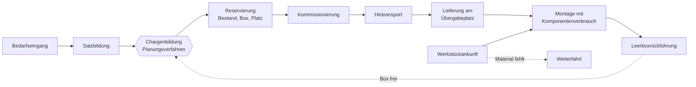

# Transportlosgrößen und Materialversorgung (Team A)

Prüfungsprojekt im Modul Produktionsplanung und -steuerung (Operations Management in der IoT Factory). Wir untersuchen, wie viele vollständige Materialsätze gemeinsam in einer Box zu den Roboter-Montagestationen der Laborfabrik geliefert werden sollen und wann. Dazu analysieren wir die Daten des Festo-MES4, entwickeln Planungsverfahren in Python und vergleichen sie in einer eigenen ereignisdiskreten SimPy-Simulation. Das Repo enthält derzeit das Projektgerüst: Datenimport, Schnittstellen, Konfiguration, Dokumentation und Arbeitspakete für fünf Personen.

## 1. Problemstellung

Die Montagestationen RASS1, RASS2 und RASS3 erhalten ihre Komponenten in Boxen, die an einer Kommissionierstation gefüllt und von Robotinos zur Station gefahren werden. Daraus entsteht ein Zielkonflikt:

- **Bündeln** mehrerer Materialsätze in einer Box spart Transporte je Satz, bindet aber Sätze, bis die Box voll genug ist. Die Versorgung kommt später an.
- **Einzeln liefern** versorgt schnell, braucht aber mehr Fahrten, mehr Boxen und mehr Übergabeplätze.
- Kommt ein Werkstück ohne Material an der Station an, findet die Montage nicht statt. Eine späte Lieferung verzögert also die Montage.

Zu entscheiden ist je Lieferung: **Anzahl und zulässige Kombination vollständiger Materialsätze in einer Box** sowie der **Bereitstellungs- und Versandzeitpunkt**. Abzuwägen sind Transportaufwand, Bündelungswarten und verzögerte Montage.

Randbedingungen aus der Aufgabenstellung:

- Ein Materialsatz ist nur vollständig brauchbar. Benötigt RASS1 Mainboard und Display, müssen beide in derselben Box ankommen.
- Jeder Satz bleibt seiner Anforderung zugeordnet. Eine Reservierung ist kein zusätzlicher Bestand.
- Box, Fahrzeug, Kommissionierplatz und Übergabeplätze sind begrenzt und während der Nutzung gebunden.
- Auch bei nicht erreichter Füllschwelle muss Restbedarf bearbeitet werden.
- Montagepriorität, Auftragsfreigabe, Fahrzeugzuordnung und Leerboxrückführung sind feste Referenzregeln und in allen Vergleichen gleich.

Der vollständige Originaltext steht in [docs/projekt/aufgabenstellung.md](docs/projekt/aufgabenstellung.md), die Zuordnung jeder Anforderung zu einem Arbeitspaket in [docs/projekt/anforderungsmatrix.md](docs/projekt/anforderungsmatrix.md).

Abgaben laut Aufgabenstellung: Hausarbeit, lauffähiger Python-Code (Planung, SimPy-Simulation und unabhängige Prüfung getrennt aufrufbar) und reproduzierbare Nachweise. Zwischenstände: Ende Woche 2 Datenqualitätsanalyse, Modellabgrenzung, Parameterherkunft und Arbeitsplan; Ende Woche 4 lauffähiger Referenzplaner mit Simulation und Ereignisprotokoll; Wochen 5 bis 8 eigene Verbesserung, Vergleichsversuche, Sensitivitätsanalyse und Ausarbeitung.

## 2. Team und Rollenverteilung

| Paket | Rolle | Verantwortung | Eigene Ordner und Dateien | Person |
|---|---|---|---|---|
| AP1 | Daten und MES-Modell | Dump-Import, Materialpfad, Komponentenbedarfe, Box- und Pufferbelegung, Reservierungen, Datenqualität und Datenlücken, Zeitansätze | `src/matsim/daten/`, `data/`, `docs/projekt/datenmodell-mes.md` | Maher Darweesh |
| AP2 | Methodik und Literatur | Einordnung nach den Lehrunterlagen, Steckbrief je Verfahren, Zielkonflikte, Annahmenkatalog, Gliederung der Hausarbeit | `docs/projekt/planungsverfahren.md`, `docs/projekt/literatur-ergaenzung.md`, `docs/projekt/annahmen-und-datenluecken.md`, `report/` | Noah Fiedler |
| AP3 | Simulationskern | Lager, Kommissionierplatz, Boxen, Fahrzeuge, Stationen, Übergabeplätze, Werkstückumlauf, Referenzregeln | `src/matsim/modell/`, `src/matsim/referenz/`, `config/anlage.yaml`, `docs/projekt/logikstruktur.md` | Mehemt Örücü |
| AP4 | Planungsverfahren | V0 bis V3 hinter der gemeinsamen Schnittstelle, eigene Verbesserung V4, Restbedarfsregel, Enumeration eines kleinen Falls | `src/matsim/regeln/` | Luis Kruse |
| AP5 | Experimente und Auswertung | Szenarien, Replikationen, Ereignisprotokoll, Kennzahlen, Wartezeit-Zerlegung, unabhängige Prüfung, Validierung, Diagramme | `src/matsim/kennzahlen/`, `src/matsim/experimente/`, `config/szenarien/`, `results/`, `docs/projekt/kennzahlen.md`, `docs/projekt/versuchsplan.md` | TODO: Name |

Jedes Paket ist in [docs/projekt/arbeitspakete.md](docs/projekt/arbeitspakete.md) ausgearbeitet: Ziel, Eingaben, Ergebnisse, Schnittstellen, Abnahmekriterien, Meilensteine und Abhängigkeiten.

Vier Schnittstellen sind bereits als Dateien festgelegt, damit alle parallel starten können:

| Schnittstelle | Datei | Richtung |
|---|---|---|
| Anlagenbeschreibung | [config/anlage.yaml](config/anlage.yaml) | AP1 → AP3 |
| Planungsschnittstelle `entscheide(zustand, anlass)` | [src/matsim/regeln/basis.py](src/matsim/regeln/basis.py) | AP3 ↔ AP4 |
| Ereignisprotokoll | [src/matsim/kennzahlen/ereignisprotokoll.py](src/matsim/kennzahlen/ereignisprotokoll.py) | AP3 → AP5 |
| Szenario-Dateien | [config/szenarien/](config/szenarien/) | AP5 → AP3 |

## 3. Stand des Projekts

| Baustein | Stand |
|---|---|
| Dump-Import nach SQLite, Snapshot-Vergleich, Bestands- und Reservierungsauswertung | lauffähig, an allen sechs Dumps getestet |
| Zeitansätze aus der Schritthistorie | Median und Quantile lauffähig; Verteilungen für das Unsicherheitsszenario offen |
| Live-Lesezugriff | Code vorhanden, im Labornetz noch nicht ausgeführt |
| `config/anlage.yaml` | erster Stand mit Herkunftsangabe je Wert; drei Parameter offen |
| Szenario-Dateien | Schema fest, Zahlenwerte sind Entwürfe |
| Planungsschnittstelle, Ereignisprotokoll-Schema | festgelegt |
| Prüfregeln Satzvollständigkeit und Chargenzulässigkeit | lauffähig, mit absichtlich fehlerhaften Fällen getestet |
| Simulation (SimPy-Modell) | nur Gerüst, keine Ablauflogik |
| Planungsverfahren V0 bis V4 | nur Gerüst, keine Logik |
| Referenzregeln | nur Signaturen; das Referenzpaket des Dozenten fehlt im Repo |
| Kennzahlen, Wartezeit-Zerlegung, Mengenbilanz- und Kapazitätsprüfung | nur Gerüst |
| Szenario-Runner, Ergebnisse, Diagramme | nur Gerüst |
| Hausarbeit | nur Gliederung |

Offene Entscheidungen und fehlende Unterlagen stehen in [docs/projekt/annahmen-und-datenluecken.md](docs/projekt/annahmen-und-datenluecken.md).

## 4. Schnellstart

Voraussetzung: Python ab 3.11. Die Befehle sind für Windows geschrieben; unter macOS und Linux heißt der Interpreter `.venv/bin/python`.

```text
python -m venv .venv
.venv\Scripts\python -m pip install -e ".[dev]"
```

Dumps ablegen: Die sechs SQL-Dumps aus dem Kursmaterial (`MES_database_snapschots.zip`) nach `data/raw/mes_snapshots/` kopieren. Sie werden nicht versioniert. Dateiliste und Prüfsummen stehen in [data/raw/mes_snapshots/README.md](data/raw/mes_snapshots/README.md).

```text
.venv\Scripts\python -m matsim.daten importiere
.venv\Scripts\python -m matsim.daten bestand 2026-11-09_1516
.venv\Scripts\python -m matsim.daten vergleiche 2026-11-09_1516 2026-11-09_1557
.venv\Scripts\python -m pytest
.venv\Scripts\python -m matsim.smoke
.venv\Scripts\python -m ruff check .
```

Erwartetes Ergebnis: Der Import erzeugt sechs SQLite-Dateien in `data/interim/` mit je 62 Tabellen. `pytest` meldet 20 bestandene und 25 erwartbar fehlschlagende Tests (`xfailed`); letztere sind die Invarianten der Simulation, die scharf werden, sobald die Simulation existiert. Ohne Dumps werden die Datentests übersprungen. Der Smoke-Test endet mit „Smoke-Test bestanden“ und simuliert nichts.

Live-Zugriff (optional, nur im Labornetz, nur lesend): `.env.example` nach `.env` kopieren, die Zugangsdaten aus den Kursunterlagen eintragen und das Extra installieren.

```text
.venv\Scripts\python -m pip install -e ".[live]"
```

Die `.env` wird nicht versioniert. Zugangsdaten gehören in keine versionierte Datei.

## 5. Repo-Struktur

```text
.
├── README.md
├── CONTRIBUTING.md            Arbeitsweise des Teams
├── .env.example               Vorlage für den Live-Zugriff, ohne Werte
├── pyproject.toml             Python-Projekt, Abhängigkeiten, pytest, ruff
├── docs/
│   ├── 00-…14-….md            Lehrunterlagen des Dozenten, unverändert
│   ├── literatur.md           Quellenangaben der Lehrunterlagen
│   └── projekt/               Projektdokumentation des Teams
├── data/
│   ├── raw/mes_snapshots/     lokale Dumps, nicht versioniert
│   ├── interim/               aus den Dumps erzeugte SQLite-Dateien, nicht versioniert
│   └── processed/             kleine, versionierte Eingabedateien für die Simulation
├── config/
│   ├── anlage.yaml            Stationen, Puffer, Boxen, Fahrzeuge, Zeiten mit Herkunft
│   └── szenarien/             Basisfall, Stressfälle, Unsicherheit, Kalibrierung
├── src/matsim/
│   ├── daten/                 Dump-Import, Live-Lesezugriff, Bestand, Zeiten
│   ├── modell/                Fachobjekte, Anlagenlader, SimPy-Modell
│   ├── regeln/                Planungsverfahren V0 bis V4 hinter einer Schnittstelle
│   ├── referenz/              feste Referenzregeln
│   ├── kennzahlen/            Ereignisprotokoll, Kennzahlen, unabhängige Prüfung
│   └── experimente/           Szenario-Lader und Runner
├── notebooks/                 Analysen, je Arbeitspaket ein Präfix
├── tests/                     pytest, u. a. Mengenbilanz und Satzvollständigkeit
├── results/                   Laufergebnisse, nicht versioniert
└── report/                    Gliederung der Hausarbeit
```

## 6. Daten

Quelle ist die Datenbank `MES4` des Festo-MES4 der Laborfabrik (MariaDB, 64 Tabellen). Der Dozent hat sechs Momentaufnahmen vom 09.11.2026 bereitgestellt. In diesem Zeitraum wurden zwei Produktionsaufträge mit zusammen drei Standardprodukten (WPNo 1000) gefertigt.

| Snapshot | Zustand laut Dateiname | Was er zeigt |
|---|---|---|
| 15:16 | Produktion gestartet, Kommissionierung RASS1 läuft | RASS1-Box fertig kommissioniert und unterwegs, je 3 Stück 800 und 814 reserviert |
| 15:22 | Kommissionierung RASS2 läuft | RASS1-Box an der Station, Zielplätze für RASS2 reserviert, aber noch leer |
| 15:25 | Kommissionierung RASS2 läuft weiter | zwei von sechs RASS2-Teilen umgesetzt |
| 15:36 | Kommissionierung RASS3 läuft | RASS2-Box an der Station, Zielplätze für RASS3 reserviert |
| 15:41 | Kommissionierung RASS3 läuft weiter | zwei von drei RASS3-Teilen umgesetzt |
| 15:57 | Produktion beendet | alle Aufträge abgeschlossen, vollständige Schritthistorie in `tblfin*` |

Wichtig für die Auswertung:

- Die Zustandstabellen (`tblorder`, `tblboxpos`, `tblbufferpos` und weitere) haben keine Historie. Bestandsverläufe gibt es nur als sechs Momentaufnahmen.
- Teilebestand wird nur aus `tblboxpos` gezählt, Boxbestand nur aus `tblbufferpos`. So werden Box und Inhalt nicht doppelt gezählt.
- Fahrten der Robotinos stehen nicht in der Schritthistorie. Die Transportzeit ist nur indirekt ableitbar und enthält Wartezeiten.
- `tblcustomer` und `tblusercontrol` enthalten personenbezogene Daten und werden vom Import ausgeschlossen.
- Der Live-Zugriff ist ausschließlich lesend und nur im Labornetz möglich.

Tabellen, Schlüssel und alle Befunde stehen in [docs/projekt/datenmodell-mes.md](docs/projekt/datenmodell-mes.md), die Datenlücken in [docs/projekt/annahmen-und-datenluecken.md](docs/projekt/annahmen-und-datenluecken.md).

## 7. Logikstruktur



Das Modell ist in fünf Schichten getrennt: Datenschicht (kennt als einzige die MES-Tabellen), Modellschicht (Ressourcen und Abläufe), Planungsschicht (austauschbare Verfahren), Referenzregeln (in allen Läufen gleich) und Auswertungsschicht (rechnet nur auf dem Ereignisprotokoll). Ein Planungsverfahren entscheidet ausschließlich über die Chargenbildung und den Versandzeitpunkt. Es wird nur bei Bedarfseingang, Ablauf einer Wartefrist und Freigabe relevanter Kapazität aufgerufen. Gebundene Chargen und beauftragte Transporte werden nicht umgeplant. Die Langfassung mit Objekten, Invarianten und Zustandsdiagrammen steht in [docs/projekt/logikstruktur.md](docs/projekt/logikstruktur.md).

## 8. Planungsverfahren und Versuchsplan

| Verfahren | Regel | Stand |
|---|---|---|
| V0 Referenz | beobachtetes MES-Verhalten: je Station alle offenen Sätze in einer Box, Stationen nacheinander | Gerüst |
| V1 Einzelversorgung | jeder vollständige Satz frühestmöglich in eigener Box | Gerüst |
| V2 Füllschwelle | bündeln bis zu einer festgelegten Füllschwelle, mit Restbedarfsregel | Gerüst |
| V3 Wartezeit oder Dringlichkeit | bündeln bis zu einer maximalen Wartezeit oder einer aus dem Produktionsbedarf abgeleiteten Dringlichkeitsgrenze | Gerüst |
| V4 Eigene Verbesserung | innerhalb von V2 oder V3; drei Kandidaten liegen vor, das Team entscheidet | offen |

Steckbriefe: [docs/projekt/planungsverfahren.md](docs/projekt/planungsverfahren.md).

| Szenario | Datei | Inhalt |
|---|---|---|
| Basis | `basis.yaml` | gleichmäßige Bedarfe, feste Dauern |
| Stress 1 | `bedarfsspitze.yaml` | Bedarfsspitze, die drei Stationen konkurrieren um Versorgung |
| Stress 2 | `knappe_boxen.yaml`, `knappe_uebergabeplaetze.yaml` | knapper Boxbestand oder ein Übergabeplatz je Station |
| Unsicherheit | `unsicherheit.yaml` | Kommissionier- und Transportzeit als Verteilung, mehrere Replikationen |
| Kalibrierung | `kalibrierung.yaml` | Parameterwahl, getrennt von den Abschluss-Szenarien |

Jedes Verfahren läuft in jedem Szenario mit denselben Seeds und denselben vorab erzeugten Eingangs- und Dauerverläufen. Details: [docs/projekt/versuchsplan.md](docs/projekt/versuchsplan.md), Kennzahlen: [docs/projekt/kennzahlen.md](docs/projekt/kennzahlen.md).

## 9. Arbeitsweise

- **Branches:** `ap<Nummer>/<kurzbeschreibung>`, zum Beispiel `ap1/zeitverteilungen` oder `ap4/v2-fuellschwelle`. Kein direkter Commit auf `main`.
- **Pull Requests:** klein und auf ein Thema begrenzt. Vor dem PR laufen `pytest` und `ruff check .` lokal.
- **Review:** Eine zweite Person gibt jeden PR frei. Änderungen an einer der vier Schnittstellen brauchen die Freigabe beider betroffenen Pakete.
- **Ordnerhoheit:** Jedes Paket ändert nur seine eigenen Ordner (Tabelle in Abschnitt 2). Änderungen in fremden Ordnern laufen über die verantwortliche Person.
- **Daten und Zugangsdaten:** keine Dumps, keine `.env`, keine Passwörter im Repo. Vor jedem Commit `git status` prüfen.
- **Annahmen:** Was nicht aus Dateien belegbar ist, kommt mit Begründung in `docs/projekt/annahmen-und-datenluecken.md`.

Ausführlich: [CONTRIBUTING.md](CONTRIBUTING.md).

## 10. Methoden- und Literaturbasis

Methodische Grundlage sind die Aufgabenstellung und die Lehrunterlagen in [docs/](docs/) (Übersicht in [docs/README.md](docs/README.md)). Zitiert wird im Kurzbelegformat der Unterlagen, zum Beispiel `[Schmidt/Nyhuis 2021, S. 141-151]`; die vollständigen Angaben stehen in [docs/literatur.md](docs/literatur.md). Seitenangaben werden nur übernommen, wenn sie so in den Lehrunterlagen stehen. Quellen, die darüber hinausgehen, stehen in [docs/projekt/literatur-ergaenzung.md](docs/projekt/literatur-ergaenzung.md) und sind dort als „vom Team am Volltext zu prüfen“ markiert.

## 11. Lizenz und Hinweise

Die Dateien `docs/00-…` bis `docs/14-…`, `docs/literatur.md` und `docs/README.md` sind Lehrunterlagen des Dozenten (Autor laut `CITATION.cff` der Lehrmaterialsammlung: Reusch) und stehen unter CC BY-NC-SA 4.0. Sie werden hier unverändert verwendet. `LICENSE.md`, `NOTICE.md` und `CITATION.cff` der Lehrmaterialsammlung liegen noch nicht in diesem Repo; ob sie übernommen werden und unter welcher Lizenz der Projektcode steht, entscheidet das Team mit dem Dozenten. Die MES-Daten sind interne Labordaten und bleiben lokal.
