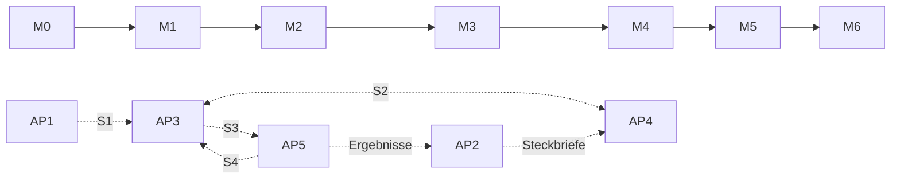

# Arbeitspakete

Fünf Pakete für fünf Personen. Jedes Paket hat eigene Ordner; niemand ändert fremde Ordner ohne Absprache. Die Anforderungsnummern (R-…) verweisen auf [anforderungsmatrix.md](anforderungsmatrix.md).

| Paket | Person | Vertretung |
|---|---|---|
| AP1 Daten und MES-Modell | TODO: Name | TODO: Name |
| AP2 Methodik und Literatur | TODO: Name | TODO: Name |
| AP3 Simulationskern | TODO: Name | TODO: Name |
| AP4 Planungsverfahren | TODO: Name | TODO: Name |
| AP5 Experimente und Auswertung | TODO: Name | TODO: Name |

## Schnittstellen

| Schnittstelle | Datei | Liefert | Nutzt | Änderung nur mit Zustimmung von |
|---|---|---|---|---|
| S1 Anlagenbeschreibung | `config/anlage.yaml`, geprüft von `matsim.modell.anlage` | AP1 | AP3, AP5 | AP1 und AP3 |
| S2 Planungsschnittstelle | `src/matsim/regeln/basis.py` | AP3 (Zustand), AP4 (Entscheidung) | AP3, AP4 | AP3 und AP4 |
| S3 Ereignisprotokoll | `src/matsim/kennzahlen/ereignisprotokoll.py` | AP3 | AP5 | AP3 und AP5 |
| S4 Szenario-Dateien | `config/szenarien/*.yaml`, geprüft von `matsim.experimente.szenario` | AP5 | AP3 | AP5 und AP3 |

## AP1 Daten und MES-Modell

| | |
|---|---|
| **Ziel** | Belastbare, nachvollziehbare Datengrundlage: Materialpfad, Bedarfe, Belegungen, Reservierungen, Zeitansätze, Datenqualität |
| **Eingaben** | sechs Dumps, Live-Datenbank im Labornetz, `Readme_Dozent.md`, Lehrunterlagen Kapitel 12 |
| **Ergebnisse** | vollständiges Befundregister in `datenmodell-mes.md` (Prüfregel, geprüfte Anzahl, auffällige Anzahl und Anteil, Beispiel, Behandlung, Modellfolge); ausführbare Prüfungen und eine manuelle Stichprobe; `config/anlage.yaml` ohne ungeklärte Herkunft; Zeitverteilungen für das Unsicherheitsszenario; kleine Tabellen in `data/processed/` |
| **Eigene Ordner** | `src/matsim/daten/`, `data/`, `docs/projekt/datenmodell-mes.md`, `notebooks/01_*` |
| **Schnittstellen** | liefert S1 an AP3; liefert Verteilungen an AP5; meldet Lücken an AP2 |
| **Abnahme** | Import und Datentests laufen auf einem frischen Klon mit den Dumps; jeder Wert in `anlage.yaml` hat Herkunft und Beleg; Lücken L-02, L-03, L-05 bis L-08 sind geklärt oder begründet als Lücke ausgewiesen; Rohdaten unverändert (Prüfsummen) |
| **Anforderungen** | R-06 bis R-13, R-44, R-45 |

Startpunkte: `matsim.daten.zeiten.zeitverteilung` (noch offen), Auswertung von `tblmachinereport` für Fahrzeugbelegung, Klärung der gebuchten Plätze an Ressource 19, Bimodalität der Montagezeiten.

## AP2 Methodik und Literatur

| | |
|---|---|
| **Ziel** | Methodische Einordnung, begründete Verfahren, vollständiger Annahmenkatalog, Gerüst und Redaktion der Hausarbeit |
| **Eingaben** | Aufgabenstellung, `docs/` (Kapitel 01, 04, 05, 06, 11, 12, 13), Befunde aus AP1 |
| **Ergebnisse** | Steckbrief je Verfahren mit Restbedarfsregel und Entscheidung zu V4; Entscheidungsmodell (Größen, Ziele, Nebenbedingungen, Modellgrenzen, Horizont); gepflegter Annahmen- und Lückenkatalog; geprüfte Zusatzliteratur; Gliederung und Redaktionsplan der Hausarbeit; Handlungsempfehlung mit Gültigkeitsbedingungen |
| **Eigene Ordner** | `docs/projekt/planungsverfahren.md`, `docs/projekt/literatur-ergaenzung.md`, `docs/projekt/annahmen-und-datenluecken.md`, `docs/projekt/aufgabenstellung.md`, `docs/projekt/anforderungsmatrix.md`, `report/` |
| **Schnittstellen** | gibt AP4 die fachliche Vorgabe je Verfahren; erhält von allen Paketen Annahmen; erhält von AP5 Ergebnisse für die Hausarbeit |
| **Abnahme** | jede Fachaussage hat einen Kurzbeleg aus `docs/` oder eine geprüfte Zusatzquelle; keine Seitenangabe ohne Prüfung; jede Annahme im Code steht im Katalog; Anforderungsmatrix ohne offene Zeile |
| **Anforderungen** | R-01, R-02, R-05, R-17, R-46 bis R-48 |

## AP3 Simulationskern

| | |
|---|---|
| **Ziel** | SimPy-Modell, das Entscheidungen mit begrenzten Ressourcen abarbeitet und ein vollständiges Ereignisprotokoll schreibt |
| **Eingaben** | S1, S4, Referenzpaket des Dozenten (fehlt, L-01), `logikstruktur.md` |
| **Ergebnisse** | Materiallager, Kommissionierplatz, Boxbestand, Fahrzeuge, Stationen mit Übergabeplätzen, Werkstückumlauf; Prozesskette vom Bedarfseingang bis zur Leerboxrückführung; Referenzregeln; Planungsaufrufe nur zu den drei Anlässen; Regel für gleichzeitige Ereignisse; Dokumentation von Prozessgrenze, Ressourcen, Kapazitäten, Ereignissen und Zustandsübergängen |
| **Eigene Ordner** | `src/matsim/modell/`, `src/matsim/referenz/`, `docs/projekt/logikstruktur.md`; `config/anlage.yaml` gemeinsam mit AP1 |
| **Schnittstellen** | nutzt S1 und S4; liefert S3 an AP5; stellt für S2 den Planungszustand bereit und bindet die Entscheidungen von AP4 |
| **Abnahme** | Lauf mit V1 im Basisfall endet regulär; Invarianten-Tests laufen ohne `xfail`; eine verspätete Lieferung verschiebt nachweislich eine Montage; Werkstück ohne Material fährt weiter und erzeugt kein wartendes Werkstück; gebundene Chargen werden nie geändert |
| **Anforderungen** | R-18 bis R-35 |

## AP4 Planungsverfahren

| | |
|---|---|
| **Ziel** | V0 bis V4 hinter der gemeinsamen Schnittstelle, unabhängig von der Simulation testbar |
| **Eingaben** | S2, Steckbriefe aus AP2, Kalibrierungsszenario aus AP5 |
| **Ergebnisse** | fünf Verfahren in `src/matsim/regeln/`; Restbedarfsregel; Parameter je Verfahren; Enumeration eines kleinen Falls mit Vergleich; Unit-Tests je Verfahren auf handgebauten Planungszuständen |
| **Eigene Ordner** | `src/matsim/regeln/`, `tests/test_regeln_*.py`, `notebooks/04_*` |
| **Schnittstellen** | S2 mit AP3; liefert AP2 die Beschreibung der umgesetzten Regeln; erhält von AP5 Kalibrierungsergebnisse |
| **Abnahme** | jedes Verfahren liefert nur zulässige Chargen (`pruefe_charge` ohne Verstoß); kein Verfahren lässt Restbedarf dauerhaft liegen; Verfahren sind ohne Simulation aufrufbar; Enumeration dokumentiert Alternativenzahl, Zielgröße und Horizont |
| **Anforderungen** | R-03, R-04, R-14 bis R-16, R-49 |

## AP5 Experimente und Auswertung

| | |
|---|---|
| **Ziel** | Reproduzierbare Vergleichsversuche, Kennzahlen, unabhängige Prüfung und Validierung |
| **Eingaben** | S3, S4, Verteilungen aus AP1, Kennzahlendefinitionen |
| **Ergebnisse** | Szenarien mit begründeten Werten; Runner mit vorab erzeugten Verläufen; Kennzahlen K1 bis K9; Wartezeit-Zerlegung; unabhängige Prüfregeln mit Nachweis an fehlerhaften Protokollen; Validierung von V0 gegen den 09.11.2026; Sensitivitätsanalyse; Tabellen und Diagramme |
| **Eigene Ordner** | `src/matsim/kennzahlen/`, `src/matsim/experimente/`, `config/szenarien/`, `results/`, `docs/projekt/kennzahlen.md`, `docs/projekt/versuchsplan.md`, `notebooks/05_*` |
| **Schnittstellen** | erhält S3 von AP3; liefert S4 an AP3; liefert Ergebnisse an AP2 |
| **Abnahme** | ein Befehl erzeugt alle Läufe eines Szenarios neu; gleiche Seeds liefern identische Protokolle; Prüfung erkennt jeden eingebauten Fehler; Kennzahlen stammen nur aus dem Protokoll; K4 geht in der Wartezeit-Zerlegung auf |
| **Anforderungen** | R-36 bis R-43, R-50 bis R-53 |

## Meilensteine

Ohne Kalenderdaten; das Team legt sie fest. Die Zwischenstände der Aufgabenstellung (Ende Woche 2, Ende Woche 4) sind als Anker genannt.

| Nr. | Meilenstein | Inhalt | Abhängigkeiten |
|---|---|---|---|
| M0 | Start | Rollen besetzt, Umgebung bei allen lauffähig, Dumps verteilt, Referenzpaket angefragt | keine |
| M1 | Datenstand und Modellabgrenzung (Anker: Ende Woche 2) | Befundregister, `anlage.yaml` mit Herkunft, Modellgrenze, Arbeitsplan, Entscheidung zu V4 und zum zweiten Stressfall | AP3 braucht S1 von AP1; AP2 braucht Befunde von AP1; AP5 braucht Parameterherkunft von AP1 |
| M2 | Durchstich | Simulation läuft mit V1 im Basisfall und schreibt ein Protokoll; erste Kennzahlen; Invarianten-Tests scharf | AP3 braucht das Referenzpaket (L-01), V1 von AP4 und `basis.yaml` von AP5; AP5 braucht S3 von AP3 |
| M3 | Referenzplaner (Anker: Ende Woche 4) | V0 bis V3 laufen; V0 gegen den 09.11.2026 validiert; unabhängige Prüfung vollständig | AP4 braucht stabilen Planungszustand von AP3; AP5 braucht V0 von AP4 und Zeitansätze von AP1 |
| M4 | Verbesserung und Versuche | V4 umgesetzt, Parameter auf `kalibrierung` gewählt und eingefroren; Basis und Stressfälle gelaufen; Enumeration | AP4 braucht Kalibrierungsläufe von AP5; AP5 braucht eingefrorene Verfahren von AP4 |
| M5 | Sensitivität und Auswertung | Unsicherheitsszenario mit Replikationen, Diagramme, Ergebnistabellen | AP5 braucht Verteilungen von AP1 |
| M6 | Abgabe | Hausarbeit, Code mit Beispielaufruf, reproduzierbare Nachweise | AP2 braucht Ergebnisse von AP5 und Texte aller Pakete |

Parallelisierung bis M2: AP4 entwickelt und testet die Verfahren auf handgebauten Planungszuständen, AP5 entwickelt Kennzahlen und Prüfung auf handgeschriebenen Protokollen. Beide brauchen dafür keine laufende Simulation, nur die festgelegten Schnittstellen S2 und S3.
