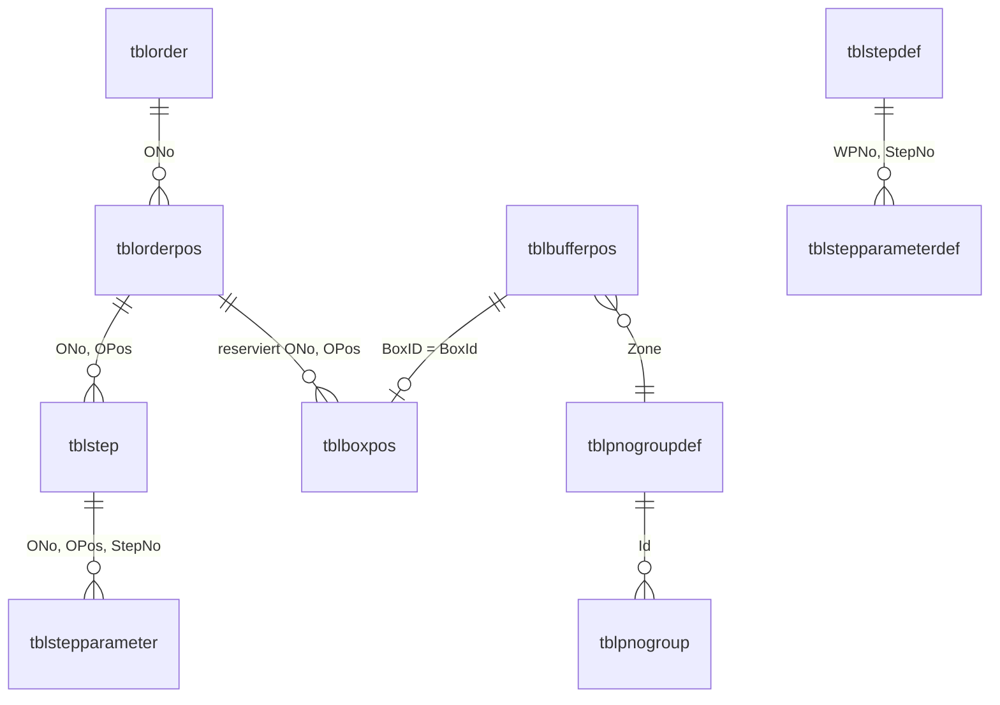

# MES-Datenmodell und Befunde

Verantwortlich: AP1. Stand: Befundregister mit wiederholbaren Prüfungen, Startbestand, Zeitansätze und Beladungsregeln (Issues #1 bis #4), geprüft gegen alle sechs Snapshots vom 09.11.2026.

Quelle ist die Datenbank `MES4` (Festo MES4, MariaDB 10.4.32, 64 Tabellen). Der Import (`python -m matsim.daten importiere`) überführt jeden Dump in eine SQLite-Datei mit 62 Tabellen; `tblcustomer` und `tblusercontrol` werden wegen personenbezogener Daten ausgeschlossen. Die Rohdateien bleiben unverändert.

Das Vorgehen folgt den Lesefragen für ein unbekanntes MES-Datenmodell aus [Kapitel 12](../12-smart-factory-mes-und-zielorientierte-prozessverbesserung.md): zuerst Definitionen, aktuelle Auftragsdaten und Historie trennen, dann Auftrag, Position und Arbeitsganginstanz unterscheiden, dann Material, Bestandseinheit und Reservierung verknüpfen.

Jeder Wert ist einer von vier Arten: **MES-Wert** (direkt gelesen), **abgeleiteter Wert** (berechnet, mit Filter), **Beobachtung** (aus dem Ablauf vom 09.11.2026) oder **Annahme** (steht in [annahmen-und-datenluecken.md](annahmen-und-datenluecken.md)).

## 1. Tabellengruppen

| Gruppe | Tabellen | Bedeutung | Historie |
|---|---|---|---|
| Stammdaten Anlage | `tblresource`, `tblbuffer`, `tblbuffertype`, `tbltopology`, `tblresourceoperation` | Stationen, Puffer, Bandverbindungen, Planzeiten je Operation | nein |
| Stammdaten Material | `tblparts`, `tblpnogroup`, `tblpnogroupdef`, `tblboxdef`, `tblcarrierdef` | Teile, Teilegruppen, Boxtyp | nein |
| Arbeitspläne | `tblworkplandef`, `tblstepdef`, `tblstepparameterdef`, `tbloperation`, `tbloperationparameter` | Schritte, Parameter und hinterlegtes SQL je Operation | nein |
| Anlagenlogik | `tblsqlquery`, `tblsqlqueryparameter` | SQL, mit dem die Stationen ihre nächste Operation suchen | nein |
| Laufende Aufträge | `tblorder`, `tblorderpos`, `tblstep`, `tblstepparameter` | Zustand offener Aufträge; Zeilen verschwinden nach Abschluss | nein, nur Zustand |
| Bestand und Belegung | `tblbox`, `tblboxpos`, `tblbufferpos`, `tblcarrier` | Boxinhalt, Pufferbelegung, Werkstückträger | nein, nur Zustand |
| Auftragshistorie | `tblfinorder`, `tblfinorderpos`, `tblfinstep`, `tblfinstepparameter` | abgeschlossene Aufträge mit Start und Ende je Schritt | ja, seit 11.06.2025 |
| Meldungen | `tblmachinereport`, `tblpartsreport` | Zustandsmeldungen der Ressourcen | ja, Bedeutung noch zu klären (L-06) |

## 2. Schlüssel und Verknüpfungen

| Objekt | Schlüssel | Verknüpfung |
|---|---|---|
| Auftrag | `ONo` | `tblorder` bzw. `tblfinorder` |
| Auftragsposition | `ONo, OPos` | ein Werkstück (Produktionsauftrag) oder ein umgesetztes Teil (Kommissionierauftrag); `WPNo` nennt den Arbeitsplan |
| Schritt | `ONo, OPos, StepNo` | `OpNo` und `ResourceID` nennen Operation und Station; in `tblfinstep` kein doppelter Schlüssel (geprüft: 0 von 14 723) |
| Boxplatz | `BoxPNo, BoxId, BoxPos` | `PNo` = Teil auf dem Platz, `ONo, OPos` = Reservierung für eine Auftragsposition |
| Pufferplatz | `ResourceId, BufNo, BufPos` | `PNo = 29` und `BoxID` = dort stehende Box; `Zone` verweist auf eine Teilegruppe; `Booked` bindet den Platz |
| Teilegruppe | `tblpnogroup.Id, PNo` | Bezeichnung in `tblpnogroupdef` |



## 3. Zählregeln

1. **Teilebestand nur aus `tblboxpos`:** ein Boxplatz mit `PNo > 0` ist genau ein Teil.
2. **Boxbestand nur aus `tblbufferpos`:** eine Zeile mit `BoxID > 0` ist eine verortete Box. Die Box selbst (PNo 29) ist kein Teilebestand.
3. **Reservierung ist kein Bestand:** `ONo <> 0` auf einem Boxplatz bindet ihn. Ist zugleich `PNo = 0`, ist es ein reservierter leerer Zielplatz.
4. **Frei** ist ein Teil nur mit `ONo = 0` und in einer verorteten Box (Befund B-10).
5. **Ein Ort je Box:** Steht eine Box auf mehreren Pufferplätzen, gilt der Platz mit dem jüngsten `TimeStamp` (Befund B-11). Die Rohdaten bleiben unverändert.
6. **Kreislauf:** Eine Box an einem Handarbeitsplatz (AASS1/AASS2, Ressourcen 26 und 27) zählt nicht als Transportbox, ihr Inhalt nicht als Startbestand.

Umgesetzt in `src/matsim/daten/bestand.py` (`teilebestand`, `boxstandort_aufgeloest`, `startbestand`), geprüft in `tests/test_dump_import.py` und `tests/test_bestand.py`. Mit `python -m matsim.daten bestand <Snapshot>` werden alle Zählungen ausgegeben.

## 4. Befundregister

Jede Prüfung ist eine Funktion in [`src/matsim/daten/qualitaet.py`](../src/matsim/daten/qualitaet.py) und läuft mit

```text
.venv\Scripts\python -m matsim.daten qualitaet                    # Snapshot 15:57
.venv\Scripts\python -m matsim.daten qualitaet 2026-11-09_1516    # anderer Snapshot
```

Die Zahlen unten stammen aus dem Snapshot 15:57 und sind in `tests/test_qualitaet.py` festgeschrieben. „Geprüft“ ist der Prüfumfang, „auffällig“ die Datensätze, auf die die jeweils genannte Regel zutrifft. „Abgleich“ vergleicht mit dem Startwissen aus dem Projektauftrag.

### 4.1 Übersicht

| Nr. | Befund | geprüft | auffällig | Anteil | Abgleich |
|---|---|---:|---:|---:|---|
| B-01 | Ressourcen der Schritthistorie | 14 723 Schritte | 0 | 0,0 % | bestätigt, ergänzt |
| B-02 | Bandtopologie | 19 Kanten | 5 | 26,3 % | weicht ab |
| B-03 | Plätze je Box | 40 Boxen | 0 | 0,0 % | bestätigt |
| B-04 | Stückliste WPNo 1000 | 5 Montageschritte | 0 | 0,0 % | bestätigt |
| B-05 | Zonen der Box-Pufferplätze | 6 Pufferplätze | 6 | 100,0 % | weicht ab |
| B-06 | Kommissionier-Arbeitspläne | 1 498 Schritte | 0 | 0,0 % | bestätigt |
| B-07 | Montage mit nachweisbarem Materialpfad | 572 Montageschritte | 9 | 1,6 % | neu |
| B-08 | Ablauf vom 09.11.2026 | 18 Positionen | 0 | 0,0 % | bestätigt, ergänzt |
| B-09 | Boxen mit bekanntem Ort | 40 Boxen | 19 | 47,5 % | bestätigt |
| B-10 | Teile in Boxen ohne Ort | 71 Teile | 15 | 21,1 % | neu |
| B-11 | Boxen an mehr als einem Ort | 21 Boxen | 1 | 4,8 % | neu |
| B-12 | Bindungen ohne laufenden Auftrag | 31 Bindungen | 31 | 100,0 % | bestätigt, ergänzt |
| B-13 | Filter der Zeitansätze | 1 701 Schritte | 104 | 6,1 % | bestätigt |
| B-14 | Ende letzter Pick bis Ablieferung | 229 Aufträge | 21 | 9,2 % | weicht ab |
| B-15 | Positionen je Kommissionierauftrag | 229 Aufträge | 11 | 4,8 % | bestätigt |
| B-16 | Fehlende Zeitstempel | 14 723 Schritte | 2 645 | 18,0 % | bestätigt, ergänzt |
| B-17 | Nicht gepflegte Felder | 40 Boxen | 40 | 100,0 % | bestätigt |
| B-18 | Planzeit gegen Istzeit | 4 Operationen | 3 | 75,0 % | neu |
| B-19 | Montagepriorität im MES | 1 Abfrage | 0 | 0,0 % | neu |
| B-20 | Picks ohne Produktionsposition | 749 Picks | 176 | 23,5 % | neu |
| B-21 | Nutzung der Boxen ohne Ort | 19 Boxen | 0 | 0,0 % | neu |
| B-22 | Zuordnung der Ablieferungen zu Robotino-Fahraufträgen | 229 Ablieferungen | 40 | 17,5 % | neu |
| B-23 | Gemischte Zielboxen | 229 Zielbox-Nutzungen | 0 | 0,0 % | neu |
| B-24 | Vollständige Sätze in einer Box | 264 Sätze | 2 | 0,8 % | neu |

### 4.2 Befunde im Einzelnen

**B-01 Ressourcen der Schritthistorie**
- Prüfung: Jede `ResourceID` in `tblfinstep` muss in `tblresource` stehen (`b01_ressourcen`).
- Ergebnis: 14 723 Schritte geprüft, 0 auffällig (0,0 %).
- Beispiel: Zusätzlich zum Startwissen gibt es die Ressourcen 8 (iPICK), 9, 10, 12, 13, 16 (manuelle Plätze) und 18 (mobile Workstation mit eigenen AGV-Puffern).
- Umgang: keine Bereinigung nötig.
- Modellfolge: Produktionsabschnitt = RASS1 bis RASS3 (Ressourcen 2, 4, 6), Kommissionierung 19, Boxlager 17, Robotinos 20 bis 25; andere Stationen nur als Durchlauf.

**B-02 Bandtopologie**
- Prüfung: `tbltopology` hat 20 Zeilen, davon eine Leerzeile 0→0. Auffällig ist eine Kante, die an einer Weiche (mehr als ein Ausgang) beginnt (`b02_topologie`).
- Ergebnis: 19 Kanten, 5 auffällig (26,3 %).
- Beispiel: Station 10 hat drei Ausgänge (1, 8, 11), Station 1 zwei (8, 14). Die Montagestationen liegen in der geschlossenen Schleife 10→11→12→13→2→3→4→5→6→7→10.
- Umgang: Topologie wird aus der Datei übernommen (D-08).
- Modellfolge: Ein Werkstück ohne Material kann die Schleife erneut durchlaufen (A-01).

**B-03 Plätze je Box**
- Prüfung: Jede Box in `tblbox` hat in `tblboxpos` genau `tblboxdef.PosCount` = 8 Plätze (`b03_boxplaetze`).
- Ergebnis: 40 Boxen, 0 auffällig (0,0 %); `tblboxpos` hat 320 = 40 × 8 Zeilen.
- Beispiel: Boxtyp PNo 29, 4 Reihen zu je 2 Plätzen.
- Umgang: keiner nötig.
- Modellfolge: Boxkapazität 8 Teile.

**B-04 Stückliste WPNo 1000**
- Prüfung: Das Teil jedes Montageschritts (Parameter 3, bei OpNo 324 Parameter 4) gehört zur Materialgruppe seiner Station (`b04_stueckliste`).
- Ergebnis: 5 Montageschritte, 0 auffällig (0,0 %).
- Beispiel: Schritt 30: 800, 60: 814 (RASS1); 100: 813, 110: 811 (RASS2); 160: 831 (RASS3).
- Umgang: Andere Produktvarianten haben andere Sätze, z. B. WPNo 1003 an RASS1 nur 800, WPNo 1004 an RASS2 nur 812. Am 09.11.2026 lief nur WPNo 1000.
- Modellfolge: Materialsätze in `config/anlage.yaml` gelten für WPNo 1000.

**B-05 Zonen der Box-Pufferplätze**
- Prüfung: Die `Zone` der Box-Pufferplätze an RASS1 bis RASS3 sollte laut Startwissen die Materialgruppe der Station sein (`b05_zonen`).
- Ergebnis: 6 Pufferplätze, 6 auffällig (100,0 %).
- Beispiel: Alle tragen Zone 7 („Boxes“ = {21, 29}); alle 320 Boxplätze tragen `PNoGroup` 9 („Box content“).
- Umgang: Die Zone beschränkt den Boxtyp, nicht den Inhalt. Sie wird nicht als Inhaltssperre ausgewertet (D-09).
- Modellfolge: Stationsreinheit folgt aus dem Materialpfad (Abschnitt 5), nicht aus Zonen.

**B-06 Kommissionier-Arbeitspläne**
- Prüfung: Jeder Pick (WPNo 1, 2, 3, Schritt 10) läuft an Ressource 19, jede Ablieferung (Schritt 20) an der Station seines Arbeitsplans: WPNo 1 → 2, 2 → 4, 3 → 6 (`b06_kommissionierplaene`).
- Ergebnis: 749 Picks und 749 Ablieferungsschritte, 0 auffällig (0,0 %).
- Beispiel: 9177/1 Schritt 10 an 19, Schritt 20 an 2.
- Umgang: keiner nötig.
- Modellfolge: Prozesskette Kommissionierung → Ablieferung an genau einer Station.

**B-07 Montage mit nachweisbarem Materialpfad**
- Prüfung: Für jeden Montageschritt (OpNo 323 bis 325, mit Start und Ende, ohne Fehler) gibt es einen Pick, dessen Parameter 8/9/10 genau diesen Auftrag, diese Position und diesen Schritt nennen (`b07_montage_ohne_pick`).
- Ergebnis: 572 Montageschritte, 9 ohne Pick (1,6 %).
- Beispiel: 8251/1 Schritt 20, OpNo 325 am 26.06.2025.
- Umgang: Ursache nicht belegt; vermutlich von Hand befüllte Box. Die Schritte bleiben in den Zeitansätzen.
- Modellfolge: In der Simulation kommt jedes Teil über die Kommissionierung zur Station.

**B-08 Ablauf vom 09.11.2026**
- Prüfung: Alle Positionen der Aufträge 9176 bis 9180 haben Start, Ende und Zustand 100 (`b08_ablauf_0911`).
- Ergebnis: 18 Positionen, 0 auffällig (0,0 %).
- Beispiel: Reihenfolge an RASS1 war 9178/2, 9176/1, 9178/1, nicht die Auslagerreihenfolge 9176/1, 9178/1, 9178/2.
- Umgang: vollständige Stichprobe in [stichprobe-auftrag-9178.md](stichprobe-auftrag-9178.md).
- Modellfolge: Referenzfall V0; Werkstücke warten bzw. kreisen, bis ihr Material da ist.

**B-09 Boxen mit bekanntem Ort**
- Prüfung: Jede Box aus `tblbox` steht auf einem Pufferplatz (`tblbufferpos.BoxID`) (`b09_verortete_boxen`).
- Ergebnis: 40 Boxen, 19 ohne Ort (47,5 %), in allen sechs Snapshots gleich.
- Beispiel: Boxen 1, 6 bis 10, 14, 16, 19, 23 bis 25, 28, 29, 31, 33, 35 bis 37.
- Umgang: Die Zahl ist in allen sechs Snapshots gleich, ein Effekt des Exportzeitpunkts scheidet damit aus. Keine der 19 Boxen war seit dem 30.10.2026 Quell- oder Zielbox eines Picks, fünf nie (B-21). Sie stehen auch an keinem Handarbeitsplatz und an keiner mobilen Workstation. Wahrscheinlich sind sie außerhalb der Anlage; belegen lässt sich das nur durch eine Zählung im Labor (L-08).
- Modellfolge: In die Simulation gehen nur die 21 verorteten Boxen (A-03): 7 leere Transportboxen, 13 Quellboxen mit Teilen, Box 38 am Handarbeitsplatz bleibt außen vor.

**B-10 Teile in Boxen ohne Ort**
- Prüfung: Teile in `tblboxpos`, deren Box auf keinem Pufferplatz steht (`b10_teile_ohne_ort`).
- Ergebnis: 71 Teile in Boxen, 15 davon in Boxen ohne Ort (21,1 %); im Snapshot 15:16 86 und 15 (17,4 %).
- Beispiel: Boxen 1, 14, 19, 23; 800: 5, 814: 9, 832: 1.
- Umgang: nicht löschen, aber nicht als verfügbaren Bestand zählen.
- Modellfolge: Anfangsbestand nur aus verorteten Boxen (A-02).

**B-11 Boxen an mehr als einem Ort**
- Prüfung: Eine verortete Box steht auf genau einem Pufferplatz (`b11_doppelt_verortet`).
- Ergebnis: 21 Boxen, 1 auffällig (4,8 %), nur im Snapshot 15:57; in den anderen fünf 0.
- Beispiel: Box 11 auf Robotino 24 (24/1/1, Zeitstempel 15:50:55) und im Lager (17/1/14, Zeitstempel 15:57:09).
- Umgang: Robotino 24 hat Box 11 um 15:50:55 an RASS3 aufgenommen (RASS3-Platz 6/1/1 wird zur selben Sekunde frei), sein letzter Fahrauftrag endet um 15:55:27 (`tblmachinereport`), um 15:57:09 bucht das Boxlager die Box ein. Der Robotino-Platz wurde nicht zurückgesetzt. In den anderen Snapshots werden Robotino-Plätze nach der Übergabe geleert (z. B. Robotino 25: 15:22 Box 3, 15:25 leer). Rohdaten bleiben unverändert; es gilt der jüngste Zeitstempel (Zählregel 5), Box 11 steht also im Lager.
- Modellfolge: keine; jede Box wird genau einmal gezählt.

**B-12 Bindungen ohne laufenden Auftrag**
- Prüfung: Jede Reservierung (`ONo <> 0` in `tblboxpos`, `tblbufferpos`, `tblcarrier`), jede Zeile in `tblstepparameter` und jede Buchung (`Booked = 1`) gehört zu einem Auftrag in `tblorder` (`b12_bindungen_ohne_auftrag`).
- Ergebnis: Im Snapshot 15:57 ist `tblorder` leer, deshalb sind alle 31 Bindungen auffällig (100 %): 26 Zeilen `tblstepparameter` (ONo 1 und 7963) und 5 gebuchte Plätze an Ressource 19. Im Snapshot 15:16: 309 Bindungen, 30 auffällig (9,7 %).
- Beispiel: 19/6/1 ist seit 21.10.2025 gebucht; Band 6 hat laut `tblbuffer` 0 Reihen und 0 Spalten und ist damit abgeschaltet.
- Umgang: Gebucht ist immer Platz 1 eines Bandes; die Kennzeichen an Band 2 und 4 stehen seit 15:02:18 (Produktionsstart), an Band 6 seit 21.10.2025, und keines wird nach Produktionsende zurückgesetzt. Das Kennzeichen beschreibt die Belegung damit nicht verlässlich. Gleichzeitig standen an der Kommissionierstation bis zu drei Boxen (15:25: Zielbox 18 und Quellboxen 3 und 4). Gebuchte Plätze werden nicht ausgewertet (L-05).
- Modellfolge: Kapazität des Kommissionierplatzes kommt aus der Historie (eine Charge zur Zeit, Abschnitt 6.3), nicht aus den Buchungskennzeichen.

**B-13 Filter der Zeitansätze**
- Prüfung: Schritte der sechs Zeitvorgänge in `config/anlage.yaml` ohne Start oder Ende oder mit `ErrorRetVal <> 0` fließen nicht in die Zeiten ein (`b13_zeitfilter`).
- Ergebnis: 1 701 Schritte, 104 verworfen (6,1 %). OpNo 324: 81 von 294 (27,6 %), alle ohne Start und Ende, also nicht ausgeführte Schritte.
- Beispiel: verworfen je OpNo: 220: 1, 323: 11, 324: 81, 325: 4, 212: 4, 211: 3.
- Umgang: Filter wie in `matsim.daten.zeiten.schrittdauern`.
- Modellfolge: Festwerte = Median der gefilterten Schritte (Abschnitt 6).

**B-14 Ende letzter Pick bis Ablieferung**
- Prüfung: Dauer vom Ende des letzten Picks bis zum Ende des ersten Ablieferschritts (OpNo 215) je Kommissionierauftrag. Auffällig ist ein Wert über der äußeren Tukey-Grenze Q3 + 3 · IQR (`b14_transportzeit`).
- Ergebnis: 229 Aufträge, 21 über 380 s (9,2 %).
- Beispiel: größte Werte 3 735 s, 6 886 s, 7 476 s.
- Umgang: Der Median ist gegen diese Werte robust. In der Verteilung werden sie als Störung entfernt (Abschnitt 6.6).
- Modellfolge: Kein reiner Fahrzeitwert, enthält Warten auf ein Fahrzeug. Zerlegung in Warten und Fahrauftrag in Abschnitt 6.4.

**B-15 Positionen je Kommissionierauftrag**
- Prüfung: Ein Auftrag für RASS1 oder RASS2 enthält eine gerade Teilezahl (ganze Sätze), kein Auftrag mehr als 8 Teile (`b15_buendelung`).
- Ergebnis: 229 Aufträge, 11 auffällig (4,8 %), alle wegen ungerader Teilezahl; keiner über 8.
- Beispiel: 8428 (WPNo 1, 3 Teile), 8666 (WPNo 1, 1 Teil). Ursache sind Produktvarianten mit nur einem Teil an der Station (B-04).
- Umgang: keiner.
- Modellfolge: höchstens 8 Teile je Box bestätigt. Verteilung der Positionen siehe Abschnitt 5.

**B-16 Fehlende Zeitstempel und Fehlercodes**
- Prüfung: Schritte ohne Start und ohne Ende (`b16_fehlende_zeiten`).
- Ergebnis: 14 723 Schritte, 2 645 auffällig (18,0 %). Zusätzlich 142 Schritte mit `ErrorRetVal <> 0` (1,0 %) und 436 von 1 351 Positionen ohne Start (32,3 %).
- Beispiel: 9093/1 Schritte 40 und 50 (RASS1 „switch on pcb“, „read QR“) ohne Start und Ende; die Aufträge 9176 bis 9180 haben keinen solchen Schritt.
- Umgang: vor jeder Zeitauswertung filtern (B-13).
- Modellfolge: keine.

**B-17 Nicht gepflegte Felder**
- Prüfung: `tblbox.ONo` und `tblbox.Full` sind 0, obwohl Boxen belegt und reserviert sind (`b17_ungepflegt`).
- Ergebnis: 40 Boxen, 40 auffällig (100 %).
- Beispiel: Box 11 ist um 15:16 mit 6 Teilen für 9177 belegt, `tblbox` zeigt `ONo = 0`, `Full = 0`. In `tblparts` haben alle 87 Teile `SafetyStock = 0` und `LotSize = 0`; `tblautomaticorder` ist leer.
- Umgang: Felder werden nicht verwendet. Boxbelegung nur aus `tblboxpos`.
- Modellfolge: keine Losgrößen- oder Mindestbestandsvorgabe aus dem MES.

**B-18 Planzeit gegen Istzeit**
- Prüfung: Median der Istzeit weicht mehr als 20 % von `tblresourceoperation.WorkingTime` ab (`b18_plan_ist`).
- Ergebnis: 4 Operationen, 3 auffällig (75 %).
- Beispiel: OpNo 220: Plan 20 s, Ist 23 s; 323: 5 / 37 s; 324: 10 / 39 s; 325: 5 / 24 s.
- Umgang: Stammdatenzeiten werden nicht verwendet.
- Modellfolge: Istzeiten aus der Historie.

**B-19 Montagepriorität im MES**
- Prüfung: Die Abfrage `tblsqlquery` 100/1 (`GetOpForRsc`) hat eine feste Sortierung (`b19_montageprioritaet`).
- Ergebnis: 1 Abfrage, 0 auffällig.
- Beispiel: `ORDER BY tblOrderPos.PlannedStart, tblOrderPos.ONo, tblOrderPos.OPos`, nur Positionen mit `State < 10` und freigegebenem Auftrag.
- Umgang: keiner.
- Modellfolge: Kandidat für die Referenzregel Montagepriorität (L-01).

**B-20 Picks ohne Produktionsposition**
- Prüfung: Der Produktionsbezug eines Picks (Parameter 8/9) zeigt auf eine Position in `tblfinorderpos` (`b20_pick_ohne_produktionsposition`).
- Ergebnis: 749 Picks, 176 auffällig (23,5 %). Sie gehören zu 23 Produktionsaufträgen, die weder in `tblfinorder` noch in `tblfinorderpos` stehen (18.06.2025 bis 03.11.2026).
- Beispiel: Produktionsaufträge 8232, 8317, 8367, 8511, 8539.
- Umgang: Diese Picks zählen für die Kommissionierzeit. Für Aussagen über Satzvollständigkeit je Produkt werden sie nicht verwendet.
- Modellfolge: Die Historie der Produktionsaufträge ist unvollständig, vermutlich gelöschte oder abgebrochene Aufträge. Bedarfsmuster lassen sich daraus nicht ableiten (L-09).

**B-21 Nutzung der Boxen ohne Ort**
- Prüfung: Eine Box ohne Ort (B-09) war am Tag des Snapshots Quell- oder Zielbox eines Picks (Parameter 3 bzw. 6 von OpNo 220) (`b21_boxen_ohne_ort_genutzt`).
- Ergebnis: 19 Boxen, 0 auffällig (0,0 %).
- Beispiel: Jüngste Nutzung 30.10.2026 (Boxen 14 und 19), nie genutzt: Boxen 1, 28, 31, 35, 37.
- Umgang: stützt die Annahme, dass diese Boxen außerhalb der Anlage sind (L-08).
- Modellfolge: Boxen ohne Ort und ihre 15 Teile gehen nicht in den Basisfall (A-02, A-03).

**B-22 Zuordnung der Ablieferungen zu Robotino-Fahraufträgen**
- Prüfung: Jede Ablieferung (OpNo 215) lässt sich einem Busy-Abschnitt eines Robotinos in `tblmachinereport` zuordnen (`b22_fahrzeugzuordnung`, Regel in Abschnitt 6.4).
- Ergebnis: 229 Ablieferungen, 40 nicht zuordenbar (17,5 %).
- Beispiel: Am 09.11.2026 aktiv waren die Robotinos 24 und 25, höchstens 2 gleichzeitig beschäftigt; alle drei Ablieferungen des Tages passen zu den Snapshots.
- Umgang: Fahrzeiten nur aus den zuordenbaren und vollständig verketteten Fahraufträgen (170).
- Modellfolge: `fahrzeuge.fahrauftrag_s` = 96 s mit Verteilung; Fahrzeuganzahl 2 (A-05).

**B-23 Gemischte Zielboxen**
- Prüfung: Eine Zielbox trägt zur selben Zeit Teile zweier Kommissionieraufträge. Nutzungszeitraum = erster Pick in die Box bis letzter Verbrauch dieser Teile (`b23_gemischte_zielboxen`).
- Ergebnis: 229 Zielbox-Nutzungen, 0 auffällig (0,0 %).
- Beispiel: Box 11 trug am 09.11.2026 die Teile von 9174 (RASS2) von 13:38:14 bis 13:44:54, von 9177 (RASS1) von 15:09:15 bis 15:24:19 und von 9180 (RASS3) von 15:39:34 bis 15:49:01.
- Umgang: keiner nötig.
- Modellfolge: Regel „eine Box nur für eine Station“ aus der Historie belegt (Abschnitt 5.4).

**B-24 Vollständige Sätze in einer Box**
- Prüfung: Für jedes Werkstück WPNo 1000 und jede Station liegen alle Teile des Satzes im selben Kommissionierauftrag und damit in derselben Box (`b24_satzvollstaendigkeit`).
- Ergebnis: 264 Sätze, 2 auffällig (0,8 %), beide ohne Pick; geteilt oder unvollständig: 0.
- Beispiel: 8926/1 an RASS1 und 9093/1 an RASS3 ohne Pick.
- Umgang: keiner.
- Modellfolge: Satz wird nur vollständig in einer Box geliefert (Abschnitt 5.4).

### 4.3 Stichprobe

- Stichprobe von Hand: Auftrag 9178 vom Auslagern bis zum Einlagern, mit Abgleich gegen alle sechs Snapshots, in [stichprobe-auftrag-9178.md](stichprobe-auftrag-9178.md). Wiederholbar mit `python -m matsim.daten stichprobe 9178`.
- Datenbankzugriff ohne Labor: siehe 4.4.

### 4.4 Prüfung des Imports gegen eine lokale MariaDB

Grundlage der Arbeit sind die sechs Dumps des Dozenten, nicht die laufende Labordatenbank. Die Labordatenbank (Zugang aus den Kursunterlagen) ist nur im Labornetz erreichbar. Geprüft werden musste deshalb etwas anderes: ob unser eigener Dump-Import (`matsim.daten.dump_import`) die Dumps richtig liest und ob der Code für den lesenden Datenbankzugriff (`matsim.daten.live`) funktioniert. Dafür werden die Dumps in eine lokale MariaDB geladen, wie es die Readme des Dozenten vorschlägt, und mit dem SQLite-Import verglichen. MariaDB liest den Dump mit ihrem eigenen Parser; stimmen beide Ergebnisse überein, ist der Import unabhängig bestätigt.

**Ergebnis (19.11.2026, MariaDB 10.11.10):** Für alle sechs Snapshots stimmen alle 62 Tabellen Zeile für Zeile überein, zusammen 1 038 524 Zeilen ohne eine Abweichung. Der Zugang mit einem Benutzer, der nur `SELECT` darf, funktioniert; Schreibversuche weist die Datenbank ab, und `matsim.daten.live` lässt sie gar nicht erst durch.

| Snapshot | Tabellen | Zeilen | Tabellen mit Abweichung |
|---|---:|---:|---:|
| 15:16 | 62 | 172 816 | 0 |
| 15:22 | 62 | 172 969 | 0 |
| 15:25 | 62 | 173 007 | 0 |
| 15:36 | 62 | 173 141 | 0 |
| 15:41 | 62 | 173 214 | 0 |
| 15:57 | 62 | 173 377 | 0 |

**Nachvollziehen** (Windows, Git Bash; ohne Installation und ohne Adminrechte):

1. MariaDB als ZIP von archive.mariadb.org laden (`mariadb-10.11.10-winx64.zip`, Prüfsumme aus `sha256sums.txt` vergleichen) und außerhalb des Repos entpacken.
2. Datenverzeichnis anlegen und Server nur lokal starten:
   ```text
   bin\mariadb-install-db.exe --datadir=<ordner>\data --port=3307 --password=<lokales Passwort>
   bin\mariadbd.exe --defaults-file=<ordner>\data\my.ini --bind-address=127.0.0.1 --console
   ```
3. Jeden Dump in eine eigene Datenbank laden. Die Dumps legen selbst `mes4` an und wechseln mit `USE` hinein; diese zwei Zeilen werden beim Einlesen herausgefiltert, die Datei bleibt unverändert. Danach die personenbezogenen Tabellen löschen:
   ```text
   mariadb -h 127.0.0.1 -P 3307 -u root -p -e "CREATE DATABASE mes4_1516"
   sed -E '/^CREATE DATABASE /d; /^USE `/d' "DB_Export_2026.11.09_1516_….sql" | mariadb -h 127.0.0.1 -P 3307 -u root -p mes4_1516
   mariadb -h 127.0.0.1 -P 3307 -u root -p -e "DROP TABLE mes4_1516.tblcustomer, mes4_1516.tblusercontrol"
   ```
4. Einen Benutzer nur mit Leserecht anlegen (`GRANT SELECT ON mes4_1516.* …`) und in die lokale `.env` eintragen: `DB_HOST=127.0.0.1`, `DB_PORT=3307`, `DB_USER`, `DB_PASSWORD`, `DB_NAME=mes4_1557`.
5. Treiber installieren und vergleichen:
   ```text
   .venv\Scripts\python -m pip install -e ".[live]"
   .venv\Scripts\python -m matsim.daten live-vergleich 2026-11-09_1516 --datenbank mes4_1516 --inhalt
   ```

`tests/test_live.py` führt den Vergleich für 15:57 aus, wenn eine Datenbank erreichbar ist, sonst wird er übersprungen. Im Labornetz genügt es, in der `.env` die Werte aus den Kursunterlagen einzutragen; derselbe Befehl vergleicht dann die Labordatenbank mit einem Snapshot. Nötig für die Projektarbeit ist das nicht (L-10).

## 5. Materialpfad und Beladungsregeln

### 5.1 Weg eines Teils

Der Weg ist für jedes Teil der Historie lückenlos über die Parameter des Kommissionierschritts nachvollziehbar (`src/matsim/daten/materialpfad.py`). An Auftrag 9178 von Hand nachverfolgt: [stichprobe-auftrag-9178.md](stichprobe-auftrag-9178.md).

| Schritt | Was passiert | Fundstelle im MES | Wirkung auf die Daten |
|---|---|---|---|
| 1. Kommissionierauftrag freigeben | Auftrag mit WPNo 1, 2 oder 3 (= Zielstation RASS1, 2, 3); eine Position je Teil | `tblstepdef` WPNo 1/2/3, Schritt 10 OpNo 220 an Ressource 19, Schritt 20 OpNo 215 an Ressource 2/4/6 | Quellteil und leerer Zielplatz tragen ab jetzt `ONo/OPos` des Kommissionierauftrags (Reservierung, kein neuer Bestand) |
| 2. Quell- und Zielbox an die Kommissionierung | Robotinos holen die Boxen aus dem Boxlager (Ressource 17) | nicht in der Schritthistorie; nur in `tblbufferpos` (Momentaufnahme) und `tblmachinereport` | 1 bis 5 Quellboxen je Auftrag (Abschnitt 6.4) |
| 3. Umsetzen (Pick) | Teil aus Quellbox/-platz in Zielbox/-platz | Parameter 2 bis 11 von OpNo 220; `tbloperation.SqlWrite` 220 | Zielplatz `PNo` = Teil; Quellplatz `ONo = OPos = PNo = 0` |
| 4. Ablieferung | Robotino fährt die Zielbox zur Station und übergibt sie auf einen freien Box-Pufferplatz | `tblstepdef` WPNo 1, Schritt 20, OpNo 215; Parameter 2 sucht einen freien Platz (`PNo = 0`) in `BufNo 1` der Station | `ONo/OPos` der Boxplätze werden vom Kommissionierauftrag auf den Produktionsauftrag umgebucht (Parameter 8/9) |
| 5. Montage | Werkstück an der Station, Roboter entnimmt das Teil | `tblstepparameterdef` 1000/30, 60, 100, 110, 160, Parameter 2; `tbloperation.SqlWrite` 323 bis 325 | Boxplatz `ONo = OPos = PNo = 0` |
| 6. Leerbox zurück | Robotino bringt die leere Box ins Boxlager | nicht in der Schritthistorie | Box wieder als Ziel- oder Quellbox verfügbar |

### 5.2 Was das hinterlegte SQL prüft und was nicht

| Abfrage | prüft | prüft nicht |
|---|---|---|
| Teileauswahl beim Anlegen (WPNo 1/2/3, Schritt 10, Parameter 11, `QueryChooseParameter`) | Auswahlliste nur aus der Materialgruppe der Station: `tblPNoGroup.Id` = 5 (RASS1), 6 (RASS2), 12 (RASS3) | Es ist eine Auswahlliste der Oberfläche, keine Sperre in der Datenbank |
| Quell- und Zielpuffer (Schritt 10, Parameter 2 und 5) | `BufNo` an Ressource 19, auf dem die genannte Box (Parameter 3 bzw. 6) steht | ob die Zielbox leer ist oder schon Teile eines anderen Auftrags trägt |
| Umsetzen (`tbloperation.SqlWrite` OpNo 220) | schreibt Teil auf Zielplatz, leert Quellplatz | Kapazität oder Inhalt der Zielbox |
| Ablieferplatz (WPNo 1, Schritt 20, Parameter 2) | freier Platz (`PNo = 0`) im Box-Puffer `BufNo 1` der Station mit passender Zone (alle Zone 7 = Box, B-05) | Inhalt der Box |
| Umbuchung bei Ablieferung (`SqlWrite` WPNo 1, Schritt 20) | bucht alle Plätze mit `ONo/OPos` des Kommissionierauftrags an dieser Ressource auf Produktionsauftrag und -position um | |
| Teil finden bei der Montage (1000/30 usw., Parameter 2) | Boxplatz mit `ONo`, `OPos` und `PNo` des Werkstücks in einer Box, die an `ResourceId` der Station steht | auf welchem der zwei Box-Pufferplätze die Box steht |
| Verbrauch (`SqlWrite` 323 bis 325) | leert den gefundenen Platz im Box-Puffer `BufNo 1` der Station | |
| Montagepriorität (`tblsqlquery` 100/1 und 100/16) | nächste Operation nach `PlannedStart, ONo, OPos`, nur `State < 10` | Materialverfügbarkeit |

Folgerung: Das MES verhindert gemischte Boxen nicht. Eine Box fährt aber je Kommissionierauftrag nur eine Station an (Schritt 20 hat eine feste Ressource), und dort findet die Montage nur Teile, die auf ein Werkstück dieser Station gebucht sind. Teile einer anderen Station in derselben Box blieben ungenutzt, bis die Box zurück ist und neu kommissioniert wird.

### 5.3 Historie: gemischte Boxen und unvollständige Sätze

Ausgewertet über alle 229 Kommissionieraufträge vom 11.06.2025 bis 09.11.2026 (`gemischte_zielboxen`, `satzpruefung`, Prüfungen B-15, B-23, B-24):

- Jeder Kommissionierauftrag füllt genau **eine Zielbox** (229 von 229).
- Kein Teil liegt außerhalb der Materialgruppe der Zielstation (0 von 749 Picks).
- **Keine gemischte Box:** Zielbox-Nutzung = erster Pick bis letzter Verbrauch der Teile. In keinem der 229 Fälle trug eine Box zur selben Zeit Teile eines zweiten Kommissionierauftrags, weder für dieselbe noch für eine andere Station. Boxen werden erst nach der Leerung wiederverwendet (Box 11: 9177 für RASS1, dann 9180 für RASS3).
- **Keine unvollständigen Sätze:** Von 264 Sätzen der WPNo 1000 (88 Werkstücke × 3 Stationen) liegen 262 vollständig in einer Box, 0 sind auf zwei Boxen geteilt, 0 unvollständig, 2 ohne Pick (8926/1 an RASS1, 9093/1 an RASS3; vgl. B-07).
- Sätze verschiedener Produktionsaufträge in einer Box sind üblich: 28 von 229 Aufträgen bündeln Sätze aus 2 bis 5 Produktionsaufträgen.
- Bündelungsgrößen: 1 bis 8 Sätze je Box; mit 8 Teilen voll waren 15 Boxen für RASS1, 10 für RASS2 und 3 für RASS3 (B-15).

### 5.4 Beladungsregeln

| Regel | Wert | Herkunft | Beleg |
|---|---|---|---|
| Satzinhalt WPNo 1000 | RASS1: 800 + 814; RASS2: 813 + 811; RASS3: 831 | MES | `tblstepdef`, `tblstepparameterdef` (B-04) |
| Boxkapazität | 8 Teile | MES | `tblboxdef.PosCount` (B-03) |
| Sätze je Box höchstens | RASS1 4, RASS2 4, RASS3 8 | abgeleitet | 8 / Satzgröße; volle Boxen in der Historie (B-15) |
| Eine Box nur für eine Station | ja | abgeleitet | Plan mit fester Zielstation, Montage nur an eigener Station (5.2); Historie nie gemischt (B-23). Keine MES-Sperre, deshalb weiterhin als A-06 geführt |
| Satz vollständig in einer Box | ja | abgeleitet | Aufgabenstellung; Historie 262 von 262 kommissionierten Sätzen (B-24) |
| Eine Zielbox je Kommissionierauftrag | ja | abgeleitet | 229 von 229 (Parameter 6) |
| Sätze verschiedener Produktionsaufträge in einer Box | erlaubt | MES | Parameter 8/9 je Position; 28 Aufträge bündeln so |
| Box erst nach Leerung wiederverwenden | ja | abgeleitet | B-23 |
| Reservierung ab Freigabe | ja | MES | Snapshots 15:22 und 15:36; Umbuchung durch OpNo 215 (5.2) |
| Montage nur aus Box an eigener Station | ja | MES | Parameter 2 der Montageschritte (5.2) |
| Kommissionierplatz: eine Charge zur Zeit | 1 | abgeleitet | Abschnitt 6.3 |

Die Regeln stehen mit Herkunft im Abschnitt `beladung` von `config/anlage.yaml` und werden in `tests/test_materialpfad.py` gegen die Historie geprüft.

### 5.5 Übergabe an die Simulation (AP3)

`config/anlage.yaml` enthält alles, was die Simulation über die Anlage braucht; jeder Wert hat `herkunft` und `beleg`. AP3 (Mehmet Örücü) hat die Datei am 19.11.2026 freigegeben. Die Wünsche aus Issue #19 sind so umgesetzt:

| Wunsch aus #19 | Parameter in `config/anlage.yaml` | Wert |
|---|---|---|
| Belegung der Station je Werkstück | `stationen.RASSx.belegung_je_werkstueck_s` | 136 / 121 / 63 s |
| Bandlaufzeit zwischen Nachbarstationen | `werkstueckumlauf.bandsegment_s`, `umlaufzeit_s` | 14 s, 140 s (A-10) |
| Vorlauf bis zum ersten Pick | `kommissionierplatz.vorlauf_s` | 264 s (Abschnitt 6.3) |
| Pausen beim Quellkistenwechsel | `kommissionierplatz.quellboxwechsel_s`, `quellboxen_je_auftrag` | 62 s, 2 Boxen |
| Leerboxrückführung ins Kistenlager, Wiederverwendung | `fahrzeuge.leerbox_ziel_resource_id`, `leerboxruecktransport_s`, `beladung.wiederverwendung_erst_nach_leerung` | Ressource 17, 96 s (A-09), ja |
| reine Fahrzeit Robotino | `fahrzeuge.fahrauftrag_s` | 96 s (Abschnitt 6.4) |

Noch offen ist nur `werkstueckumlauf.wiederkehrregel` (Referenzpaket, L-01). Diese Punkte entscheiden andere Pakete, AP1 liefert dafür die Daten:

1. **Startbestand reicht für 4 Produkte** (L-11). Die Szenarien sehen 12 vor. Entweder Anfangsbestand als Szenarioannahme erhöhen oder Nachschub modellieren (AP5 mit AP3).
2. **Hintransport:** Werden Fahrzeuge als Ressource modelliert, gilt `fahrzeuge.fahrauftrag_s` (96 s), sonst `fahrzeuge.hintransport_s` (130 s), nie beides (A-07).
3. **Kommissionierung:** Werden die Quellbox-Fahrten der Robotinos simuliert, entstehen Vorlauf und Wechselpausen im Modell; sonst gilt die Formel im Kommentar zu `kommissionierplatz` in `anlage.yaml` (A-11).
4. **Verteilungen** für das Szenario `unsicherheit`: `matsim.daten.zeiten.verteilung(<Parameterpfad>)`; die Szenariodatei nennt bisher nur Pickzeit und Hintransport (AP5).

### 5.6 Fachliche Eingabeprüfung der Anlagenbeschreibung (S1, Issue #26)

Der vorhandene Lader `matsim.modell.anlage.lade_anlage` prüft die Anlagenbeschreibung beim
Laden. Das Schema bleibt unverändert; die Prüfungen wenden die dokumentierten Beladungsregeln
auf die jeweils eingelesenen Werte an.

- Boxpositionen und Komponentenstückzahlen eines Satzes müssen positive ganze Zahlen sein.
  Bestands- und Ressourcenanzahlen dürfen null sein. Texte, Wahrheitswerte und Nachkommazahlen
  zählen nicht als ganze Zahlen.
- Gesetzte Sekundenwerte (auch die Montagezeit je Teilenummer) müssen endliche, nichtnegative
  Zahlen sein. Ein dokumentierter offener Wert (`wert: null`, `herkunft: offen`, mit `beleg`)
  bleibt offen und ist nicht als Zahl oder Regel verwendbar. Das gilt auch für die Wiederkehrregel.
- Jeder Materialsatz enthält nur bekannte und für seine Station zulässige Komponenten. Ein
  ganzer Satz muss in eine Box passen. Die konfigurierte Obergrenze ist zulässig, wenn
  `max_saetze_je_box × Positionen je Satz ≤ box.positionen`. Für einen Satz aus zwei Teilen
  sind bei acht Boxpositionen höchstens vier Sätze zulässig; eine niedrigere Grenze ist erlaubt.

Fehler werden ohne automatische Korrektur als `AnlagenFehler` mit Parameterpfad und Begründung
gemeldet, zum Beispiel `beladung.max_saetze_je_box.RASS1: 5 Sätze × 2 Positionen überschreiten
box.positionen (8)`. Eine ladbare Konfiguration ist nicht automatisch startbereit und kann
bewusst zu wenig Material oder Ressourcen für einen Versuch enthalten. Die Prüfung deckt weder
den konkreten Versuchsbedarf noch die Entscheidungen des Planers ab.

## 6. Zeitansätze aus der Historie

Zeitraum 11.06.2025 bis 09.11.2026, 552 abgeschlossene Aufträge. Dauer = `End` minus `Start` je Schritt, Filter wie in B-13 (Start und Ende vorhanden, `ErrorRetVal = 0`). Nach [Kapitel 12](../12-smart-factory-mes-und-zielorientierte-prozessverbesserung.md), Abschnitt „Historische Istzeiten als Rückfluss“, werden Median und Quantile statt des Mittelwerts verwendet, weil einzelne Störungen den Mittelwert verzerren. Alle Werte erzeugt `python -m matsim.daten zeiten`; die Funktionen stehen in `src/matsim/daten/zeiten.py`, die Tests in `tests/test_zeiten.py`.

### 6.1 Schrittdauern

| Vorgang | Schritte gesamt | n nach Filter | Median | Mittel | q10 / q90 | Maximum |
|---|---:|---:|---:|---:|---:|---:|
| Kommissionieren je Teil (OpNo 220, Ressource 19) | 749 | 748 | 23 s | 30,7 s | 21 / 25 s | 1051 s |
| Montage RASS1 je Teil (OpNo 323, Ressource 2) | 247 | 236 | 37 s | 51,4 s | 25 / 41 s | 1197 s |
| Montage RASS2 je Teil (OpNo 324, Ressource 4) | 294 | 213 | 39 s | 43,6 s | 25 / 40 s | 1258 s |
| Montage RASS3 je Teil (OpNo 325, Ressource 6) | 127 | 123 | 24 s | 28,1 s | 24 / 27 s | 130 s |
| Auslagern ASRS32 (OpNo 212, Ressource 1) | 136 | 132 | 16 s | 15,9 s | 14 / 17 s | 19 s |
| Einlagern ASRS32 (OpNo 211, Ressource 1) | 148 | 145 | 15 s | 14,8 s | 13 / 17 s | 19 s |

### 6.2 Zweigipflige Montagezeit: Sie hängt am Teil

Die Montagezeit je Station ist zweigipflig, weil die beiden Teile eines Satzes unterschiedlich lange dauern. Ausgewertet je Teil über den Teile-Parameter des Montageschritts (`montagestatistik_je_teil`):

| Station | Teil | Schritt in WPNo 1000 | n | Median | q10 / q90 |
|---|---|---|---:|---:|---:|
| RASS1 | 800 Mainboard | 30 (erstes Teil) | 123 | 39 s | 37 / 52 s |
| RASS1 | 814 Display | 60 (zweites Teil) | 113 | 28 s | 25 / 31 s |
| RASS2 | 813 Analog-Platine | 100 (erstes Teil) | 100 | 40 s | 39 / 40 s |
| RASS2 | 811 Gyroskop | 110 (zweites Teil) | 103 | 25 s | 24 / 25 s |
| RASS3 | 831 Frontabdeckung | 160 | 118 | 24 s | 23 / 27 s |

Je Teil ist die Verteilung eingipflig und eng. Die Stichprobe 9178 bestätigt das (Mainboard 37 s, Display 27 s, Analog 40 s, Gyroskop 25 s). Ob der Unterschied am Teil oder an der Position im Ablauf liegt, lässt sich nicht trennen, weil in WPNo 1000 beides zusammenfällt. Für die Simulation ist das gleichgültig: `config/anlage.yaml` enthält `montagezeit_s` je Teil.

Die Station ist je Werkstück deutlich länger belegt als die Montage dauert, weil Abdeckung auflegen (OpNo 320), bei RASS1 Einschalten und QR lesen und Ablegen auf das Band (OpNo 321) dazukommen (`stationsbelegung`, erster Start bis letztes Ende je Werkstück WPNo 1000): RASS1 136 s, RASS2 121 s, RASS3 63 s (n = 87, 87, 86).

### 6.3 Kommissionierstation: eine Charge zur Zeit, Vorlauf und Quellboxwechsel

Geprüft für alle 229 Kommissionieraufträge der Historie: Der Zeitraum erster Pick-Start bis letztes Pick-Ende überlappt bei keinem Paar (`kommissionier_ueberlappungen`). Auch Einzelschritte zweier Aufträge überlappen nie (749 Picks). Die Kommissionierstation bearbeitet also eine Charge zur Zeit (A-04 ist damit aus der Historie belegt). Die Buchungskennzeichen an Ressource 19 (B-12) widersprechen dem nicht, sie werden nur nicht zurückgesetzt.

Eine Charge belegt die Kommissionierung aber länger als die Summe ihrer Picks (`kommissioniervorlauf`, `pickluecken`):

| Zeitanteil | n | Median | q10 / q90 | 09.11.2026 |
|---|---:|---:|---:|---|
| Vorlauf: Anlage des Auftrags (`tblfinorder.PlannedStart`) bis erster Pick | 229 | 264 s | 186 / 786 s | 240, 386, 269 s |
| Pick je Teil (OpNo 220) | 748 | 23 s | 21 / 25 s | 22 bis 26 s |
| Lücke zum nächsten Pick, gleiche Quellbox | 297 | 0 s | 0 / 1 s | 0 s |
| Lücke zum nächsten Pick, andere Quellbox | 223 | 62 s | 0 / 293 s | 49, 131, 1, 0, 215, 150, 35, 104 s |

Im Vorlauf bringen die Robotinos Zielbox und erste Quellbox an die Station (Snapshot 15:22 und 15:25: für 9179 kam Quellbox 4 um 15:21:03, Quellbox 3 um 15:22:44, Zielbox 18 um 15:24:22, erster Pick um 15:24:23). Beim Wechsel der Quellbox wartet die Station auf die nächste Box; 0 s heißt, sie stand schon an einem anderen Band (bis zu 3 Boxen gleichzeitig, B-12). Je Auftrag werden im Median 2 verschiedene Quellboxen gebraucht (1 bis 5). Für eine Simulation ohne Quellbox-Fahrten ergibt sich die Belegung einer Charge damit näherungsweise aus Vorlauf + Teile × Pickzeit + (Quellboxen − 1) × Wechselpause (A-11); in der Historie gab es 223 Wechsel bei 195 zusätzlichen Quellboxen, weil Boxen auch abwechselnd genutzt werden.

### 6.4 Fahrzeuge aus `tblmachinereport`

`tblmachinereport` enthält für jeden Robotino (Ressourcen 20 bis 25) Meldungen mit `Busy = 1` oder `0`. Ein zusammenhängender Zeitraum mit `Busy = 1` ist ein einzelnes Kommando; zwischen zwei Kommandos desselben Fahrauftrags meldet das Fahrzeug rund 3 s `Busy = 0`. Ort und Box stehen nicht in der Meldung. Beispiel 09.11.2026, Robotino 25, Zielbox 11 für RASS1:

| Zeit | Busy-Abschnitt | Deutung | Beleg aus den Snapshots |
|---|---|---|---|
| 15:16:10–15:16:25 | 15 s | Aufnahme an der Kommissionierung | 15:16: Box 11 auf 25/1/1, Zeitstempel 15:16:24 |
| 15:16:28–15:17:25 | 57 s | Fahrt zu RASS1 | |
| 15:17:28–15:17:49 | 21 s | Übergabe | 15:22: Box 11 auf 2/1/2, Zeitstempel 15:17:43; OpNo 215 ab 15:17:44 |

**Zahl aktiver Fahrzeuge** (`aktive_fahrzeuge_je_tag`, `max_gleichzeitig_aktiv`): Seit 03.11.2026 melden nur die Robotinos 24 und 25 Busy-Abschnitte, höchstens 2 sind gleichzeitig beschäftigt. Davor waren an den 56 Tagen mit Ablieferungen 1 bis 6 Robotinos aktiv (an 20 Tagen genau 2); gleichzeitig beschäftigt waren an 25 Tagen höchstens 2, an 19 Tagen 3 und an 12 Tagen 4 bis 6. Für den Stand der Anlage im November 2026 stützt das A-05 (2 Fahrzeuge im Basisfall); mehr Fahrzeuge sind eine Variante für die Sensitivität.

**Fahrzeiten** (`transportzerlegung`): Jede Ablieferung (Start OpNo 215) wird dem Busy-Abschnitt eines Robotinos zugeordnet, der den Ablieferstart enthält (sonst dem mit dem nächstgelegenen Ende). Von dort werden vorausgehende Abschnitte desselben Fahrzeugs mit höchstens 6 s Lücke zu einem Fahrauftrag verkettet. Damit zerfällt „Ende letzter Pick bis Ablieferung“ (B-14) in

- **Warten auf ein Fahrzeug:** Ende letzter Pick bis Beginn des Fahrauftrags, Median 15 s, q10/q90 = 8 / 192 s;
- **Fahrauftrag:** Aufnahme, Fahrt und Übergabe, Median 96 s, q10/q90 = 68 / 143 s.

Zuordenbar sind 189 von 229 Ablieferungen; 40 nicht, weil kein passender Abschnitt existiert oder die Kette vor dem letzten Pick beginnen müsste (B-22). Von den 189 werden 19 nicht als Fahrzeit verwendet, weil die Kette nach einer Pause von mehr als 6 s abbricht und der Fahrauftrag dann unter dem halben Median liegt (bis hinunter zu 2 s, `vollstaendige_fahrauftraege`). Die Zuordnung ist eine Heuristik. Am 09.11.2026 stimmt sie für alle drei Ablieferungen mit den Snapshots überein (9177 und 9179: Robotino 25, 9180: Robotino 24); 9177 wartete 81 s, weil Robotino 25 noch Quellboxen fuhr.

**Weitere Fahrzeuglast:** Dieselben Robotinos fahren auch die Quellboxen vom Boxlager zur Kommissionierung und zurück. Ein Kommissionierauftrag braucht 1 bis 5 Quellboxen (87-mal 1, 107-mal 2, 20-mal 3, 12-mal 4, 3-mal 5; am 09.11.2026: 3, 4 und 3; `materialpfad.quellboxen_je_auftrag`). Diese Fahrten stehen nicht in der Schritthistorie.

**Rückfahrt der Leerbox:** weder in `tblfinstep` noch eindeutig in `tblmachinereport` erkennbar, weil keine Operation die Rückkehr der Box ins Lager markiert. Annahme A-09: gleich lang wie der Fahrauftrag (96 s).

### 6.5 Werkstückumlauf

Bandlaufzeiten sind nicht aufgezeichnet (L-02). Messbar ist die Zeit zwischen Ende eines Schritts und Start des nächsten Schritts desselben Werkstücks an der Nachbarstation, aber nur dort ohne Wartezeit, wo die Folgestation kein Material braucht: RASS1 → Messen (3), RASS2 → Kamera (5), RASS3 → Funktionstest (7). Median 14 s, q10/q90 = 13 / 15 s, n = 319 (`bandsegmentdauern`). Die übrigen Segmente enthalten Warten auf Material (z. B. Messen → RASS2: Median 389 s, q10 16 s). Annahme A-10: Umlaufzeit = 10 Segmente der inneren Schleife × 14 s = 140 s.

### 6.6 Festwerte und Verteilungen

Im Hauptvergleich gelten Festwerte (Median). Für das Szenario `unsicherheit` liegt zu jedem Zeitparameter eine empirische Verteilung vor, unter demselben Pfad wie in `config/anlage.yaml`:

```python
import random
from matsim.daten.zeiten import verteilung

rng = random.Random(seed)
pickzeit = verteilung("kommissionierplatz.pickzeit_je_teil_s").ziehe(rng)
```

Die Verteilungen liegen versioniert in `data/processed/zeitverteilungen.json` und sind ohne Dumps nutzbar.

**Warum empirisch:** Gezogen wird mit Zurücklegen aus den beobachteten Dauern. So muss keine Verteilungsfamilie unterstellt werden, Schiefe und Diskretisierung auf ganze Sekunden bleiben erhalten, und die Stichproben sind mit 100 bis 750 Werten je Vorgang groß genug.

**Ausreißer:** Eine Dauer gilt als Störung (Stillstand, Eingriff, abgebrochener Schritt) und wird entfernt, wenn sie außerhalb der äußeren Tukey-Grenzen Q1 − 3·IQR bzw. Q3 + 3·IQR liegt **und** mehr als doppelt so lang bzw. weniger als halb so lang wie der Median ist (`stoerungsgrenzen`). Die zweite Bedingung verhindert, dass bei sehr engen Verteilungen (Gyroskop: Q1 = Q3 = 25 s) schon 26 s als Störung zählen. Störungen sind nicht Teil des Modells; ihr Anteil steht je Verteilung in der Tabelle.

| Parameter in `config/anlage.yaml` | Festwert | n roh | als Störung entfernt | Verteilung Median | q10 / q90 |
|---|---:|---:|---:|---:|---:|
| `kommissionierplatz.pickzeit_je_teil_s` | 23 s | 748 | 26 (über 46 s) | 22 s | 21 / 25 s |
| `fahrzeuge.hintransport_s` | 130 s | 229 | 21 (über 380 s) | 121 s | 85 / 202 s |
| `fahrzeuge.fahrauftrag_s` | 96 s | 170 | 1 | 96 s | 68 / 143 s |
| `stationen.RASS1.montagezeit_s.800` | 39 s | 123 | 11 | 39 s | 37 / 41 s |
| `stationen.RASS1.montagezeit_s.814` | 28 s | 113 | 4 | 28 s | 25 / 29 s |
| `stationen.RASS2.montagezeit_s.813` | 40 s | 100 | 4 | 40 s | 39 / 40 s |
| `stationen.RASS2.montagezeit_s.811` | 25 s | 103 | 5 | 25 s | 24 / 25 s |
| `stationen.RASS3.montagezeit_s.831` | 24 s | 118 | 4 | 24 s | 23 / 26 s |
| `stationen.RASS1.belegung_je_werkstueck_s` | 136 s | 87 | 16 | 135 s | 133 / 148 s |
| `stationen.RASS2.belegung_je_werkstueck_s` | 121 s | 87 | 4 | 121 s | 120 / 122 s |
| `stationen.RASS3.belegung_je_werkstueck_s` | 63 s | 86 | 6 | 62,5 s | 61 / 66 s |
| `werkstueckumlauf.auslagern_s` | 16 s | 132 | 0 | 16 s | 14 / 17 s |
| `werkstueckumlauf.einlagern_s` | 15 s | 145 | 0 | 15 s | 13 / 17 s |
| `werkstueckumlauf.bandsegment_s` | 14 s | 319 | 41 (über 28 s) | 14 s | 13 / 15 s |

`fahrzeuge.hintransport_s` enthält das Warten auf ein Fahrzeug. Wer Fahrzeuge in der Simulation als Ressource modelliert, nimmt `fahrauftrag_s`; sonst wird das Warten doppelt gezählt (A-07).

## 7. Bestand je Snapshot

Teile in Boxen laut `tblboxpos`, frei / reserviert:

| Teil | 15:16 | 15:22 | 15:25 | 15:36 | 15:41 | 15:57 |
|---|---|---|---|---|---|---|
| 800 | 9 / 3 | 9 / 1 | 9 / 0 | 9 / 0 | 9 / 0 | 9 / 0 |
| 814 | 13 / 3 | 13 / 1 | 13 / 0 | 13 / 0 | 13 / 0 | 13 / 0 |
| 811 | 8 / 0 | 5 / 3 | 5 / 3 | 5 / 3 | 5 / 1 | 5 / 0 |
| 813 | 8 / 0 | 5 / 3 | 5 / 3 | 5 / 2 | 5 / 0 | 5 / 0 |
| 831 | 8 / 0 | 8 / 0 | 8 / 0 | 5 / 3 | 5 / 3 | 5 / 0 |
| 812, 832, 833, 834 | 9, 9, 7, 9 frei | unverändert | unverändert | unverändert | unverändert | unverändert |

Der Verbrauch von je 3 Stück der Teile 800, 814, 811, 813 und 831 passt zu 3 gefertigten Produkten. Die Summe aus frei und reserviert sinkt nur durch Montage. Reservierte leere Zielplätze: 15:22 sechs Plätze in Box 18 für ONo 9179, 15:25 vier, 15:36 drei Plätze in Box 11 für ONo 9180, 15:41 einer.

Sechs Momentaufnahmen sind keine Bestandshistorie. Zwischen zwei Snapshots lassen sich die Bewegungen aber vollständig aus der Schritthistorie ablesen:

### 7.1 Abgleich Schritthistorie gegen Snapshots

Jeder Pick (OpNo 220) nennt in seinen Parametern Quellbox und -platz, Zielbox und -platz und das Teil (Abschnitt 5). Jede Montage leert den Platz, den der Pick für genau diesen Auftrag, diese Position und diesen Schritt belegt hat. `matsim.daten.materialpfad.abgleich` schreibt den Boxinhalt (`tblboxpos.PNo` je Platz) von Snapshot A mit allen Picks und Montagen bis zum Export von Snapshot B fort und vergleicht ihn mit B. Exportzeitpunkt = jüngster Zeitstempel im Snapshot.

```text
.venv\Scripts\python -m matsim.daten abgleich 2026-11-09_1516 2026-11-09_1522
```

| A → B | Export A | Export B | Picks | Montagen | abweichende Boxplätze von 320 |
|---|---|---|---:|---:|---:|
| 15:16 → 15:22 | 15:16:35 | 15:22:21 | 0 | 4 | 0 |
| 15:22 → 15:25 | 15:22:21 | 15:25:11 | 2 | 2 | 0 |
| 15:25 → 15:36 | 15:25:11 | 15:36:43 | 4 | 1 | 0 |
| 15:36 → 15:41 | 15:36:43 | 15:41:01 | 2 | 4 | 0 |
| 15:41 → 15:57 | 15:41:01 | 15:57:39 | 1 | 4 | 0 |

Ergebnis: Jede Inhaltsänderung zwischen zwei Snapshots ist durch einen Pick oder eine Montage erklärt (zusammen 9 Picks und 15 Montagen, also 3 Produkte mit je 5 Teilen; die übrigen 6 Picks lagen vor 15:16); es verschwindet kein Teil und es taucht keines auf. Die Abweichungen beim Boxbestand sind damit keine verlorenen Bewegungen: B-09 und B-10 bestehen schon vor dem Ablauf, B-11 betrifft nur die Pufferbelegung, nicht den Boxinhalt. Geprüft in `tests/test_bestand.py`.

### 7.2 Startbestand für die Simulation

Quelle: Snapshot 15:57 (Ruhezustand nach Produktionsende, keine Reservierungen, keine Box unterwegs), Zählregeln aus Abschnitt 3, Funktion `matsim.daten.bestand.startbestand`.

| Größe | Wert | Begründung |
|---|---:|---|
| Boxen laut Stammdaten | 40 | `tblboxdef.Count` |
| Boxen ohne Ort | 19 | nicht in der Simulation (B-09, B-21) |
| verortete Boxen | 21 | jede genau einmal (Zählregel 5) |
| davon leere Transportboxen | 7 | Boxen 2, 4, 11, 15, 18, 34, 39 |
| davon Quellboxen mit Teilen | 13 | Inhalt = Anfangsbestand |
| davon am Handarbeitsplatz | 1 | Box 38 an AASS1, leer, seit 12.03.2026 nicht kommissioniert |
| freie Teile | 800: 4, 811: 5, 812: 9, 813: 5, 814: 4, 831: 5, 832: 8, 833: 7, 834: 9 | `ONo = 0`, verortete Box im Kreislauf |
| Teile in Boxen ohne Ort | 800: 5, 814: 9, 832: 1 | nur Sensitivität (A-02) |
| vollständige Produkte WPNo 1000 aus dem Bestand | 4 | begrenzt durch 800 und 814 (L-11) |

Die Werte stehen mit Herkunft in `config/anlage.yaml` (`box`, `materiallager`) und werden in `tests/test_bestand.py` gegen den Snapshot geprüft.

### 7.3 Bedarfsdeckung vor dem Simulationslauf (Issue #25)

`matsim.daten.bedarfsdeckung.pruefe_bedarfsdeckung` summiert die Komponenten konkreter
`Anforderung`-Objekte je Teilenummer. Der Bericht weist Bedarf, freien Bestand und Fehlmenge aus.
Jeder Bedarfsbeitrag bleibt über die Anforderungs-ID und Station nachvollziehbar.

```python
from matsim.daten.bedarfsdeckung import pruefe_bedarfsdeckung

bericht = pruefe_bedarfsdeckung(
    anforderungen,
    freier_anfangsbestand,
    datenstand="MES-Snapshot 2026-11-09 15:57",
    anlage_abweichungen=szenario.get("anlage_abweichungen", {}),
)
print(bericht.als_json())
```

- Als Basis dient nur aufbereiteter freier Bestand, z. B. `Startbestand.teile_frei` oder
  `materiallager.anfangsbestand` aus der geladenen Anlagenbeschreibung (nur die Mengen je
  Teilenummer). Reservierte Teile und Teile ohne Ort werden weder hinzugezählt noch erneut
  abgezogen. Ein fehlender Eintrag zählt als null.
- Ein Szenarioeintrag wie `materiallager.anfangsbestand.800: 12` **ersetzt** die Menge für Teil
  800, statt 12 Stück hinzuzuzählen. Basis- und Szenariowert werden getrennt als
  `bestandsannahmen` ausgewiesen. Andere Anlagenabweichungen, etwa die Zahl der Boxen, sind für
  diese Mengenprüfung unerheblich. Ohne Abweichungen kann der Parameter entfallen.
- Mit dem dokumentierten Anfangsbestand sind vier Standardprodukte mengenmäßig gedeckt. Bei zwölf
  fehlen für 800 und 814 je acht Stück, für 811, 813 und 831 je sieben. Bestandsmangel wird berichtet,
  nicht als ungültiges Szenario abgewiesen.
- Der Bericht benötigt weder Datenbankzugriff noch einen Simulationslauf. Er rechnet keinen
  Nachschub ein und trifft keine Aussage über Lieferzeitpunkte oder Fertigstellung. Die Einbindung
  in den Szenario-Runner und die Entscheidung über die Versuchseingaben bleiben mit AP5 abzustimmen.
