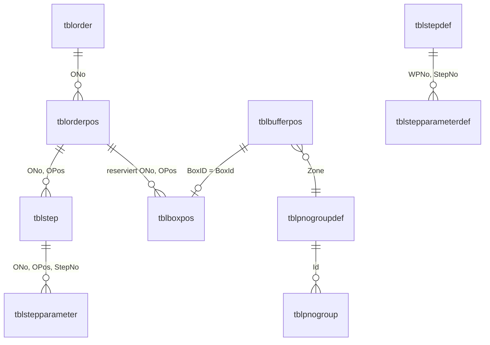

# MES-Datenmodell und Befunde

Verantwortlich: AP1. Stand: Befundregister mit wiederholbaren Prüfungen (Issue #1), geprüft gegen alle sechs Snapshots vom 09.11.2026.

Quelle ist die Datenbank `MES4` (Festo MES4, MariaDB 10.4.32, 64 Tabellen). Der Import (`python -m matsim.daten importiere`) überführt jeden Dump in eine SQLite-Datei mit 62 Tabellen; `tblcustomer` und `tblusercontrol` werden wegen personenbezogener Daten ausgeschlossen. Die Rohdateien bleiben unverändert.

Das Vorgehen folgt den Lesefragen für ein unbekanntes MES-Datenmodell aus [Kapitel 12](../12-smart-factory-mes-und-zielorientierte-prozessverbesserung.md): zuerst Definitionen, aktuelle Auftragsdaten und Historie trennen, dann Auftrag, Position und Arbeitsganginstanz unterscheiden, dann Material, Bestandseinheit und Reservierung verknüpfen.

Jeder Wert ist einer von vier Arten: **MES-Wert** (direkt gelesen), **abgeleiteter Wert** (berechnet, mit Filter), **Beobachtung** (aus dem Ablauf vom 09.11.2026) oder **Annahme** (steht in [annahmen-und-datenluecken.md](annahmen-und-datenluecken.md)).

## 1. Tabellengruppen

| Gruppe | Tabellen | Bedeutung | Historie |
|---|---|---|---|
| Stammdaten Anlage | `tblresource`, `tblbuffer`, `tblbuffertype`, `tbltopology`, `tblresourceoperation` | Stationen, Puffer, Bandverbindungen, Planzeiten je Operation | nein |
| Stammdaten Material | `tblparts`, `tblpnogroup`, `tblpnogroupdef`, `tblboxdef`, `tblcarrierdef` | Teile, Teilegruppen, Boxtyp | nein |
| Arbeitspläne | `tblworkplandef`, `tblstepdef`, `tblstepparameterdef`, `tbloperation`, `tbloperationparameter` | Schritte, Parameter und hinterlegtes SQL je Operation | nein |
| Anlagenlogik | `tblsqlquery`, `tblsqlqueryparameter` | SQL, mit dem die Stationen ihre nächste Operation suchen | nein |
| Laufende Aufträge | `tblorder`, `tblorderpos`, `tblstep`, `tblstepparameter` | Zustand offener Aufträge; Zeilen verschwinden nach Abschluss | nein, nur Zustand |
| Bestand und Belegung | `tblbox`, `tblboxpos`, `tblbufferpos`, `tblcarrier` | Boxinhalt, Pufferbelegung, Werkstückträger | nein, nur Zustand |
| Auftragshistorie | `tblfinorder`, `tblfinorderpos`, `tblfinstep`, `tblfinstepparameter` | abgeschlossene Aufträge mit Start und Ende je Schritt | ja, seit 11.06.2025 |
| Meldungen | `tblmachinereport`, `tblpartsreport` | Zustandsmeldungen der Ressourcen | ja, Bedeutung noch zu klären (L-06) |

## 2. Schlüssel und Verknüpfungen

| Objekt | Schlüssel | Verknüpfung |
|---|---|---|
| Auftrag | `ONo` | `tblorder` bzw. `tblfinorder` |
| Auftragsposition | `ONo, OPos` | ein Werkstück (Produktionsauftrag) oder ein umgesetztes Teil (Kommissionierauftrag); `WPNo` nennt den Arbeitsplan |
| Schritt | `ONo, OPos, StepNo` | `OpNo` und `ResourceID` nennen Operation und Station; in `tblfinstep` kein doppelter Schlüssel (geprüft: 0 von 14 723) |
| Boxplatz | `BoxPNo, BoxId, BoxPos` | `PNo` = Teil auf dem Platz, `ONo, OPos` = Reservierung für eine Auftragsposition |
| Pufferplatz | `ResourceId, BufNo, BufPos` | `PNo = 29` und `BoxID` = dort stehende Box; `Zone` verweist auf eine Teilegruppe; `Booked` bindet den Platz |
| Teilegruppe | `tblpnogroup.Id, PNo` | Bezeichnung in `tblpnogroupdef` |



## 3. Zählregeln

1. **Teilebestand nur aus `tblboxpos`:** ein Boxplatz mit `PNo > 0` ist genau ein Teil.
2. **Boxbestand nur aus `tblbufferpos`:** eine Zeile mit `BoxID > 0` ist eine verortete Box. Die Box selbst (PNo 29) ist kein Teilebestand.
3. **Reservierung ist kein Bestand:** `ONo <> 0` auf einem Boxplatz bindet ihn. Ist zugleich `PNo = 0`, ist es ein reservierter leerer Zielplatz.
4. **Frei** ist ein Teil nur mit `ONo = 0` und in einer verorteten Box (Befund B-10).
5. **Ein Ort je Box:** Steht eine Box auf mehreren Pufferplätzen, gilt der Platz mit dem jüngsten `TimeStamp` (Befund B-11). Die Rohdaten bleiben unverändert.
6. **Kreislauf:** Eine Box an einem Handarbeitsplatz (AASS1/AASS2, Ressourcen 26 und 27) zählt nicht als Transportbox, ihr Inhalt nicht als Startbestand.

Umgesetzt in `src/matsim/daten/bestand.py` (`teilebestand`, `boxstandort_aufgeloest`, `startbestand`), geprüft in `tests/test_dump_import.py` und `tests/test_bestand.py`. Mit `python -m matsim.daten bestand <Snapshot>` werden alle Zählungen ausgegeben.

## 4. Befundregister

Jede Prüfung ist eine Funktion in [`src/matsim/daten/qualitaet.py`](../src/matsim/daten/qualitaet.py) und läuft mit

```text
.venv\Scripts\python -m matsim.daten qualitaet                    # Snapshot 15:57
.venv\Scripts\python -m matsim.daten qualitaet 2026-11-09_1516    # anderer Snapshot
```

Die Zahlen unten stammen aus dem Snapshot 15:57 und sind in `tests/test_qualitaet.py` festgeschrieben. „Geprüft“ ist der Prüfumfang, „auffällig“ die Datensätze, auf die die jeweils genannte Regel zutrifft. „Abgleich“ vergleicht mit dem Startwissen aus dem Projektauftrag.

### 4.1 Übersicht

| Nr. | Befund | geprüft | auffällig | Anteil | Abgleich |
|---|---|---:|---:|---:|---|
| B-01 | Ressourcen der Schritthistorie | 14 723 Schritte | 0 | 0,0 % | bestätigt, ergänzt |
| B-02 | Bandtopologie | 19 Kanten | 5 | 26,3 % | weicht ab |
| B-03 | Plätze je Box | 40 Boxen | 0 | 0,0 % | bestätigt |
| B-04 | Stückliste WPNo 1000 | 5 Montageschritte | 0 | 0,0 % | bestätigt |
| B-05 | Zonen der Box-Pufferplätze | 6 Pufferplätze | 6 | 100,0 % | weicht ab |
| B-06 | Kommissionier-Arbeitspläne | 1 498 Schritte | 0 | 0,0 % | bestätigt |
| B-07 | Montage mit nachweisbarem Materialpfad | 572 Montageschritte | 9 | 1,6 % | neu |
| B-08 | Ablauf vom 09.11.2026 | 18 Positionen | 0 | 0,0 % | bestätigt, ergänzt |
| B-09 | Boxen mit bekanntem Ort | 40 Boxen | 19 | 47,5 % | bestätigt |
| B-10 | Teile in Boxen ohne Ort | 71 Teile | 15 | 21,1 % | neu |
| B-11 | Boxen an mehr als einem Ort | 21 Boxen | 1 | 4,8 % | neu |
| B-12 | Bindungen ohne laufenden Auftrag | 31 Bindungen | 31 | 100,0 % | bestätigt, ergänzt |
| B-13 | Filter der Zeitansätze | 1 701 Schritte | 104 | 6,1 % | bestätigt |
| B-14 | Ende letzter Pick bis Ablieferung | 229 Aufträge | 21 | 9,2 % | weicht ab |
| B-15 | Positionen je Kommissionierauftrag | 229 Aufträge | 11 | 4,8 % | bestätigt |
| B-16 | Fehlende Zeitstempel | 14 723 Schritte | 2 645 | 18,0 % | bestätigt, ergänzt |
| B-17 | Nicht gepflegte Felder | 40 Boxen | 40 | 100,0 % | bestätigt |
| B-18 | Planzeit gegen Istzeit | 4 Operationen | 3 | 75,0 % | neu |
| B-19 | Montagepriorität im MES | 1 Abfrage | 0 | 0,0 % | neu |
| B-20 | Picks ohne Produktionsposition | 749 Picks | 176 | 23,5 % | neu |
| B-21 | Nutzung der Boxen ohne Ort | 19 Boxen | 0 | 0,0 % | neu |

### 4.2 Befunde im Einzelnen

**B-01 Ressourcen der Schritthistorie**
- Prüfung: Jede `ResourceID` in `tblfinstep` muss in `tblresource` stehen (`b01_ressourcen`).
- Ergebnis: 14 723 Schritte geprüft, 0 auffällig (0,0 %).
- Beispiel: Zusätzlich zum Startwissen gibt es die Ressourcen 8 (iPICK), 9, 10, 12, 13, 16 (manuelle Plätze) und 18 (mobile Workstation mit eigenen AGV-Puffern).
- Umgang: keine Bereinigung nötig.
- Modellfolge: Produktionsabschnitt = RASS1 bis RASS3 (Ressourcen 2, 4, 6), Kommissionierung 19, Boxlager 17, Robotinos 20 bis 25; andere Stationen nur als Durchlauf.

**B-02 Bandtopologie**
- Prüfung: `tbltopology` hat 20 Zeilen, davon eine Leerzeile 0→0. Auffällig ist eine Kante, die an einer Weiche (mehr als ein Ausgang) beginnt (`b02_topologie`).
- Ergebnis: 19 Kanten, 5 auffällig (26,3 %).
- Beispiel: Station 10 hat drei Ausgänge (1, 8, 11), Station 1 zwei (8, 14). Die Montagestationen liegen in der geschlossenen Schleife 10→11→12→13→2→3→4→5→6→7→10.
- Umgang: Topologie wird aus der Datei übernommen (D-08).
- Modellfolge: Ein Werkstück ohne Material kann die Schleife erneut durchlaufen (A-01).

**B-03 Plätze je Box**
- Prüfung: Jede Box in `tblbox` hat in `tblboxpos` genau `tblboxdef.PosCount` = 8 Plätze (`b03_boxplaetze`).
- Ergebnis: 40 Boxen, 0 auffällig (0,0 %); `tblboxpos` hat 320 = 40 × 8 Zeilen.
- Beispiel: Boxtyp PNo 29, 4 Reihen zu je 2 Plätzen.
- Umgang: keiner nötig.
- Modellfolge: Boxkapazität 8 Teile.

**B-04 Stückliste WPNo 1000**
- Prüfung: Das Teil jedes Montageschritts (Parameter 3, bei OpNo 324 Parameter 4) gehört zur Materialgruppe seiner Station (`b04_stueckliste`).
- Ergebnis: 5 Montageschritte, 0 auffällig (0,0 %).
- Beispiel: Schritt 30: 800, 60: 814 (RASS1); 100: 813, 110: 811 (RASS2); 160: 831 (RASS3).
- Umgang: Andere Produktvarianten haben andere Sätze, z. B. WPNo 1003 an RASS1 nur 800, WPNo 1004 an RASS2 nur 812. Am 09.11.2026 lief nur WPNo 1000.
- Modellfolge: Materialsätze in `config/anlage.yaml` gelten für WPNo 1000.

**B-05 Zonen der Box-Pufferplätze**
- Prüfung: Die `Zone` der Box-Pufferplätze an RASS1 bis RASS3 sollte laut Startwissen die Materialgruppe der Station sein (`b05_zonen`).
- Ergebnis: 6 Pufferplätze, 6 auffällig (100,0 %).
- Beispiel: Alle tragen Zone 7 („Boxes“ = {21, 29}); alle 320 Boxplätze tragen `PNoGroup` 9 („Box content“).
- Umgang: Die Zone beschränkt den Boxtyp, nicht den Inhalt. Sie wird nicht als Inhaltssperre ausgewertet (D-09).
- Modellfolge: Stationsreinheit folgt aus dem Materialpfad (Abschnitt 5), nicht aus Zonen.

**B-06 Kommissionier-Arbeitspläne**
- Prüfung: Jeder Pick (WPNo 1, 2, 3, Schritt 10) läuft an Ressource 19, jede Ablieferung (Schritt 20) an der Station seines Arbeitsplans: WPNo 1 → 2, 2 → 4, 3 → 6 (`b06_kommissionierplaene`).
- Ergebnis: 749 Picks und 749 Ablieferungsschritte, 0 auffällig (0,0 %).
- Beispiel: 9177/1 Schritt 10 an 19, Schritt 20 an 2.
- Umgang: keiner nötig.
- Modellfolge: Prozesskette Kommissionierung → Ablieferung an genau einer Station.

**B-07 Montage mit nachweisbarem Materialpfad**
- Prüfung: Für jeden Montageschritt (OpNo 323 bis 325, mit Start und Ende, ohne Fehler) gibt es einen Pick, dessen Parameter 8/9/10 genau diesen Auftrag, diese Position und diesen Schritt nennen (`b07_montage_ohne_pick`).
- Ergebnis: 572 Montageschritte, 9 ohne Pick (1,6 %).
- Beispiel: 8251/1 Schritt 20, OpNo 325 am 26.06.2025.
- Umgang: Ursache nicht belegt; vermutlich von Hand befüllte Box. Die Schritte bleiben in den Zeitansätzen.
- Modellfolge: In der Simulation kommt jedes Teil über die Kommissionierung zur Station.

**B-08 Ablauf vom 09.11.2026**
- Prüfung: Alle Positionen der Aufträge 9176 bis 9180 haben Start, Ende und Zustand 100 (`b08_ablauf_0911`).
- Ergebnis: 18 Positionen, 0 auffällig (0,0 %).
- Beispiel: Reihenfolge an RASS1 war 9178/2, 9176/1, 9178/1, nicht die Auslagerreihenfolge 9176/1, 9178/1, 9178/2.
- Umgang: vollständige Stichprobe in [stichprobe-auftrag-9178.md](stichprobe-auftrag-9178.md).
- Modellfolge: Referenzfall V0; Werkstücke warten bzw. kreisen, bis ihr Material da ist.

**B-09 Boxen mit bekanntem Ort**
- Prüfung: Jede Box aus `tblbox` steht auf einem Pufferplatz (`tblbufferpos.BoxID`) (`b09_verortete_boxen`).
- Ergebnis: 40 Boxen, 19 ohne Ort (47,5 %), in allen sechs Snapshots gleich.
- Beispiel: Boxen 1, 6 bis 10, 14, 16, 19, 23 bis 25, 28, 29, 31, 33, 35 bis 37.
- Umgang: Die Zahl ist in allen sechs Snapshots gleich, ein Effekt des Exportzeitpunkts scheidet damit aus. Keine der 19 Boxen war seit dem 30.10.2026 Quell- oder Zielbox eines Picks, fünf nie (B-21). Sie stehen auch an keinem Handarbeitsplatz und an keiner mobilen Workstation. Wahrscheinlich sind sie außerhalb der Anlage; belegen lässt sich das nur durch eine Zählung im Labor (L-08).
- Modellfolge: In die Simulation gehen nur die 21 verorteten Boxen (A-03): 7 leere Transportboxen, 13 Quellboxen mit Teilen, Box 38 am Handarbeitsplatz bleibt außen vor.

**B-10 Teile in Boxen ohne Ort**
- Prüfung: Teile in `tblboxpos`, deren Box auf keinem Pufferplatz steht (`b10_teile_ohne_ort`).
- Ergebnis: 71 Teile in Boxen, 15 davon in Boxen ohne Ort (21,1 %); im Snapshot 15:16 86 und 15 (17,4 %).
- Beispiel: Boxen 1, 14, 19, 23; 800: 5, 814: 9, 832: 1.
- Umgang: nicht löschen, aber nicht als verfügbaren Bestand zählen.
- Modellfolge: Anfangsbestand nur aus verorteten Boxen (A-02).

**B-11 Boxen an mehr als einem Ort**
- Prüfung: Eine verortete Box steht auf genau einem Pufferplatz (`b11_doppelt_verortet`).
- Ergebnis: 21 Boxen, 1 auffällig (4,8 %), nur im Snapshot 15:57; in den anderen fünf 0.
- Beispiel: Box 11 auf Robotino 24 (24/1/1, Zeitstempel 15:50:55) und im Lager (17/1/14, Zeitstempel 15:57:09).
- Umgang: Robotino 24 hat Box 11 um 15:50:55 an RASS3 aufgenommen (RASS3-Platz 6/1/1 wird zur selben Sekunde frei), sein letzter Fahrauftrag endet um 15:55:27 (`tblmachinereport`), um 15:57:09 bucht das Boxlager die Box ein. Der Robotino-Platz wurde nicht zurückgesetzt. In den anderen Snapshots werden Robotino-Plätze nach der Übergabe geleert (z. B. Robotino 25: 15:22 Box 3, 15:25 leer). Rohdaten bleiben unverändert; es gilt der jüngste Zeitstempel (Zählregel 5), Box 11 steht also im Lager.
- Modellfolge: keine; jede Box wird genau einmal gezählt.

**B-12 Bindungen ohne laufenden Auftrag**
- Prüfung: Jede Reservierung (`ONo <> 0` in `tblboxpos`, `tblbufferpos`, `tblcarrier`), jede Zeile in `tblstepparameter` und jede Buchung (`Booked = 1`) gehört zu einem Auftrag in `tblorder` (`b12_bindungen_ohne_auftrag`).
- Ergebnis: Im Snapshot 15:57 ist `tblorder` leer, deshalb sind alle 31 Bindungen auffällig (100 %): 26 Zeilen `tblstepparameter` (ONo 1 und 7963) und 5 gebuchte Plätze an Ressource 19. Im Snapshot 15:16: 309 Bindungen, 30 auffällig (9,7 %).
- Beispiel: 19/6/1 ist seit 21.10.2025 gebucht; Band 6 hat laut `tblbuffer` 0 Reihen und 0 Spalten und ist damit abgeschaltet.
- Umgang: Gebucht ist immer Platz 1 eines Bandes; die Kennzeichen an Band 2 und 4 stehen seit 15:02:18 (Produktionsstart), an Band 6 seit 21.10.2025, und keines wird nach Produktionsende zurückgesetzt. Das Kennzeichen beschreibt die Belegung damit nicht verlässlich. Gleichzeitig standen an der Kommissionierstation bis zu drei Boxen (15:25: Zielbox 18 und Quellboxen 3 und 4). Gebuchte Plätze werden nicht ausgewertet (L-05).
- Modellfolge: Kapazität des Kommissionierplatzes kommt aus der Historie (eine Charge zur Zeit, A-04), nicht aus den Buchungskennzeichen.

**B-13 Filter der Zeitansätze**
- Prüfung: Schritte der sechs Zeitvorgänge in `config/anlage.yaml` ohne Start oder Ende oder mit `ErrorRetVal <> 0` fließen nicht in die Zeiten ein (`b13_zeitfilter`).
- Ergebnis: 1 701 Schritte, 104 verworfen (6,1 %). OpNo 324: 81 von 294 (27,6 %), alle ohne Start und Ende, also nicht ausgeführte Schritte.
- Beispiel: verworfen je OpNo: 220: 1, 323: 11, 324: 81, 325: 4, 212: 4, 211: 3.
- Umgang: Filter wie in `matsim.daten.zeiten.schrittdauern`.
- Modellfolge: Festwerte = Median der gefilterten Schritte (Abschnitt 6).

**B-14 Ende letzter Pick bis Ablieferung**
- Prüfung: Dauer vom Ende des letzten Picks bis zum Ende der Ablieferung (OpNo 215) je Kommissionierauftrag. Auffällig ist ein Wert über der äußeren Tukey-Grenze Q3 + 3 · IQR (`b14_transportzeit`).
- Ergebnis: 229 Aufträge, 21 über 378 s (9,2 %).
- Beispiel: größte Werte 3 736 s, 6 886 s, 7 477 s.
- Umgang: Der Median ist gegen diese Werte robust. Für Verteilungen werden sie als Störung entfernt (Issue #3).
- Modellfolge: Kein reiner Fahrzeitwert, enthält Warten auf ein Fahrzeug (L-03).

**B-15 Positionen je Kommissionierauftrag**
- Prüfung: Ein Auftrag für RASS1 oder RASS2 enthält eine gerade Teilezahl (ganze Sätze), kein Auftrag mehr als 8 Teile (`b15_buendelung`).
- Ergebnis: 229 Aufträge, 11 auffällig (4,8 %), alle wegen ungerader Teilezahl; keiner über 8.
- Beispiel: 8428 (WPNo 1, 3 Teile), 8666 (WPNo 1, 1 Teil). Ursache sind Produktvarianten mit nur einem Teil an der Station (B-04).
- Umgang: keiner.
- Modellfolge: höchstens 8 Teile je Box bestätigt. Verteilung der Positionen siehe Abschnitt 5.

**B-16 Fehlende Zeitstempel und Fehlercodes**
- Prüfung: Schritte ohne Start und ohne Ende (`b16_fehlende_zeiten`).
- Ergebnis: 14 723 Schritte, 2 645 auffällig (18,0 %). Zusätzlich 142 Schritte mit `ErrorRetVal <> 0` (1,0 %) und 436 von 1 351 Positionen ohne Start (32,3 %).
- Beispiel: 9093/1 Schritte 40 und 50 (RASS1 „switch on pcb“, „read QR“) ohne Start und Ende; die Aufträge 9176 bis 9180 haben keinen solchen Schritt.
- Umgang: vor jeder Zeitauswertung filtern (B-13).
- Modellfolge: keine.

**B-17 Nicht gepflegte Felder**
- Prüfung: `tblbox.ONo` und `tblbox.Full` sind 0, obwohl Boxen belegt und reserviert sind (`b17_ungepflegt`).
- Ergebnis: 40 Boxen, 40 auffällig (100 %).
- Beispiel: Box 11 ist um 15:16 mit 6 Teilen für 9177 belegt, `tblbox` zeigt `ONo = 0`, `Full = 0`. In `tblparts` haben alle 87 Teile `SafetyStock = 0` und `LotSize = 0`; `tblautomaticorder` ist leer.
- Umgang: Felder werden nicht verwendet. Boxbelegung nur aus `tblboxpos`.
- Modellfolge: keine Losgrößen- oder Mindestbestandsvorgabe aus dem MES.

**B-18 Planzeit gegen Istzeit**
- Prüfung: Median der Istzeit weicht mehr als 20 % von `tblresourceoperation.WorkingTime` ab (`b18_plan_ist`).
- Ergebnis: 4 Operationen, 3 auffällig (75 %).
- Beispiel: OpNo 220: Plan 20 s, Ist 23 s; 323: 5 / 37 s; 324: 10 / 39 s; 325: 5 / 24 s.
- Umgang: Stammdatenzeiten werden nicht verwendet.
- Modellfolge: Istzeiten aus der Historie.

**B-19 Montagepriorität im MES**
- Prüfung: Die Abfrage `tblsqlquery` 100/1 (`GetOpForRsc`) hat eine feste Sortierung (`b19_montageprioritaet`).
- Ergebnis: 1 Abfrage, 0 auffällig.
- Beispiel: `ORDER BY tblOrderPos.PlannedStart, tblOrderPos.ONo, tblOrderPos.OPos`, nur Positionen mit `State < 10` und freigegebenem Auftrag.
- Umgang: keiner.
- Modellfolge: Kandidat für die Referenzregel Montagepriorität (L-01).

**B-20 Picks ohne Produktionsposition**
- Prüfung: Der Produktionsbezug eines Picks (Parameter 8/9) zeigt auf eine Position in `tblfinorderpos` (`b20_pick_ohne_produktionsposition`).
- Ergebnis: 749 Picks, 176 auffällig (23,5 %). Sie gehören zu 23 Produktionsaufträgen, die weder in `tblfinorder` noch in `tblfinorderpos` stehen (18.06.2025 bis 03.11.2026).
- Beispiel: Produktionsaufträge 8232, 8317, 8367, 8511, 8539.
- Umgang: Diese Picks zählen für die Kommissionierzeit. Für Aussagen über Satzvollständigkeit je Produkt werden sie nicht verwendet.
- Modellfolge: Die Historie der Produktionsaufträge ist unvollständig, vermutlich gelöschte oder abgebrochene Aufträge. Bedarfsmuster lassen sich daraus nicht ableiten (L-09).

**B-21 Nutzung der Boxen ohne Ort**
- Prüfung: Eine Box ohne Ort (B-09) war am Tag des Snapshots Quell- oder Zielbox eines Picks (Parameter 3 bzw. 6 von OpNo 220) (`b21_boxen_ohne_ort_genutzt`).
- Ergebnis: 19 Boxen, 0 auffällig (0,0 %).
- Beispiel: Jüngste Nutzung 30.10.2026 (Boxen 14 und 19), nie genutzt: Boxen 1, 28, 31, 35, 37.
- Umgang: stützt die Annahme, dass diese Boxen außerhalb der Anlage sind (L-08).
- Modellfolge: Boxen ohne Ort und ihre 15 Teile gehen nicht in den Basisfall (A-02, A-03).

### 4.3 Stichprobe und Live-Zugriff

- Stichprobe von Hand: Auftrag 9178 vom Auslagern bis zum Einlagern, mit Abgleich gegen alle sechs Snapshots, in [stichprobe-auftrag-9178.md](stichprobe-auftrag-9178.md). Wiederholbar mit `python -m matsim.daten stichprobe 9178`.
- Live-Zugriff: Der Befehl `python -m matsim.daten live-vergleich` vergleicht die Zeilenzahlen von 17 Tabellen der Live-Datenbank mit einem Snapshot. Er führt nur `SELECT COUNT(*)` aus und ist im Labornetz noch nicht gelaufen (L-10).

## 5. Materialpfad und zulässige Kombinationen

Aus B-05 bis B-07 folgt:

1. Ein Kommissionierauftrag hat genau einen Arbeitsplan (WPNo 1, 2 oder 3) und damit genau eine Zielstation. Seine Teileauswahl ist auf die Gruppe der Station begrenzt (Parameter 11: Gruppe 5, 6 bzw. 12).
2. Alle Positionen eines Kommissionierauftrags werden in dieselbe Zielbox umgesetzt und mit OpNo 215 gemeinsam an der Station abgeliefert (beobachtet: Box 11 für 9177, Box 18 für 9179, Box 11 für 9180).
3. Die Montage findet ein Teil nur in einer Box am Puffer der eigenen Station.

Eine Box mit Sätzen verschiedener Stationen wäre technisch befüllbar (alle Boxplätze haben Gruppe 9), aber die Sätze der fremden Station könnten dort nicht verbaut werden. **Abgeleitete Regel:** Eine Charge enthält nur Sätze einer Station. Rechnerische Obergrenzen je Box: 4 RASS1-Sätze, 4 RASS2-Sätze, 8 RASS3-Sätze. Die Regel ist abgeleitet, nicht als MES-Sperre hinterlegt (A-06).

## 6. Zeitansätze aus der Historie

Zeitraum 11.06.2025 bis 09.11.2026, 552 abgeschlossene Aufträge. Dauer = `End` minus `Start` je Schritt. Nach [Kapitel 12](../12-smart-factory-mes-und-zielorientierte-prozessverbesserung.md), Abschnitt „Historische Istzeiten als Rückfluss“, werden Median und Quantile statt des Mittelwerts verwendet, weil einzelne Störungen den Mittelwert verzerren.

| Vorgang | Schritte gesamt | n nach Filter | Median | Mittel | q10 / q90 | Maximum |
|---|---:|---:|---:|---:|---:|---:|
| Kommissionieren je Teil (OpNo 220, Ressource 19) | 749 | 748 | 23 s | 30,7 s | 21 / 25 s | 1051 s |
| Montage RASS1 je Teil (OpNo 323, Ressource 2) | 247 | 236 | 37 s | 51,4 s | 25 / 41 s | 1197 s |
| Montage RASS2 je Teil (OpNo 324, Ressource 4) | 294 | 213 | 39 s | 43,6 s | 25 / 40 s | 1258 s |
| Montage RASS3 je Teil (OpNo 325, Ressource 6) | 127 | 123 | 24 s | 28,1 s | 24 / 27 s | 130 s |
| Auslagern ASRS32 (OpNo 212, Ressource 1) | 136 | 132 | 16 s | 15,9 s | 14 / 17 s | 19 s |
| Einlagern ASRS32 (OpNo 211, Ressource 1) | 148 | 145 | 15 s | 14,8 s | 13 / 17 s | 19 s |

Die Montagedauer je Teil ist bimodal (q10 = 25 s, Median 37 bis 39 s). Am 09.11.2026 dauerte das erste Teil eines Satzes rund 37 bis 40 s, das zweite rund 25 s. Ob das an der Operation oder am Teil liegt, klärt AP1.

## 7. Bestand je Snapshot

Teile in Boxen laut `tblboxpos`, frei / reserviert:

| Teil | 15:16 | 15:22 | 15:25 | 15:36 | 15:41 | 15:57 |
|---|---|---|---|---|---|---|
| 800 | 9 / 3 | 9 / 1 | 9 / 0 | 9 / 0 | 9 / 0 | 9 / 0 |
| 814 | 13 / 3 | 13 / 1 | 13 / 0 | 13 / 0 | 13 / 0 | 13 / 0 |
| 811 | 8 / 0 | 5 / 3 | 5 / 3 | 5 / 3 | 5 / 1 | 5 / 0 |
| 813 | 8 / 0 | 5 / 3 | 5 / 3 | 5 / 2 | 5 / 0 | 5 / 0 |
| 831 | 8 / 0 | 8 / 0 | 8 / 0 | 5 / 3 | 5 / 3 | 5 / 0 |
| 812, 832, 833, 834 | 9, 9, 7, 9 frei | unverändert | unverändert | unverändert | unverändert | unverändert |

Der Verbrauch von je 3 Stück der Teile 800, 814, 811, 813 und 831 passt zu 3 gefertigten Produkten. Die Summe aus frei und reserviert sinkt nur durch Montage. Reservierte leere Zielplätze: 15:22 sechs Plätze in Box 18 für ONo 9179, 15:25 vier, 15:36 drei Plätze in Box 11 für ONo 9180, 15:41 einer.

Sechs Momentaufnahmen sind keine Bestandshistorie. Zwischen zwei Snapshots lassen sich die Bewegungen aber vollständig aus der Schritthistorie ablesen:

### 7.1 Abgleich Schritthistorie gegen Snapshots

Jeder Pick (OpNo 220) nennt in seinen Parametern Quellbox und -platz, Zielbox und -platz und das Teil (Abschnitt 5). Jede Montage leert den Platz, den der Pick für genau diesen Auftrag, diese Position und diesen Schritt belegt hat. `matsim.daten.materialpfad.abgleich` schreibt den Boxinhalt (`tblboxpos.PNo` je Platz) von Snapshot A mit allen Picks und Montagen bis zum Export von Snapshot B fort und vergleicht ihn mit B. Exportzeitpunkt = jüngster Zeitstempel im Snapshot.

```text
.venv\Scripts\python -m matsim.daten abgleich 2026-11-09_1516 2026-11-09_1522
```

| A → B | Export A | Export B | Picks | Montagen | abweichende Boxplätze von 320 |
|---|---|---|---:|---:|---:|
| 15:16 → 15:22 | 15:16:35 | 15:22:21 | 0 | 4 | 0 |
| 15:22 → 15:25 | 15:22:21 | 15:25:11 | 2 | 2 | 0 |
| 15:25 → 15:36 | 15:25:11 | 15:36:43 | 4 | 1 | 0 |
| 15:36 → 15:41 | 15:36:43 | 15:41:01 | 2 | 4 | 0 |
| 15:41 → 15:57 | 15:41:01 | 15:57:39 | 1 | 4 | 0 |

Ergebnis: Jede Inhaltsänderung zwischen zwei Snapshots ist durch einen Pick oder eine Montage erklärt (zusammen 9 Picks und 15 Montagen, also 3 Produkte mit je 5 Teilen; die übrigen 6 Picks lagen vor 15:16); es verschwindet kein Teil und es taucht keines auf. Die Abweichungen beim Boxbestand sind damit keine verlorenen Bewegungen: B-09 und B-10 bestehen schon vor dem Ablauf, B-11 betrifft nur die Pufferbelegung, nicht den Boxinhalt. Geprüft in `tests/test_bestand.py`.

### 7.2 Startbestand für die Simulation

Quelle: Snapshot 15:57 (Ruhezustand nach Produktionsende, keine Reservierungen, keine Box unterwegs), Zählregeln aus Abschnitt 3, Funktion `matsim.daten.bestand.startbestand`.

| Größe | Wert | Begründung |
|---|---:|---|
| Boxen laut Stammdaten | 40 | `tblboxdef.Count` |
| Boxen ohne Ort | 19 | nicht in der Simulation (B-09, B-21) |
| verortete Boxen | 21 | jede genau einmal (Zählregel 5) |
| davon leere Transportboxen | 7 | Boxen 2, 4, 11, 15, 18, 34, 39 |
| davon Quellboxen mit Teilen | 13 | Inhalt = Anfangsbestand |
| davon am Handarbeitsplatz | 1 | Box 38 an AASS1, leer, seit 12.03.2026 nicht kommissioniert |
| freie Teile | 800: 4, 811: 5, 812: 9, 813: 5, 814: 4, 831: 5, 832: 8, 833: 7, 834: 9 | `ONo = 0`, verortete Box im Kreislauf |
| Teile in Boxen ohne Ort | 800: 5, 814: 9, 832: 1 | nur Sensitivität (A-02) |
| vollständige Produkte WPNo 1000 aus dem Bestand | 4 | begrenzt durch 800 und 814 (L-11) |

Die Werte stehen mit Herkunft in `config/anlage.yaml` (`box`, `materiallager`) und werden in `tests/test_bestand.py` gegen den Snapshot geprüft.
