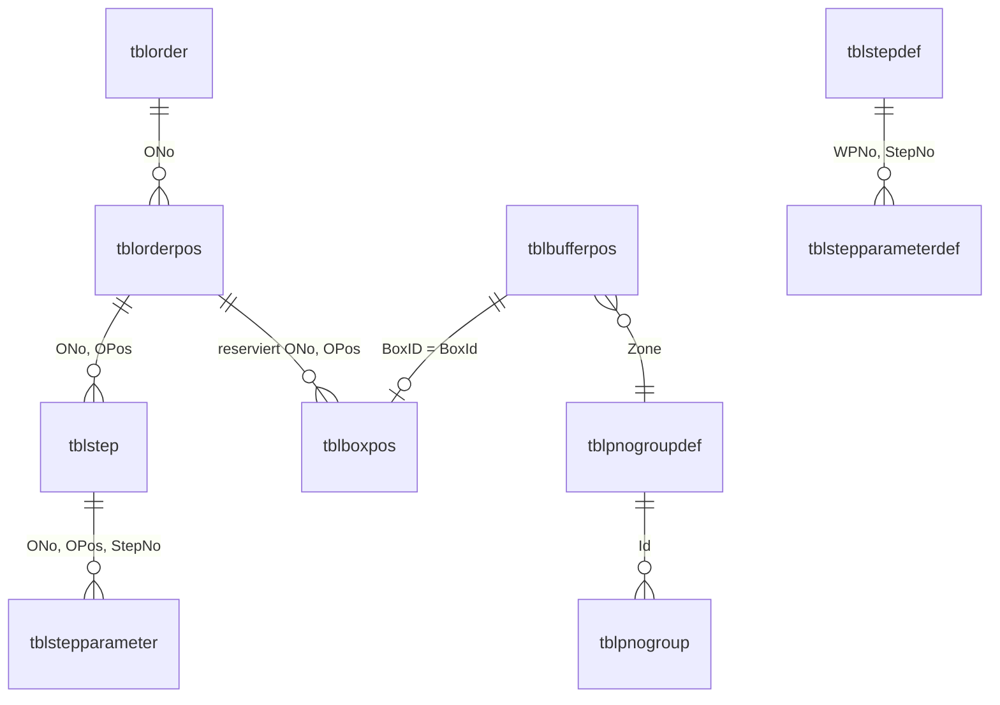

# MES-Datenmodell und Befunde

Verantwortlich: AP1. Stand: erster Abgleich des Startwissens gegen alle sechs Snapshots vom 09.11.2026.

Quelle ist die Datenbank `MES4` (Festo MES4, MariaDB 10.4.32, 64 Tabellen). Der Import (`python -m matsim.daten importiere`) überführt jeden Dump in eine SQLite-Datei mit 62 Tabellen; `tblcustomer` und `tblusercontrol` werden wegen personenbezogener Daten ausgeschlossen. Die Rohdateien bleiben unverändert.

Das Vorgehen folgt den Lesefragen für ein unbekanntes MES-Datenmodell aus [Kapitel 12](../12-smart-factory-mes-und-zielorientierte-prozessverbesserung.md): zuerst Definitionen, aktuelle Auftragsdaten und Historie trennen, dann Auftrag, Position und Arbeitsganginstanz unterscheiden, dann Material, Bestandseinheit und Reservierung verknüpfen.

Jeder Wert ist einer von vier Arten: **MES-Wert** (direkt gelesen), **abgeleiteter Wert** (berechnet, mit Filter), **Beobachtung** (aus dem Ablauf vom 09.11.2026) oder **Annahme** (steht in [annahmen-und-datenluecken.md](annahmen-und-datenluecken.md)).

## 1. Tabellengruppen

| Gruppe | Tabellen | Bedeutung | Historie |
|---|---|---|---|
| Stammdaten Anlage | `tblresource`, `tblbuffer`, `tblbuffertype`, `tbltopology`, `tblresourceoperation` | Stationen, Puffer, Bandverbindungen, Planzeiten je Operation | nein |
| Stammdaten Material | `tblparts`, `tblpnogroup`, `tblpnogroupdef`, `tblboxdef`, `tblcarrierdef` | Teile, Teilegruppen, Boxtyp | nein |
| Arbeitspläne | `tblworkplandef`, `tblstepdef`, `tblstepparameterdef`, `tbloperation`, `tbloperationparameter` | Schritte, Parameter und hinterlegtes SQL je Operation | nein |
| Anlagenlogik | `tblsqlquery`, `tblsqlqueryparameter` | SQL, mit dem die Stationen ihre nächste Operation suchen | nein |
| Laufende Aufträge | `tblorder`, `tblorderpos`, `tblstep`, `tblstepparameter` | Zustand offener Aufträge; Zeilen verschwinden nach Abschluss | nein, nur Zustand |
| Bestand und Belegung | `tblbox`, `tblboxpos`, `tblbufferpos`, `tblcarrier` | Boxinhalt, Pufferbelegung, Werkstückträger | nein, nur Zustand |
| Auftragshistorie | `tblfinorder`, `tblfinorderpos`, `tblfinstep`, `tblfinstepparameter` | abgeschlossene Aufträge mit Start und Ende je Schritt | ja, seit 11.06.2025 |
| Meldungen | `tblmachinereport`, `tblpartsreport` | Zustandsmeldungen der Ressourcen | ja, Bedeutung noch zu klären (L-06) |

## 2. Schlüssel und Verknüpfungen

| Objekt | Schlüssel | Verknüpfung |
|---|---|---|
| Auftrag | `ONo` | `tblorder` bzw. `tblfinorder` |
| Auftragsposition | `ONo, OPos` | ein Werkstück (Produktionsauftrag) oder ein umgesetztes Teil (Kommissionierauftrag); `WPNo` nennt den Arbeitsplan |
| Schritt | `ONo, OPos, StepNo` | `OpNo` und `ResourceID` nennen Operation und Station; in `tblfinstep` kein doppelter Schlüssel (geprüft: 0 von 14 723) |
| Boxplatz | `BoxPNo, BoxId, BoxPos` | `PNo` = Teil auf dem Platz, `ONo, OPos` = Reservierung für eine Auftragsposition |
| Pufferplatz | `ResourceId, BufNo, BufPos` | `PNo = 29` und `BoxID` = dort stehende Box; `Zone` verweist auf eine Teilegruppe; `Booked` bindet den Platz |
| Teilegruppe | `tblpnogroup.Id, PNo` | Bezeichnung in `tblpnogroupdef` |

## 3. Zählregeln

1. **Teilebestand nur aus `tblboxpos`:** ein Boxplatz mit `PNo > 0` ist genau ein Teil.
2. **Boxbestand nur aus `tblbufferpos`:** eine Zeile mit `BoxID > 0` ist eine verortete Box. Die Box selbst (PNo 29) ist kein Teilebestand.
3. **Reservierung ist kein Bestand:** `ONo <> 0` auf einem Boxplatz bindet ihn. Ist zugleich `PNo = 0`, ist es ein reservierter leerer Zielplatz.
4. **Frei** ist ein Teil nur mit `ONo = 0` und in einer verorteten Box (Befund B-10).

Umgesetzt in `src/matsim/daten/bestand.py`, geprüft in `tests/test_dump_import.py`.

## 4. Befundregister

Spalte „Abgleich“: Ergebnis gegenüber dem Startwissen aus dem Projektauftrag. Prüfabfragen liegen als Funktionen in `src/matsim/daten/` oder sind hier als SQL genannt.

| Nr. | Befund | Prüfregel und Umfang | Ergebnis | Abgleich | Modellfolge |
|---|---|---|---|---|---|
| B-01 | Anlage | `tblresource`, 28 Zeilen | Rollen der Ressourcen 1 bis 27 wie im Startwissen. Zusätzlich vorhanden: 8 iPICK, 9/10/12/13/16 manuelle Arbeitsplätze, 18 mobile Workstation mit eigenen AGV-Puffern | bestätigt, ergänzt | Produktionsabschnitt = RASS1 bis RASS3; andere Stationen nur als Durchlauf |
| B-02 | Bandtopologie | `tbltopology`, 20 Kanten | innere Schleife 10→11→12→13→2→3→4→5→6→7→10; von 10 zusätzlich nach 1 und 8; von 1 nach 8 und 14; 14→15→16→1 | weicht ab: Station 10 hat drei Ausgänge, nicht zwei; die Montagestationen liegen in einer geschlossenen Schleife | Werkstück ohne Material kann die Schleife erneut durchlaufen (A-01) |
| B-03 | Boxtyp | `tblboxdef`, 1 Zeile | PNo 29, 40 Boxen, 8 Positionen, 4 Reihen; `tblboxpos` 320 Zeilen | bestätigt | Boxkapazität 8 Positionen |
| B-04 | Stückliste WPNo 1000 | `tblstepdef` und `tblstepparameterdef`, 30 Schritte | RASS1: 800 + 814; RASS2: 813 + 811; RASS3: 831; Basisteil 821 aus ASRS32 | bestätigt | Materialsätze in `config/anlage.yaml` |
| B-05 | Zulässige Inhalte | `tblpnogroup`, `tblbufferpos.Zone`, `tblboxpos.PNoGroup` | Gruppen 5, 6, 12 wie im Startwissen. Aber: **alle** Box-Pufferplätze tragen Zone 7 („Boxes“ = {21, 29}), **alle** 320 Boxplätze tragen PNoGroup 9 („Box content“) | weicht ab: die Zone beschränkt den Boxtyp, nicht den Boxinhalt | Stationsreinheit folgt nicht aus Zonen, sondern aus dem Materialpfad (Abschnitt 5) |
| B-06 | Kommissionier-Arbeitspläne | `tblstepdef` WPNo 1, 2, 3 | je Schritt 10 = OpNo 220 an Ressource 19, Schritt 20 = OpNo 215 an Ressource 2, 4, 6; Parameter 3/4, 6/7, 8/9/10, 11 wie im Startwissen | bestätigt | Prozesskette Kommissionierung → Ablieferung |
| B-07 | Montage und Verbrauch | SQL in `tblstepparameterdef` 1000/30 und `tbloperation` 323 bis 325 | Teil wird nur in einer Box am Puffer der eigenen Station mit gleicher `ONo/OPos` gesucht; nach Montage `ONo = OPos = PNo = 0` | bestätigt | Satzvollständigkeit und Zuordnung als Prüfregel |
| B-08 | Ablauf 09.11.2026 | `tblfinorder`, `tblfinstep` für ONo 9176 bis 9180 | Aufträge, Positionen und Zeitpunkte wie im Startwissen. Zusätzlich: Reihenfolge an RASS1 war 9178/2, 9176/1, 9178/1 und damit nicht die Auslagerreihenfolge | bestätigt, ergänzt | Referenzfall V0; Indiz für umlaufende Werkstücke |
| B-09 | Verortete Boxen | `SELECT COUNT(DISTINCT BoxID) FROM tblbufferpos WHERE BoxID > 0`, 6 Snapshots | in jedem Snapshot 21 von 40 Boxen verortet | bestätigt (im Startwissen 21 bis 22; 22 sind Zeilen, siehe B-11) | Boxbestand ungeklärt (A-03) |
| B-10 | Bestand in nicht verorteten Boxen | `tblboxpos` mit `BoxId` ohne Zeile in `tblbufferpos`, Snapshot 15:57 | 15 Teile in 4 nicht verorteten Boxen: 800: 5 von 9, 814: 9 von 13, 832: 1 von 9 | neu | Anfangsbestand der Simulation nur aus verorteten Boxen; Sensitivität (A-02) |
| B-11 | Doppelt verortete Box | `matsim.daten.bestand.boxstandorte`, Snapshot 15:57 | Box 11 steht zugleich auf 17/1/14 und auf Robotino 24/1/1 (1 von 21 Boxen) | neu | nicht bereinigen; als Exportzeitpunkt-Effekt oder Inkonsistenz klären (L-07) |
| B-12 | Bindungen ohne Auftrag | `matsim.daten.bestand.reservierungen_ohne_auftrag`, 6 Snapshots | `tblboxpos`, `tblbufferpos.ONo`, `tblcarrier`: 0. `tblstepparameter`: 26 Zeilen zu ONo 1 und 7963 (WPNo 1, Schritte 10 und 20). `tblbufferpos.Booked = 1` mit `ONo = 0` an 4 bis 6 Plätzen der Ressource 19 in jedem Snapshot | bestätigt, ergänzt | gebuchte Plätze an Ressource 19 gelten nicht als frei, bis geklärt (L-05) |
| B-13 | Zeitansätze | `matsim.daten.zeiten.statistik`; Filter: Start und Ende vorhanden, `ErrorRetVal = 0` | siehe Tabelle in Abschnitt 6 | Mediane bestätigt, Stichprobengrößen weichen um wenige Fälle ab | Festwerte für den Hauptvergleich |
| B-14 | Transportzeit | Ende letzter Pick bis Ende erster OpNo 215 je Kommissionierauftrag, n = 229 | Median 130 s, Mittel 276 s, Minimum 67 s, Maximum 7476 s, q10/q90 = 85/368 s | weicht ab (Startwissen: n = 226, Median 128 s, Mittel 197 s, Maximum 3107 s; anderer Filter) | kein reiner Fahrzeitwert, enthält Warten (L-03) |
| B-15 | Historische Bündelungsgrößen | Positionen je Auftrag in `tblfinorderpos` für WPNo 1, 2, 3 | WPNo 1: 84 Aufträge (1:5, 2:43, 3:1, 4:6, 6:14, 8:15); WPNo 2: 77 (1:5, 2:41, 4:7, 6:14, 8:10); WPNo 3: 68 (1:40, 2:6, 3:11, 4:4, 5:2, 6:1, 7:1, 8:3) | bestätigt | Plausibilisierung von V0 |
| B-16 | Fehlende Zeiten und Fehler | `tblfinorderpos` 1351 Zeilen, `tblfinstep` 14 723 Zeilen | 436 Positionen ohne Start (32,3 %); 2645 Schritte ohne Start und Ende (18,0 %); 142 Schritte mit `ErrorRetVal ≠ 0` (1,0 %); 16 Positionen mit State 99, 17 mit `Error = 1` | bestätigt, ergänzt | vor Zeitauswertungen filtern (Filter in B-13) |
| B-17 | Nicht gepflegte Felder | `tblbox`, `tblbufferpos`, `tblparts`, `tblautomaticorder` | `tblbox.ONo` und `Full` durchgehend 0; `QuantityMax` 0; `SafetyStock` und `LotSize` 0; `tblautomaticorder` leer | bestätigt | keine Losgrößen- oder Mindestbestandsvorgabe aus dem MES |
| B-18 | Planzeit gegen Istzeit | `tblresourceoperation.WorkingTime` gegen Median aus B-13 | OpNo 220: 20 s Plan, 23 s Ist; OpNo 323: 5 s Plan, 37 s Ist; OpNo 324: 10 s Plan, 39 s Ist; OpNo 325: 5 s Plan, 24 s Ist | neu | Istzeiten verwenden, nicht die Stammdaten |
| B-19 | Montagepriorität im MES | `tblsqlquery` 100/1 `GetOpForRsc` | Auswahl sortiert nach `PlannedStart, ONo, OPos`, nur Positionen mit `State < 10` und freigegebenem Auftrag | neu | Kandidat für die Referenzregel Montagepriorität |

Noch offen für das Befundregister (AP1, bis Ende Woche 2): Anteil auffälliger Datensätze je Regel für alle genutzten Tabellen, eine manuelle Datenstichprobe, Prüfung widersprüchlicher Statusangaben.

## 5. Materialpfad und zulässige Kombinationen

Aus B-05 bis B-07 folgt:

1. Ein Kommissionierauftrag hat genau einen Arbeitsplan (WPNo 1, 2 oder 3) und damit genau eine Zielstation. Seine Teileauswahl ist auf die Gruppe der Station begrenzt (Parameter 11: Gruppe 5, 6 bzw. 12).
2. Alle Positionen eines Kommissionierauftrags werden in dieselbe Zielbox umgesetzt und mit OpNo 215 gemeinsam an der Station abgeliefert (beobachtet: Box 11 für 9177, Box 18 für 9179, Box 11 für 9180).
3. Die Montage findet ein Teil nur in einer Box am Puffer der eigenen Station.

Eine Box mit Sätzen verschiedener Stationen wäre technisch befüllbar (alle Boxplätze haben Gruppe 9), aber die Sätze der fremden Station könnten dort nicht verbaut werden. **Abgeleitete Regel:** Eine Charge enthält nur Sätze einer Station. Rechnerische Obergrenzen je Box: 4 RASS1-Sätze, 4 RASS2-Sätze, 8 RASS3-Sätze. Die Regel ist abgeleitet, nicht als MES-Sperre hinterlegt (A-06).

## 6. Zeitansätze aus der Historie

Zeitraum 11.06.2025 bis 09.11.2026, 552 abgeschlossene Aufträge. Dauer = `End` minus `Start` je Schritt. Nach [Kapitel 12](../12-smart-factory-mes-und-zielorientierte-prozessverbesserung.md), Abschnitt „Historische Istzeiten als Rückfluss“, werden Median und Quantile statt des Mittelwerts verwendet, weil einzelne Störungen den Mittelwert verzerren.

| Vorgang | Schritte gesamt | n nach Filter | Median | Mittel | q10 / q90 | Maximum |
|---|---:|---:|---:|---:|---:|---:|
| Kommissionieren je Teil (OpNo 220, Ressource 19) | 749 | 748 | 23 s | 30,7 s | 21 / 25 s | 1051 s |
| Montage RASS1 je Teil (OpNo 323, Ressource 2) | 247 | 236 | 37 s | 51,4 s | 25 / 41 s | 1197 s |
| Montage RASS2 je Teil (OpNo 324, Ressource 4) | 294 | 213 | 39 s | 43,6 s | 25 / 40 s | 1258 s |
| Montage RASS3 je Teil (OpNo 325, Ressource 6) | 127 | 123 | 24 s | 28,1 s | 24 / 27 s | 130 s |
| Auslagern ASRS32 (OpNo 212, Ressource 1) | 136 | 132 | 16 s | 15,9 s | 14 / 17 s | 19 s |
| Einlagern ASRS32 (OpNo 211, Ressource 1) | 148 | 145 | 15 s | 14,8 s | 13 / 17 s | 19 s |

Die Montagedauer je Teil ist bimodal (q10 = 25 s, Median 37 bis 39 s). Am 09.11.2026 dauerte das erste Teil eines Satzes rund 37 bis 40 s, das zweite rund 25 s. Ob das an der Operation oder am Teil liegt, klärt AP1.

## 7. Bestand je Snapshot

Teile in Boxen laut `tblboxpos`, frei / reserviert:

| Teil | 15:16 | 15:22 | 15:25 | 15:36 | 15:41 | 15:57 |
|---|---|---|---|---|---|---|
| 800 | 9 / 3 | 9 / 1 | 9 / 0 | 9 / 0 | 9 / 0 | 9 / 0 |
| 814 | 13 / 3 | 13 / 1 | 13 / 0 | 13 / 0 | 13 / 0 | 13 / 0 |
| 811 | 8 / 0 | 5 / 3 | 5 / 3 | 5 / 3 | 5 / 1 | 5 / 0 |
| 813 | 8 / 0 | 5 / 3 | 5 / 3 | 5 / 2 | 5 / 0 | 5 / 0 |
| 831 | 8 / 0 | 8 / 0 | 8 / 0 | 5 / 3 | 5 / 3 | 5 / 0 |
| 812, 832, 833, 834 | 9, 9, 7, 9 frei | unverändert | unverändert | unverändert | unverändert | unverändert |

Der Verbrauch von je 3 Stück der Teile 800, 814, 811, 813 und 831 passt zu 3 gefertigten Produkten. Die Summe aus frei und reserviert sinkt nur durch Montage. Reservierte leere Zielplätze: 15:22 sechs Plätze in Box 18 für ONo 9179, 15:25 vier, 15:36 drei Plätze in Box 11 für ONo 9180, 15:41 einer.

Sechs Momentaufnahmen sind keine Bestandshistorie. Zwischen zwei Snapshots sind Bewegungen nur über die Schritthistorie der Aufträge 9176 bis 9180 nachvollziehbar (L-04).
