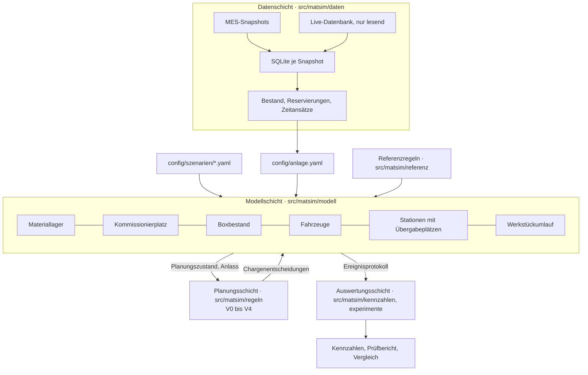
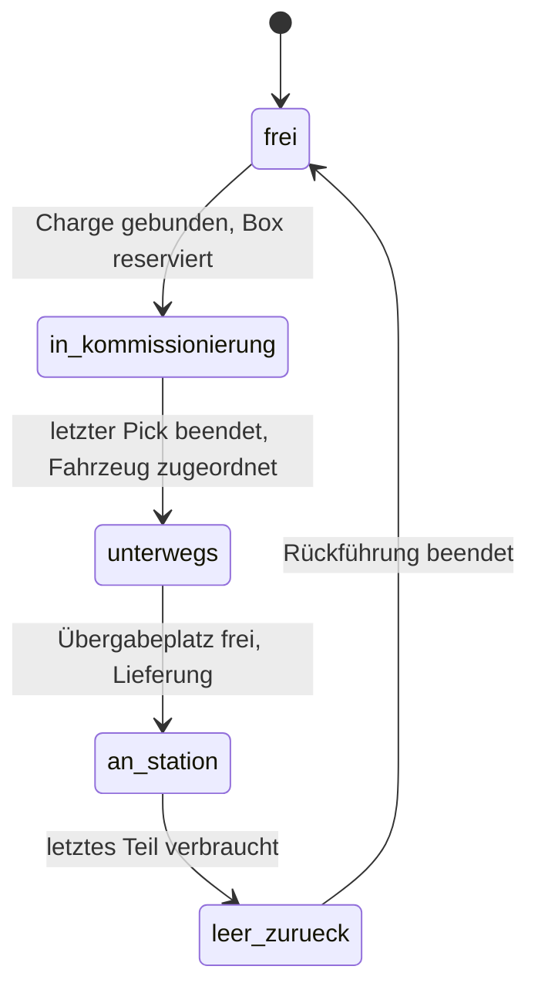
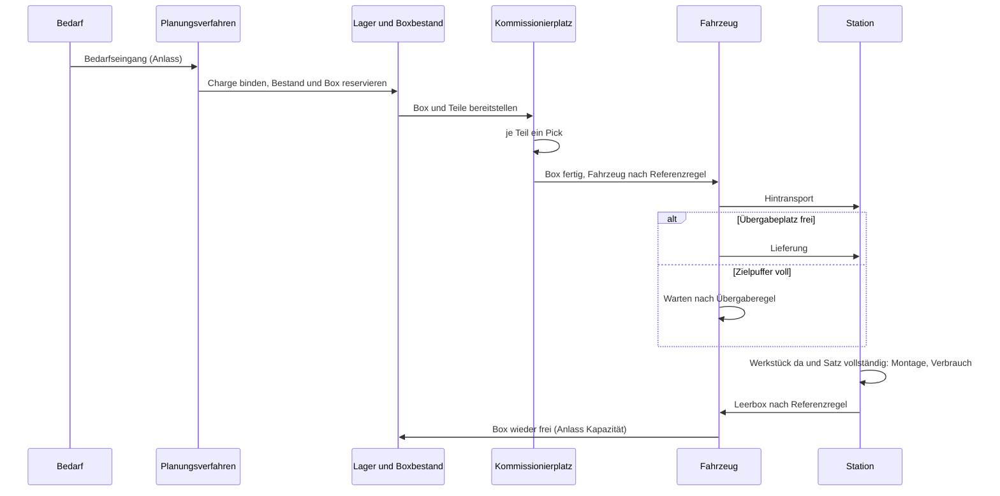

# Logikstruktur

Verantwortlich: AP3 (Pflege), abgestimmt mit AP4 und AP5. Dieses Dokument beschreibt die Architektur der Daten-, Planungs- und Simulationslogik. Das Code-Gerüst in `src/matsim/` bildet sie mit Signaturen ab; Ablauflogik fehlt noch.

## 1. Schichten



| Schicht | Aufgabe | Regel |
|---|---|---|
| Datenschicht | MES-Snapshots und Live-Datenbank in bereinigte Tabellen, `config/anlage.yaml` und Zeitansätze überführen | einzige Schicht, die MES-Tabellennamen kennt |
| Modellschicht | Materiallager, begrenzter Kommissionierplatz, endlicher Boxbestand, Fahrzeuge, Montagestationen mit begrenzten Übergabeplätzen, Werkstückumlauf | verarbeitet Entscheidungen, übernimmt keine geplanten Fertigstellungen |
| Planungsschicht | entscheidet nur über Satzanzahl und Kombination je Box sowie Bereitstellungs- und Versandzeitpunkt | austauschbar über `entscheide(zustand, anlass)`; verändert keinen Zustand |
| Referenzregeln | Montagepriorität, Auftragsfreigabe, Fahrzeugzuordnung, Leerboxrückführung, Warte- und Übergaberegel, Weiterfahrt bei Materialmangel | in allen Vergleichsläufen identisch |
| Auswertungsschicht | Kennzahlen, Wartezeit-Zerlegung, unabhängige Prüfung, Vergleich | rechnet nur auf dem Ereignisprotokoll |

Planung, Simulation und Ergebnisprüfung sind getrennt aufrufbar: Verfahren sind reine Funktionen des Zustands, die Simulation schreibt ein Protokoll, die Prüfung liest nur das Protokoll.

## 2. Objekte und Invarianten

Definiert in `src/matsim/modell/typen.py`.

| Objekt | Inhalt | Regel |
|---|---|---|
| `Anforderung` | Station, Auftrag, Position, Eingang, Bedarfszeitpunkt | erzeugt genau einen `Materialsatz` |
| `Materialsatz` | Komponenten mit Stückzahlen | nur vollständig lieferbar; bleibt seiner Anforderung zugeordnet |
| `Charge` | vollständige Sätze einer Station in genau einer Box, frühester Versandzeitpunkt | nach Bindung nicht mehr umplanbar |
| `Box` | 8 Positionen, Inhalt je Position | Zustände siehe unten |
| `Reservierung` | bindet Bestand, Box, Kommissionierplatz, Fahrzeug oder Übergabeplatz an eine Anforderung | erhöht den Bestand nie |



Invarianten. Jede ist eine unabhängige Prüfregel in `src/matsim/kennzahlen/pruefung.py` und ein Test in `tests/`.

| Nr. | Invariante | Prüfregel | Stand |
|---|---|---|---|
| I-1 | Je Teil gilt jederzeit: frei + reserviert + in Boxen unterwegs oder an Station + verbaut = Anfangsbestand | `pruefe_mengenbilanz` | Gerüst, Test als `xfail` |
| I-2 | Kein Satz gilt als geliefert, wenn nicht alle Komponenten in derselben Box liegen und ihm zugeordnet sind | `satz_vollstaendig_in_box` | umgesetzt und getestet |
| I-3 | Eine Charge überschreitet die Boxkapazität nicht, enthält nur Sätze einer Station und nur zulässige Teile | `pruefe_charge` | umgesetzt und getestet |
| I-4 | Fahrzeug, Box und Platz sind nie doppelt belegt | `pruefe_doppelbindungen` | Gerüst, Test als `xfail` |
| I-5 | Kapazitäten von Kommissionierplatz, Boxbestand, Fahrzeugen und Übergabeplätzen werden nie überschritten | `pruefe_kapazitaeten` | Gerüst, Test als `xfail` |
| I-6 | Je Satz gilt die Reihenfolge Reservierung, Pick, Transport, Lieferung, Montage | `pruefe_vorgaenger` | Gerüst, Test als `xfail` |
| I-7 | Jede Anforderung ist am Laufende geliefert oder als offener Restbedarf ausgewiesen | `pruefe_abschluss` | Gerüst, Test als `xfail` |

Verstöße werden gemeldet und nie stillschweigend repariert.

## 3. Prozesskette



| Schritt | Gebundene Ressourcen | Ereignisse im Protokoll |
|---|---|---|
| Bedarfseingang und Satzbildung | keine | `bedarf_eingang`, `satz_gebildet` |
| Chargenbildung | keine, bis zur Bindung | `planung_aufruf`, `charge_gebunden` |
| Reservierung | Bestand, Box, Kommissionierplatz | `reserviert` |
| Kommissionierung | Kommissionierplatz, Box | `kommissionierung_beginn`, `teil_gepickt`, `kommissionierung_ende` |
| Hintransport | Fahrzeug, Box | `transport_beginn`, `transport_ende` |
| Lieferung | Übergabeplatz, Box | `lieferung` |
| Montage | Station, Übergabeplatz, Box | `werkstueck_ankunft`, `montage_beginn`, `komponente_verbraucht`, `montage_ende` |
| Materialmangel | keine | `weiterfahrt_materialmangel` |
| Leerboxrückführung | Fahrzeug, Box | `leerbox_rueck_beginn`, `leerbox_rueck_ende` |

### Planungsanlässe

Neu geplant wird ausschließlich bei:

1. **Bedarfseingang**,
2. **Ablauf einer Wartefrist**, die das Verfahren über `naechste_wartefrist` angemeldet hat,
3. **Freigabe relevanter Kapazität**: Box, Kommissionierplatz, Fahrzeug oder Übergabeplatz.

Gebundene Chargen und beauftragte Transporte werden nicht umgeplant. Sie erscheinen im Planungszustand nicht mehr als offene Anforderungen.

### Lieferung beeinflusst Montage

Ein Werkstück, das an einer Station ankommt, wird nur montiert, wenn eine Box am Übergabeplatz dieser Station den vollständigen, ihm zugeordneten Satz enthält (MES-Beleg: B-07 in [datenmodell-mes.md](datenmodell-mes.md)). Fehlt der Satz, fährt das Werkstück weiter; das Ereignis `weiterfahrt_materialmangel` ist eine verpasste Bearbeitungsmöglichkeit. Beleg für die Weiterfahrt ist die Aufgabenstellung („Fehlt Material, fährt das Werkstück weiter“, Text zu Team C) zusammen mit der geschlossenen Bandschleife 10→11→12→13→2→…→7→10 in `tbltopology`. Wann das Werkstück wiederkehrt, legt das Referenzpaket fest; bis dahin ist die Regel offen (L-01, L-02 in [annahmen-und-datenluecken.md](annahmen-und-datenluecken.md)). Fehlendes Material erzeugt kein vor der Station wartendes Werkstück.

### Gleichzeitige Ereignisse

Zeiten sind Sekunden. Bei gleicher Zeit gilt die Reihenfolge: Ressourcenfreigaben, dann Lieferungen, dann Werkstückankünfte, dann Bedarfseingänge, dann Ablauf von Wartefristen, zuletzt Planungsaufrufe. Innerhalb gleicher Art entscheidet die kleinere Identität (laufende Nummer, z. B. W001 vor W002). Die laufende Nummer im Protokoll hält die tatsächliche Reihenfolge fest.

Begründung: Ein Werkstück, das in derselben Sekunde wie seine Box ankommt, soll montiert werden und nicht eine Runde umsonst fahren. Der Planungsaufruf kommt zuletzt, damit er alles sieht, was in dieser Sekunde frei geworden oder angekommen ist (für V0 etwa den schon verringerten Wert `chargen_in_versorgung`, Abschnitt 4). Bedarfseingang und Fristablauf sind gegenüber der ersten Fassung als eigene Ränge vor der Planung ergänzt (AP3, 25.11.2026).

Umsetzung: `Termin` in `src/matsim/modell/simulation.py` reiht ein Ereignis mit der Priorität seines Rangs ein (Freigabe 2, Lieferung 3, Ankunft 4, Bedarf 5, Frist 6, Planung 9) plus `nr × 10⁻⁶` für die Identität. SimPy arbeitet gleichzeitige Ereignisse nach Priorität ab, kleinere zuerst. Seine eigenen Ereignisse (Prozessstart, Zuteilung einer frei gewordenen Ressource) haben Priorität 0 oder 1 und laufen damit vor allen eigenen Rängen: Eine frei gewordene Ressource ist schon neu zugeteilt, bevor eine Lieferung derselben Sekunde verarbeitet wird. Geprüft in `tests/test_simulation_grundgeruest.py`.

## 4. Planungsschnittstelle

Definiert in `src/matsim/regeln/basis.py`.

```python
class Planungsverfahren(ABC):
    name: str
    def entscheide(self, zustand: Planungszustand, anlass: Anlass) -> list[Chargenentscheidung]: ...
    def naechste_wartefrist(self, zustand: Planungszustand) -> float | None: ...
```

| Typ | Felder |
|---|---|
| `Anlass` | Art (einer der drei Planungsanlässe), Zeit, Detail |
| `Planungszustand` | Zeit, offene Anforderungen, freier Bestand je Teil, freie Boxen, freie Kommissionierplätze, freie Fahrzeuge, freie Übergabeplätze je Station, Boxpositionen, zulässige Teile je Station, Zusatz |
| `Chargenentscheidung` | Station, Anforderungen der Charge, frühester Versandzeitpunkt |

Regeln der Schnittstelle:

- Das Verfahren sieht nur den zum Anlass bekannten Zustand, keine künftigen Ereignisse.
- Eine leere Liste bedeutet „weiter warten“. Dann muss `naechste_wartefrist` einen Zeitpunkt liefern, sofern offene Anforderungen bestehen und kein Kapazitätsanlass absehbar ist. So bleibt kein Restbedarf liegen.
- Die Simulation prüft jede Entscheidung mit `pruefe_charge` und gegen den Bestand. Eine unzulässige Entscheidung ist ein Fehler des Verfahrens und bricht den Lauf ab.
- Erweiterungen des Zustands laufen über das Feld `zusatz` und werden hier dokumentiert, bevor ein Verfahren sie nutzt.

Vereinbarte Schlüssel in `zusatz`:

| Schlüssel | Typ | Bedeutung | Gelesen von | Pflicht für die Simulation |
|---|---|---|---|---|
| `chargen_in_versorgung` | `int`, mindestens 0 | Anzahl gebundener Chargen, deren Box noch nicht am Übergabeplatz abgeliefert ist (vom Ereignis `charge_gebunden` bis `lieferung`) | V0 | ja, in jedem Planungsaufruf; fehlt der Schlüssel, bricht V0 mit `ValueError` ab |

Zu `chargen_in_versorgung`: Die Lieferung verringert den Wert. Der Planungsaufruf, der auf die Lieferung folgt, muss den bereits verringerten Wert sehen. Ausgelöst wird er durch die Freigabe des Fahrzeugs nach der Lieferung (Anlass „Kapazität frei“). Das folgt aus der Regel für gleichzeitige Ereignisse (Planungsaufrufe zuletzt). Ohne diesen Aufruf bliebe Restbedarf unter V0 liegen, weil V0 keine Wartefrist anmeldet. Die Konstante steht als `CHARGEN_IN_VERSORGUNG` in `matsim.regeln.verfahren`.

## 5. Verifikation und Validierung

Die Lehrunterlagen grenzen Simulation als eigenes Modul ab ([Kapitel 00](../00-uebersicht-und-modulzuschnitt.md), Abschnitt „Abgrenzung zu anderen Modulen“). Deshalb wird das Vorgehen hier festgelegt; Quellen dazu stehen in [literatur-ergaenzung.md](literatur-ergaenzung.md).

| Stufe | Frage | Mittel |
|---|---|---|
| Verifikation | Rechnet das Modell, was es soll? | Invarianten I-1 bis I-7 als unabhängige Prüfregeln; Nachweis an absichtlich fehlerhaften Protokollen; Handrechnung eines Falls mit zwei Sätzen |
| Validierung der Daten | Stimmen die Parameter? | Herkunft je Wert in `config/anlage.yaml`; Befundregister |
| Validierung des Ablaufs | Bildet V0 den beobachteten Ablauf nach? | Vergleich mit dem 09.11.2026: Ablieferung der RASS1-Box 15:17:47, RASS2-Box 15:34:58, RASS3-Box 15:45:09; erste Montagen 15:17:56, 15:35:31, 15:46:07 |
| Güte der Verfahren | Wie nah liegt das Verfahren am Bestmöglichen? | vollständige Enumeration zulässiger Chargenbildungen für einen kleinen Fall |

Grenze: Der Referenzfall umfasst drei Produkte. Er prüft die Abfolge, nicht die Übertragbarkeit auf Lastfälle. Eine Verbesserung im Modell belegt keine Verbesserung der realen Anlage.
