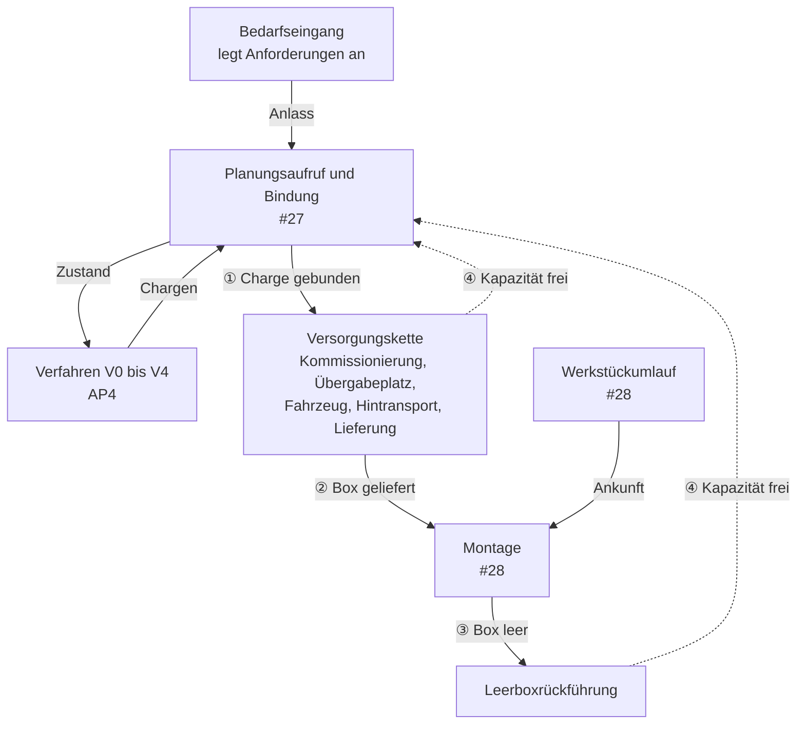

# Simulationskern: Bauplan

Verantwortlich: AP3 (Laurens Rüther; Review: Mehmet Örücü). Stand: 25.11.2026, Schritte 1 und 2 von 9 umgesetzt.

Dieser Bauplan beschreibt, wie der Simulationskern in `src/matsim/modell/simulation.py` aufgebaut ist und in welchen Schritten er entsteht. Er ergänzt die [Logikstruktur](logikstruktur.md), die [Kennzahlen](kennzahlen.md) und die [Planungsverfahren](planungsverfahren.md). Zahlen mit dem Vermerk „Prototyp“ stammen aus einem Wegwerf-Prototyp, mit dem der Plan vor der Umsetzung geprüft wurde; er liegt nicht im Repo. Maßgeblich sind die Zahlen der Tests.

## Stand der Umsetzung

| Schritt | Inhalt | Issue | Stand |
| --- | --- | --- | --- |
| 1 | Grundgerüst | #38 | erledigt (`fb2401b`) |
| 2 | Kommissionierung | #38 | erledigt (`9a6d636`) |
| 3 | Hintransport und Lieferung | #38 | erledigt (`e78f292`) |
| 4 | Leerboxrückführung | #38 | erledigt (`bc69863`) |
| 5 | Warteursachen der Versorgungskette | #38 | erledigt |
| 6 | Planungsaufruf und Bindung | #27 | offen |
| 7 | Werkstückumlauf und Montage | #28 | offen |
| 8 | Durchstich (M2) | folgt | offen |
| 9 | V0 gegen den 09.11.2026 (M3) | folgt | offen |

Jeder Schritt ist ein eigener Commit auf dem Branch `ap3/durchstich`; die Commit-Nachricht nennt Schritt und Issue.

## 1 Ziel und Rahmen

Der Simulationskern ist die Klasse `Simulation` in `src/matsim/modell/simulation.py`. Sie spielt einen Lauf aus Anlage, Szenario, Verfahren und Seed durch und liefert ein Ereignisprotokoll. Alle Kennzahlen und Prüfungen rechnet AP5 nur aus diesem Protokoll.

**Was der Kern leisten muss** (Teilziel T3 in `projekt/zielsetzung.md`):

- die ganze Prozesskette abbilden: Bedarfseingang, Satz- und Chargenbildung, Reservierung, Kommissionierung, Hintransport, Lieferung, Montage mit Komponentenverbrauch, Leerboxrückführung
- Kommissionierplatz, Boxen, Fahrzeuge und Übergabeplätze begrenzen und während der Nutzung gebunden halten
- zeigen, dass eine Lieferung bestimmt, ob und wann montiert wird; fehlt ein Satz, fährt das Werkstück weiter
- das Verfahren nur bei Bedarfseingang, Ablauf einer Wartefrist und Freigabe von Kapazität aufrufen; gebundene Chargen nie umplanen

**Woran er gemessen wird:**

| Meilenstein | Anker | Was laufen muss |
| --- | --- | --- |
| M2 Durchstich | vor Woche 4 | V1 im Basisfall, Ereignisprotokoll, Invarianten-Tests scharf |
| M3 Referenzplaner | Ende Woche 4 | V0 bis V3; V0 gegen den Ablauf vom 09.11.2026 validiert |

**Wer was baut:**

| Teil | Zuständig | Issue | Stand |
| --- | --- | --- | --- |
| Grundgerüst: Zustand, Ressourcen, Zeiten | Laurens | #38 | erledigt |
| Versorgungskette: Kommissionierung bis Leerboxrückführung | Laurens | #38 | erledigt |
| Planungsaufruf, Chargenbindung, Wartefristen, Ereignisreihenfolge | Laurens (Übernahme mit Mehmet abzustimmen) | #27 | offen |
| Werkstückumlauf und Montage | Laurens (Übernahme mit Mehmet abzustimmen) | #28 | offen |
| Review der AP3-PRs | Mehmet | – | – |
| Verfahren V0 bis V4 | Luis (AP4) | #7 bis #10, #12 | V0 bis V3 fertig, V4 offen |
| Bedarfsverläufe, Prüfregeln, Kennzahlen | AP5 (Team) | – | Gerüst |
| Referenzregeln (Fahrzeugzuordnung, Übergabe, Wiederkehr …) | Dozent, Referenzpaket | #18 | fehlt |

**Schon fertig und direkt nutzbar:** `config/anlage.yaml` mit strengem Lader (`lade_anlage`, `wert`), empirische Zeitverteilungen (`matsim.daten.zeiten.verteilung`), die Fachobjekte in `modell/typen.py`, die Planungsschnittstelle in `regeln/basis.py`, V0 bis V3, das Ereignisprotokoll mit festen Ereignistypen und Warteursachen sowie die Prüfregeln für Satzvollständigkeit und Chargenzulässigkeit.

## 2 Aufbau im Überblick

Der Kern ist eine Klasse mit sechs Prozessen, die über gemeinsamen Zustand und vier Anschlusspunkte zusammenarbeiten. Das Verfahren sitzt außerhalb und sieht nur Momentaufnahmen.



Alle Prozesse schreiben ins Ereignisprotokoll; AP5 rechnet daraus Kennzahlen und Prüfungen.

Die Planung bindet Chargen und startet die Versorgung (①). Die Versorgung stellt die Box an die Station (②), die Montage gibt die leere Box an die Rückführung (③). Jede frei werdende Ressource meldet sich bei der Planung zurück (④).

**Ein- und Ausgaben:** Eingaben sind `anlage` (S1, aus `lade_anlage()`), `szenario` (S4), `verfahren` (S2, aus `erzeuge()`), `seed` und optional ein fertiger `verlauf`. Ausgabe ist das `Ereignisprotokoll` (S3). Die Simulation übernimmt keine geplanten Fertigstellungen; sie spielt nur Entscheidungen mit begrenzten Ressourcen durch.

**Gerippe der Klasse** (Namen wie im heutigen Gerüst, wo es passt):

```python
class Simulation:
    def __init__(self, anlage, szenario, verfahren, seed, verlauf=None): ...  # Schritt 1

    # Hilfen (Schritt 1)
    def dauer(self, pfad) -> float: ...
    def protokolliere(self, ereignis, **felder) -> None: ...

    # Planung (#27, Schritt 6)
    def melde_anlass(self, art, detail="") -> None: ...
    def planungszustand(self) -> Planungszustand: ...
    def plane(self): ...                                    # Prozess, läuft je Zeitpunkt zuletzt

    # Prozesse
    def bedarfseingang(self): ...                           # Schritt 8
    def versorgung(self, charge, box): ...                  # Schritte 2 bis 5, ruft die beiden folgenden auf
    def kommissionierung(self, charge, box): ...            # Schritt 2
    def hintransport(self, charge, box): ...                # Schritt 3, endet mit der Lieferung
    def leerboxrueckfuehrung(self, box, platz): ...         # Schritt 4
    def werkstueckumlauf(self, werkstueck): ...             # #28, Schritt 7
    def montage(self, station, werkstueck, box, platz): ... # #28, Schritt 7

    def laufe(self) -> Ereignisprotokoll: ...               # Schritt 8
```

Alle Prozesse sind Generatoren mit `yield`. Sie arbeiten nur über `self` zusammen, nie über Rückgabewerte. Die Planungsschicht (`regeln/`) und die Auswertung (`kennzahlen/`) kennen den Simulationscode nicht.

## 3 Zustand und Ressourcen

Der ganze Zustand eines Laufs liegt im Objekt `Simulation`. Jede begrenzte Ressource bekommt Namen für ihre Einheiten, damit das Protokoll jede Belegung einer bestimmten Einheit zuordnen kann.

| Ressource | Anzahl im Basisfall | Wert in `anlage.yaml` | SimPy-Objekt | Name im Protokoll |
| --- | --- | --- | --- | --- |
| Kommissionierplatz | 1 | `kommissionierplatz.gleichzeitige_chargen` | `simpy.Resource` | `kommissionierplatz` |
| Fahrzeuge | 2 | `fahrzeuge.anzahl` | `simpy.Store` mit Namen | `fahrzeug_1`, `fahrzeug_2` |
| Transportboxen | 7 | `box.transportboxen_frei` | `simpy.Store` mit `Box`-Objekten | `box_id` 1 bis 7 |
| Übergabeplätze | 2 je Station | `stationen.<S>.uebergabeplaetze` | ein `simpy.Store` je Station | `RASS1.platz_1` usw. |
| Montagestationen | 1 je Station | – | `simpy.PriorityResource` | `RASS1`, `RASS2`, `RASS3` |
| Materiallager | Bestand je Teil | `materiallager.anfangsbestand` | Zähler `dict[int, int]` | `lager` |

**Warum `Store` statt `Resource`:** Eine `Resource` zählt nur belegte Einheiten, sie weiß nicht, *welches* Fahrzeug gerade fährt. Die Prüfung „kein Fahrzeug doppelt belegt“ (I-4) und die Fahrzeugbelegungszeit (K2) brauchen aber den Namen. Ein `Store` ist ein Regal mit benannten Dingen: `yield store.get()` nimmt das vorderste heraus und wartet, wenn das Regal leer ist; `store.put(x)` legt es hinten wieder hinein. Damit gilt automatisch: Das am längsten freie Fahrzeug fährt zuerst.

**Fachlicher Zustand** (Attribute der Klasse):

| Attribut | Typ | Inhalt |
| --- | --- | --- |
| `freier_bestand` | `dict[int, int]` | freie, nicht reservierte Teile je Teilenummer |
| `anforderungen` | `dict[str, Anforderung]` | alle Anforderungen des Laufs |
| `offene` | `dict[str, Anforderung]` | noch keiner Charge zugeordnet; nur diese sieht das Verfahren |
| `chargen` | `dict[str, Charge]` | gebundene Chargen, unveränderlich |
| `box_an_platz` | `dict[str, Box]` | welche Box auf welchem Übergabeplatz steht |
| `chargen_in_versorgung` | `int` | gebunden, aber noch nicht abgeliefert (für V0) |
| `warteursache` | `dict[str, Warteursache]` | laufende Wartezeit je Satz (Abschnitt 10) |
| `werkstuecke` | `dict[str, …]` | Werkstücke mit Fortschritt (Abschnitt 8) |

**Box-Inhalt:** `Box.plaetze` ist eine Liste von `Boxplatz(position, pno, anforderung_id)`. Jeder Pick fügt einen Platz hinzu, jeder Verbrauch entfernt einen. So bleibt jedes Teil seiner Anforderung zugeordnet, und `satz_vollstaendig_in_box` kann direkt auf der Box prüfen.

**Zustände einer Box** (`BoxZustand` in `typen.py`): `frei` → `in_kommissionierung` (bei der Bindung) → `unterwegs` (Transportbeginn) → `an_station` (Lieferung) → `leer_zurueck` (Abholung der leeren Box) → `frei` (zurück im Kistenlager).

**Szenario-Abweichungen:** Stressfälle ändern Anlagenwerte, zum Beispiel `knappe_boxen` setzt `box.transportboxen_frei` auf 3. `__init__` wendet `szenario["anlage_abweichungen"]` auf eine Kopie der Anlage an, bevor die Ressourcen entstehen, und prüft das Ergebnis erneut. Dafür wird `lade_anlage` in `modell/anlage.py` in Laden und Prüfen (`pruefe_anlage(daten)`) geteilt; geänderte Werte bekommen `herkunft: annahme` und den Szenarionamen als Beleg.

## 4 Zeiten, Zufall und Eingangsverläufe

Alle Dauern kommen aus einer einzigen Methode `dauer(pfad)`. Im Hauptvergleich liefert sie den Festwert aus `anlage.yaml`, im Szenario `unsicherheit` einen gezogenen Messwert aus einem eigenen Zufallsstrom je Parameter.

```python
def dauer(self, pfad: str) -> float:
    if pfad in self._verteilungen:                 # nur bei zeiten.modus = verteilung
        return float(self._verteilungen[pfad].ziehe(self._strom(pfad)))
    return float(wert(self.anlage, pfad))          # Festwert, offene Werte lösen einen Fehler aus

def _strom(self, pfad: str) -> random.Random:
    if pfad not in self._stroeme:
        self._stroeme[pfad] = random.Random(f"{self.seed}/{pfad}")
    return self._stroeme[pfad]
```

**Warum ein Strom je Parameter:** Die Aufgabenstellung verlangt für alle Verfahren dieselben Dauerverläufe. Würden alle Zeiten aus einem Strom gezogen, verschiebt schon eine zusätzliche Fahrt bei V1 jede spätere Zahl. Mit getrennten Strömen bekommt der n-te Fahrauftrag in V0 bis V4 denselben Wert. Ein Text als Startwert ist in Python stabil, unabhängig von `PYTHONHASHSEED`.

**Verwendete Zeiten:**

| Vorgang | Parameter | Festwert |
| --- | --- | --- |
| Vorlauf je Charge | `kommissionierplatz.vorlauf_s` | 264 s |
| Pick je Teil | `kommissionierplatz.pickzeit_je_teil_s` | 23 s |
| Quellboxwechsel | `kommissionierplatz.quellboxwechsel_s` | 62 s |
| Quellboxen je Auftrag | `kommissionierplatz.quellboxen_je_auftrag` | 2 |
| Hintransport (Fahrzeuge als Ressource) | `fahrzeuge.fahrauftrag_s` | 96 s |
| Leerboxrückfahrt | `fahrzeuge.leerboxruecktransport_s` | 96 s (A-09) |
| Stationsbelegung je Werkstück | `stationen.<S>.belegung_je_werkstueck_s` | 136 / 121 / 63 s |
| Montage je Teil | `stationen.<S>.montagezeit_s.<PNo>` | RASS1 39 + 28 s, RASS2 40 + 25 s, RASS3 24 s |
| Auslagern | `werkstueckumlauf.auslagern_s` | 16 s |
| Bandsegment | `werkstueckumlauf.bandsegment_s` | 14 s |
| Umlauf bis zur Wiederkehr | `werkstueckumlauf.umlaufzeit_s` | 140 s (A-10) |

`fahrzeuge.hintransport_s` (130 s) nutzt der Kern nie, weil das Warten auf ein Fahrzeug im Modell entsteht (A-07).

**Kommissionierdauer einer Charge** (Variante b aus dem Lernnotebook):

```latex
T_{Komm} = t_{Vorlauf} + n_{Teile} \cdot t_{Pick} + (\min(n_{Quellboxen},\, n_{Teile}) - 1) \cdot t_{Wechsel}
```

Das `min` weicht bewusst von der Formel in `anlage.yaml` ab: Eine Charge mit nur einem Teil (ein RASS3-Satz) braucht keinen Quellboxwechsel. Die Abweichung wird bei A-11 nachgetragen.

**Vorab erzeugte Eingangsverläufe:** Der Bedarf kommt nicht aus dem Kern, sondern aus `erzeuge_verlaeufe(szenario, seed)` im Runner (AP5). `Simulation` nimmt einen fertigen Verlauf als optionalen Parameter `verlauf` und ruft den Runner nur auf, wenn keiner übergeben wird. Tests geben kleine Verläufe von Hand vor. Für M2 reicht eine Minimalfassung für `muster: gleichmaessig` (Abschnitt 5).

**Zu korrigieren:** `unsicherheit.yaml` nennt `fahrzeuge.hintransport_s` als verteilte Zeit. Weil der Kern `fahrauftrag_s` nutzt, hätte die Verteilung keine Wirkung. AP5 sollte den Eintrag auf `fahrzeuge.fahrauftrag_s` ändern.

## 5 Bedarfseingang

Ein Produktauftrag erzeugt bei seinem Bedarfseingang drei Anforderungen, je eine für RASS1, RASS2 und RASS3, jede mit genau einem Materialsatz. Danach meldet der Prozess den Anlass „Bedarfseingang“ und startet das Werkstück.

**Ein Eintrag im Verlauf** (Vorschlag für die Schnittstelle zum Runner):

```python
@dataclass(frozen=True)
class Produktauftrag:
    nr: int            # 1, 2, 3, …
    eingang_s: float   # Bedarfseingang: die drei Anforderungen entstehen
    freigabe_s: float  # Auftragsfreigabe: das Werkstück wird ausgelagert
```

Zwei getrennte Zeiten, weil der Versuchsplan noch offen lässt, ob der Bedarf mit der Freigabe, mit dem Auslagern oder mit einem Vorlauf entsteht (versuchsplan.md, Punkt 2). Bis zur Entscheidung gilt `freigabe_s = eingang_s`. Am 09.11.2026 stand das Werkstück schon an RASS1, bevor die Box kam, das passt dazu.

**Ablauf des Prozesses `bedarfseingang()`** je Produktauftrag:

1. Bis `eingang_s` warten (Rang „Bedarfseingang“, Abschnitt 9).
2. Je Station eine `Anforderung` anlegen: Kennung `A001-RASS1`, `auftrag = nr`, `position = 1`, Satz aus `stationen.<S>.materialsatz` (RASS1: 800 + 814, RASS2: 813 + 811, RASS3: 831).
3. Protokoll: `bedarf_eingang` und `satz_gebildet` je Anforderung.
4. In `offene` aufnehmen und `melde_anlass(BEDARFSEINGANG, "P001")`.
5. Werkstück `W001` mit `freigabe_s` starten (Abschnitt 8).

Kennungen mit führenden Nullen, damit die alphabetische Reihenfolge der Zahlenreihenfolge entspricht. Darauf baut die Regel „kleinere Identität zuerst“.

**Bedarfszeitpunkt:** `Anforderung.bedarfszeitpunkt_s` ist die geplante Ankunft des Werkstücks an der Station, wenn es nirgends warten müsste: Freigabe + Auslagern + Zufahrt + Belegung der Vorgängerstationen + Bandsegmente. V3 braucht diesen Wert für die Dringlichkeitsgrenze. Er dient auch dazu, „Verletzungen fester Plantermine“ getrennt auszuweisen, wie es die Aufgabenstellung verlangt. Vorschlag, mit AP4 abzustimmen.

**Bedarfsmuster:** `gleichmaessig` heißt Produkt k kommt bei (k − 1) × `zwischenankunft_s` (Basis: alle 240 s, 12 Produkte). Bei `spitze` ist offen, ob die 6 Spitzenprodukte zu den 12 hinzukommen oder darin enthalten sind. Das klärt AP5.

**Folge von L-11, im Prototyp gemessen:** Der Startbestand reicht für 4 RASS1-Sätze, aber für 5 RASS2- und RASS3-Sätze. V1 bindet deshalb auch die RASS2- und RASS3-Sätze von Produkt 5. Werkstück 5 kommt aber nie über RASS1 hinaus. Am Laufende sind 12 von 36 Montagen erledigt, 22 Anforderungen ungebunden, und zwei Boxen mit zwei Übergabeplätzen bleiben bis zum Schluss belegt. Ohne Entscheidung zu L-11 sagt ein Basislauf wenig über die Verfahren aus.

## 6 Planungsaufruf und Chargenbindung (#27)

Die Simulation sammelt alle Anlässe eines Zeitpunkts und ruft das Verfahren danach genau einmal auf. Erst wenn die ganze Entscheidungsliste geprüft ist, bindet sie Bestand und konkrete Boxen; ein Fehler bricht den Lauf ab, nichts wird stillschweigend repariert.

**Anlässe melden:** Jeder Prozess ruft `melde_anlass(art, detail)`. Die Methode merkt sich den Anlass. Ist für diesen Zeitpunkt noch kein Aufruf vorgesehen, legt sie einen an, und zwar mit dem letzten Rang (Abschnitt 9). Als „Kapazität frei“ zählen: Box zurück im Lager, Kommissionierplatz frei, Fahrzeug frei, Übergabeplatz frei.

**Ablauf von `plane()`:**

1. Führenden Anlass wählen (Rang: Bedarfseingang, Wartefrist, Kapazität frei); alle gesammelten Details kommen ins Feld `detail`. Protokoll: `planung_aufruf`.
2. Momentaufnahme `planungszustand()` bilden (Tabelle unten).
3. `verfahren.entscheide(zustand, anlass)` aufrufen.
4. Die **ganze Liste prüfen**, bevor etwas gebunden wird: Kennungen bekannt, offen und nur einmal vergeben; alle Sätze gehören zur Station der Entscheidung; `pruefe_charge` meldet nichts; der Bestand deckt alle Chargen gemeinsam; es gibt genug freie Boxen; `versand_fruehestens_s` liegt nicht vor jetzt.
5. Bei einem Verstoß: `Planungsfehler` mit allen Verstößen, Lauf endet.
6. Je Entscheidung **binden**: Box aus dem Regal nehmen (die vorderste, also am längsten freie; sie wird direkt aus der Liste des Regals genommen, ohne zu warten, damit die Bindung nicht unterbrochen wird), Charge `C001` mit `gebunden_s = jetzt` anlegen, Bestand vom freien abziehen, Sätze aus `offene` entfernen, `chargen_in_versorgung += 1`. Protokoll: `charge_gebunden` je Satz, `reserviert` für Bestand und Box.
7. Laufende Wartezeit der gebundenen Sätze beenden; **Anschlusspunkt 1:** `env.process(self.versorgung(charge, box))`.
8. Warteursache der weiter offenen Sätze neu bewerten (Abschnitt 10).
9. **Wartefrist:** `naechste_wartefrist(planungszustand())` mit dem Zustand *nach* der Bindung fragen. `None` heißt keine Frist. Eine Frist, die nicht nach jetzt liegt, ist ein `Planungsfehler`, sonst entstünde eine Endlosschleife zur selben Zeit.

**Die Momentaufnahme für das Verfahren:**

| Feld in `Planungszustand` | Wert aus der Simulation |
| --- | --- |
| `zeit_s` | `env.now` |
| `offene_anforderungen` | `offene`, sortiert nach Eingang, dann Kennung |
| `freier_bestand` | Kopie von `freier_bestand` |
| `freie_boxen` | Boxen im Regal |
| `freie_kommissionierplaetze` | Kapazität minus belegt |
| `freie_fahrzeuge` | Fahrzeuge im Regal |
| `freie_uebergabeplaetze` | je Station die Plätze im Regal |
| `box_positionen` | 8 |
| `zulaessige_teile` | je Station aus `anlage.yaml` |
| `zusatz` | `{"chargen_in_versorgung": n}`, später die Vorschau aus #11 |

Das Verfahren bekommt Kopien. So kann es den Zustand nicht verändern, und gebundene Chargen tauchen nie wieder als offen auf.

**Veraltete Fristen:** Jede neue Frist erhöht einen Zähler `frist_nr`. Das Frist-Ereignis merkt sich seine Nummer und meldet nur dann einen Anlass, wenn sie noch die aktuelle ist. Eine alte Frist läuft so ins Leere, ohne Doppelbindung.

**Warum ein Aufruf je Zeitpunkt:** Alle Anlässe desselben Zeitpunkts sehen denselben Zustand. V0 und V1 werten die Art des Anlasses nicht aus. Ein Aufruf je Anlass würde nur Leeraufrufe ins Protokoll schreiben. Ein Aufruf je Anlass ginge ebenfalls; festgelegt wird es in Schritt 6.

**Was V0 davon braucht:** Die Lieferung senkt `chargen_in_versorgung`, bevor der Planungsaufruf desselben Zeitpunkts läuft. Das stellt die Reihenfolge in Abschnitt 9 sicher (Lieferungen vor Planung).

## 7 Versorgungskette

Jede gebundene Charge läuft durch einen einzigen Prozess `versorgung(charge, box)`: kommissionieren, Übergabeplatz reservieren, Fahrzeug holen, fahren, abliefern. Die Leerboxrückführung ist ein eigener Prozess, den die Montage startet, wenn das letzte Teil entnommen ist.

```python
def versorgung(self, charge, box):
    """Ein Prozess je Charge, gestartet bei der Bindung (Anschlusspunkt 1)."""
    yield from self.kommissionierung(charge, box)   # Schritte 0 bis 5
    yield from self.hintransport(charge, box)       # Schritte 6 bis 9

def kommissionierung(self, charge, box):
    # 0  nur wenn das Verfahren später versenden will: bis versand_fruehestens_s warten
    with self.kommissionierplatz.request() as anfrage:
        yield anfrage                               # 1  Platz anfordern
        ...                                         # 2 bis 4  Vorlauf, Picks, Quellboxwechsel
    # 5  Platz frei, sobald der with-Block verlassen wird

def hintransport(self, charge, box):
    platz = yield self.uebergabeplaetze[charge.station].get()   # 6  Platz an der Station
    fahrzeug = yield self.fahrzeuge.get()                       # 7  Fahrzeug
    yield Termin(self.env, self.dauer("fahrzeuge.fahrauftrag_s"), LIEFERUNG)  # 8
    ...                                                         # 9  Lieferung
```

`yield from` reicht die Wartepunkte eines Teilprozesses an den aufrufenden Prozess durch. So bleiben Kommissionierung und Hintransport getrennt testbar und behalten die Namen aus dem heutigen Gerüst.

**Die Schritte im Einzelnen:**

| Nr | Schritt | Dauer | gebunden | Protokoll | Wartet der Satz? |
| --- | --- | --- | --- | --- | --- |
| 0 | Versandzeit abwarten (nur wenn später als jetzt) | bis `versand_fruehestens_s` | Box, Bestand | – | Bündelung |
| 1 | Kommissionierplatz anfordern | bis frei | – | `reserviert` bei Zuteilung | Kommissionierung |
| 2 | Vorlauf (Boxen kommen an den Platz) | 264 s | Platz, Box | `kommissionierung_beginn` | Kommissionierung |
| 3 | Picks, Satz für Satz in Eingangsfolge | 23 s je Teil | Platz, Box | `teil_gepickt` je Teil, Teil kommt in `box.plaetze` | eigene Picks nein, fremde ja |
| 4 | Quellboxwechsel | (min(2, Teile) − 1) × 62 s | Platz, Box | – | Kommissionierung |
| 5 | Platz freigeben | – | Box | `kommissionierung_ende`, `reservierung_aufgeloest`; Anlass „Kapazität frei“ | – |
| 6 | Übergabeplatz der Station reservieren | bis frei | Box, Platz | `reserviert` | Stationskapazität |
| 7 | Fahrzeug holen | bis frei | Box, Platz, Fahrzeug | `reserviert` | Transport |
| 8 | Hintransport (Aufnahme, Fahrt, Übergabe) | 96 s | Box, Platz, Fahrzeug | `transport_beginn`, `transport_ende` | nein, Fahrzeit |
| 9 | Lieferung | 0 s | Box, Platz | `lieferung`; Fahrzeug `reservierung_aufgeloest`; Anlass „Kapazität frei“ | – |

Die Wechselpausen liegen gesammelt nach den Picks. So liegen die Picks eines Satzes direkt hintereinander, und die Wartezeit-Zerlegung (Abschnitt 10) geht genau auf. In der Realität verteilen sie sich zwischen die Picks; für Lieferzeit und Platzbelegung macht das keinen Unterschied.

**Bei der Lieferung (Schritt 9):** `box.zustand = AN_STATION`, `box_an_platz[platz] = box`, `chargen_in_versorgung -= 1`, Fahrzeug zurück ins Regal, Anlass melden. Das ist **Anschlusspunkt 2**: die Montage findet die Box über `box_an_platz`.

**Leerboxrückführung `leerboxrueckfuehrung(box, platz)`** (Anschlusspunkt 3, gestartet von der Montage):

1. Fahrzeug holen. Kein Satz wartet hier, deshalb keine Warteursache.
2. Abholung: `leerbox_rueck_beginn`, Box `leer_zurueck`, Übergabeplatz zurück ins Regal (`reservierung_aufgeloest`), Anlass „Kapazität frei“.
3. Fahrt ins Kistenlager (Ressource 17): 96 s (A-09).
4. `leerbox_rueck_ende`: Box `frei` und zurück ins Regal, Fahrzeug frei, Anlass „Kapazität frei“.

**Erwartete Zeiten mit Festwerten** (später Tests, im Prototyp nachgerechnet):

| Fall | Kommissionierung | Lieferung |
| --- | --- | --- |
| ein RASS1-Satz (2 Teile) allein | 0 bis 372 s | 468 s |
| ein RASS3-Satz (1 Teil) allein | 0 bis 287 s | 383 s |
| zwei RASS1-Chargen zugleich gebunden, die zweite | 372 bis 744 s, davor 372 s Warten | 840 s |
| ein RASS1-Satz, einziges Fahrzeug bis 500 s belegt | 0 bis 372 s | 596 s, davon 128 s Warten auf Transport |

**Übergangsregel bei vollem Zielpuffer: erst Platz, dann Fahrzeug.** Ein Transport startet erst, wenn ein Übergabeplatz der Zielstation für ihn reserviert ist. Bis dahin wartet die fertige Box an der Kommissionierung. Grund: Wartet ein Fahrzeug mit Box vor einer vollen Station, kann es sich verklemmen. Die leere Box auf dem Platz braucht ein Fahrzeug, aber alle Fahrzeuge warten auf diesen Platz. Im Prototyp ist das passiert: V1, ein Platz je Station, Werkstücke kommen später als das Material. Ergebnis: 3 von 36 Montagen, beide Fahrzeuge dauerhaft blockiert. Mit „erst Platz, dann Fahrzeug“ waren es in allen geprüften Fällen 36 von 36.

Folge für `kennzahlen.md`: K2 enthält dann kein Warten vor vollem Zielpuffer. Die Phase „Box am Fahrzeug, kein Übergabeplatz frei“ wird zu „Box fertig, kein Übergabeplatz frei“; die Ursache bleibt Stationskapazität. Liefert das Referenzpaket (#18) eine andere Regel, wird nur Schritt 6 und 7 getauscht.

## 8 Werkstückumlauf und Montage (#28)

Jedes Produkt ist ein Werkstück, das RASS1, RASS2 und RASS3 der Reihe nach anfährt. Montiert wird nur, wenn bei seiner Ankunft der vollständige Satz seiner Anforderung in einer Box auf einem Übergabeplatz der Station liegt. Sonst fährt es eine Runde weiter und kommt wieder.

**Ablauf des Prozesses `werkstueckumlauf(werkstueck)`:**

1. Bei `freigabe_s` auslagern (16 s), dann Zufahrt bis RASS1.
2. An jeder Station: Ankunft (Rang „Werkstückankunft“), Protokoll `werkstueck_ankunft`.
3. Alle Boxen in `box_an_platz` dieser Station mit `satz_vollstaendig_in_box` prüfen.
4. **Satz da:** Station anfordern. Ist sie belegt, wartet das Werkstück davor; die Reihenfolge folgt der Montagepriorität (PlannedStart, Auftrag, Position). Dann Montage (unten).
5. **Satz fehlt:** `weiterfahrt_materialmangel`, eine Umlaufzeit (140 s) warten, zurück zu Punkt 2. Es entsteht kein wartendes Werkstück vor der Station.
6. Nach der Montage zur nächsten Station; nach RASS3 verlässt das Werkstück das Modell (Modellgrenze).

**Montage:** `montage_beginn`, dann je Teil des Satzes in Satzreihenfolge: Teil entnehmen (`komponente_verbraucht`, Platz in `box.plaetze` leeren) und `montagezeit_s` des Teils abwarten. Die Restzeit bis `belegung_je_werkstueck_s` ist Nebenzeit (Deckel auflegen, QR lesen, Ablegen). Dann `montage_ende` und Station frei. Die Montagezeiten stecken also in der Belegung und werden nicht doppelt gezählt: RASS1 136 s Belegung, davon 39 + 28 s Montage.

**Box leer:** Sobald das letzte Teil entnommen ist, startet die Montage `leerboxrueckfuehrung(box, platz)` (Anschlusspunkt 3). Die Box gilt erst nach der Rückfahrt als frei.

**Parameter für den Umlauf:**

| Größe | Wert | Quelle | Stand |
| --- | --- | --- | --- |
| Auslagern | 16 s | `werkstueckumlauf.auslagern_s` | vorhanden |
| Zufahrt vom Lager bis RASS1 | fehlt; laut Dump mindestens 35 s | neu, AP1 und #20 | offen |
| RASS1 → RASS2, RASS2 → RASS3 | je 2 Segmente × 14 s = 28 s | Schleife 2 → 3 → 4 → 5 → 6 aus `werkstueckumlauf.schleife` | Messen und Kamera als Durchfahrt angenommen |
| Wiederkehr nach Weiterfahrt | 140 s | A-01 und A-10 | Referenzregel offen (#18) |
| Station belegt, Satz da | Werkstück wartet vor der Station | neue Annahme; Dump-Befund 7 spricht eher für eine Warteschlange | Referenzregel offen (#18) |

`werkstueckumlauf.wiederkehrregel` ist in `anlage.yaml` offen, und `wert()` löst bei offenen Werten einen Fehler aus. Bis #18 geklärt ist, nutzt der Kern deshalb A-01 mit `umlaufzeit_s`, ausdrücklich als Annahme. Tests dürfen eigene Zeiten setzen (#28 erlaubt synthetische Regeln für Tests).

**Prüffälle aus #28:** Ankunft bei 10 s, Wiederkehr nach 20 s, Lieferung bei 11 s: Montage frühestens bei 30 s, nicht bei 11 s. Kommen Lieferung und Werkstück in derselben Sekunde, wird sofort montiert (Lieferungen vor Ankünften, Abschnitt 9).

**Was die Validierung zeigen wird:** Am 09.11.2026 begann die erste Montage 9, 33 und 58 s nach Ankunft der Box. Im Modell wartet ein kreisendes Werkstück bis zu 140 s auf die nächste Vorbeifahrt; im Prototyp waren es 72, 88 und 7 s.

## 9 Gleichzeitige Ereignisse

Bei gleicher Zeit gilt: Ressourcenfreigaben, dann Lieferungen, dann Werkstückankünfte, dann Bedarfseingänge und Fristen, zuletzt der Planungsaufruf. Danach schreibt die Simulation nur noch die Warteursachen ins Protokoll (Abgleich, Abschnitt 10). Umgesetzt wird das über die Priorität, mit der ein Ereignis in SimPys Warteschlange kommt. Der Prototyp hat bestätigt, dass das funktioniert.

**So ordnet SimPy:** Jedes Ereignis liegt in einer Warteschlange, sortiert nach Zeit, dann Priorität, dann Einfügereihenfolge. SimPy selbst nutzt nur die Prioritäten 0 und 1. `env.schedule(ereignis, prioritaet, verzoegerung)` nimmt aber jede Zahl. Eine kleine Hilfsklasse macht daraus einen Timeout mit Rang:

```python
FREIGABE, LIEFERUNG, ANKUNFT, BEDARF, FRIST, PLANUNG, ABGLEICH = 2, 3, 4, 5, 6, 9, 10

class Termin(Event):  # gekürzt, ohne die Prüfung der Eingaben
    """Wie env.timeout(), aber mit Rang für gleichzeitige Ereignisse."""

    def __init__(self, env, verzoegerung, rang, nr=0):
        super().__init__(env)
        self._ok = True        # so macht es SimPys eigener Timeout auch
        self._value = None
        env.schedule(self, rang + nr * _NR_ZUSCHLAG, verzoegerung)   # _NR_ZUSCHLAG = 1e-6
```

| Rang | Art | Priorität | Beispiele |
| --- | --- | --- | --- |
| 1 | SimPy intern | 0 und 1 | Prozessstart, Zuteilung einer Ressource, normale Zwischenschritte |
| 2 | Ressourcenfreigabe | 2 | Ende der Kommissionierung, Ende der Montage, Leerbox zurück |
| 3 | Lieferung | 3 | Ende des Hintransports |
| 4 | Werkstückankunft | 4 | Ankunft an einer Station, auch nach einem Umlauf |
| 5 | Bedarfseingang | 5 | Produktauftrag kommt an |
| 6 | Wartefrist | 6 | Frist des Verfahrens läuft ab |
| 7 | Planungsaufruf | 9 | nach allen fachlichen Ereignissen |
| 8 | Abgleich der Warteursachen | 10 | kein fachliches Ereignis, schreibt nur Wartezeiten ins Protokoll (Abschnitt 10) |

**Gleicher Rang:** Die kleinere Identität zuerst. Dafür kommt die laufende Nummer des Objekts als winziger Zuschlag dazu (`nr × 10⁻⁶`), etwa Werkstück 1 vor Werkstück 2.

**Geprüft im Prototyp:** Sechs Ereignisse zur Sekunde 10, absichtlich in falscher Reihenfolge angelegt. Abgearbeitet wurden sie so: Freigabe des Platzes, Zuteilung an den Wartenden, Lieferung, Ankunft W1, Ankunft W2, Planung. Wird eine Ressource frei, bekommt der nächste Wartende sie noch vor der Lieferung derselben Sekunde, weil SimPy die Zuteilung mit Priorität 1 einreiht.

**Was daraus folgt:**

- Kommen Box und Werkstück in derselben Sekunde an, wird montiert.
- Der Planer sieht alles, was in dieser Sekunde frei geworden oder angekommen ist.
- V0 sieht `chargen_in_versorgung` schon verringert, wenn die Lieferung zur selben Zeit wie der Planungsaufruf liegt.

**Zu dokumentieren:** `logikstruktur.md` nennt bisher vier Arten. Bedarfseingang und Frist kommen als eigene Ränge vor der Planung dazu. Laut Logikstruktur bestätigt AP3 die Regel vor dem ersten Vergleichslauf. Die Klasse `Termin` gehört ins Grundgerüst, weil alle Prozesse sie brauchen.

## 10 Ereignisprotokoll und Warteursachen

Jede Zustandsänderung wird eine Zeile. Jede Belegung einer begrenzten Ressource beginnt mit `reserviert` und endet mit `reservierung_aufgeloest`. So kann AP5 Kapazitäten, Doppelbindungen und die Mengenbilanz prüfen, ohne den Simulationscode zu kennen.

**Welche Zeile wann** (alle Typen gibt es schon in `Ereignistyp`):

| Ereignis | Wann | Wichtige Felder |
| --- | --- | --- |
| `bedarf_eingang`, `satz_gebildet` | Anforderung entsteht | `anforderung_id`, `ressource` = Station |
| `planung_aufruf` | je Aufruf | `bemerkung` = Anlass und Details, `menge` = gebundene Chargen |
| `charge_gebunden` | je Satz der Charge | `anforderung_id`, `charge_id`, `box_id` |
| `reserviert`, `reservierung_aufgeloest` | Belegung beginnt, endet | `ressource` = Name der Einheit; beim Bestand `ressource = lager`, `pno`, `menge` |
| `warten_beginn`, `warten_ende` | Wartezeit eines Satzes | `anforderung_id`, `ursache` |
| `kommissionierung_beginn`, `_ende` | Platz arbeitet | `charge_id`, `box_id` |
| `teil_gepickt` | je Teil | `anforderung_id`, `box_id`, `pno`, `menge = 1` |
| `transport_beginn`, `transport_ende` | Fahrt | `charge_id`, `box_id`, `ressource` = Fahrzeug, bei Beginn `menge` = belegte Positionen (für K3) |
| `lieferung` | Box steht auf dem Platz | `charge_id`, `box_id`, `ressource` = Übergabeplatz |
| `werkstueck_ankunft`, `weiterfahrt_materialmangel` | Werkstück an Station | `werkstueck_id`, `anforderung_id`, `ressource` = Station |
| `montage_beginn`, `montage_ende` | Station arbeitet | `werkstueck_id`, `anforderung_id`, `box_id` |
| `komponente_verbraucht` | je Teil | `anforderung_id`, `box_id`, `pno`, `menge` |
| `leerbox_rueck_beginn`, `_ende` | Rückfahrt | `box_id`, `ressource` = Fahrzeug |
| `lauf_ende` | Laufende | Endgrund; je offener Anforderung eine Zeile mit letztem Zustand (Abschnitt 11) |

`zustand_alt` und `zustand_neu` beschreiben die Box, wenn die Zeile eine `box_id` trägt, sonst den Satz.

**Mengenbilanz (I-1) aus drei Zeilentypen:** `reserviert` mit `ressource = lager` verschiebt Teile von frei nach reserviert. `teil_gepickt` verschiebt eines von reserviert in die Box. `komponente_verbraucht` verschiebt es aus der Box nach verbaut. Frei + reserviert + in Boxen + verbaut ergibt zu jeder Zeit den Anfangsbestand.

**Warteursachen je Satz** (Regel aus `kennzahlen.md`, Abschnitt 2):

| Phase | Ursache | wer protokolliert |
| --- | --- | --- |
| offen, eine Komponente fehlt im freien Bestand | Bestand | Planung (#27) |
| offen, Bestand da, keine Box frei | Box | Planung (#27) |
| offen, Bestand und Box da, Verfahren bindet nicht | Bündelung | Planung (#27) |
| gebunden, Versand erst später | Bündelung | Versorgung |
| wartet auf den Kommissionierplatz, Vorlauf, fremde Picks, Quellboxwechsel | Kommissionierung | Versorgung |
| fertig, kein Übergabeplatz frei | Stationskapazität | Versorgung |
| Platz reserviert, kein Fahrzeug frei | Transport | Versorgung |

**Vor der Bindung** bewertet `plane()` am Ende jedes Aufrufs jeden offenen Satz neu. Ändert sich die Ursache, folgen `warten_ende` (alt) und `warten_beginn` (neu) zur selben Zeit. Das reicht, weil jede Änderung an Bestand oder freien Boxen einen Planungsaufruf auslöst.

**Nach der Bindung** beginnt die Wartezeit „Kommissionierung“ sofort, auch der Vorlauf zählt dazu. Sie endet vor dem ersten eigenen Pick und beginnt nach dem letzten eigenen Pick neu, wenn bis zum Ende der Kommissionierung noch Zeit vergeht. Danach folgen, falls nötig, „Stationskapazität“ (kein Übergabeplatz frei) und „Transport“ (Platz reserviert, kein Fahrzeug frei). Wartezeiten der Länge null kommen nicht ins Protokoll.

**Umsetzung (Schritt 5):** Die Prozesse setzen nur die aktuelle Ursache: `setze_warteursache(anforderung_ids, ursache)`, `None` heißt „wartet nicht“. Ins Protokoll schreibt sie erst ein Abgleich am Ende des Zeitpunkts, mit dem Rang `ABGLEICH` nach der Planung. Er vergleicht je geändertem Satz die aktuelle Ursache mit der laut Protokoll und schreibt bei einem Unterschied `warten_ende` (alt) und `warten_beginn` (neu). So entsteht keine Wartezeit der Länge null, auch wenn ein Platz im selben Moment frei wird, und mehrere Wechsel im selben Moment ergeben höchstens ein Ende und einen Beginn. Die Planung (Schritt 6) nutzt denselben Weg für Bestand, Box und Bündelung.

**Kontrollrechnung (AP5 prüft sie):** Zeit bis zur Bereitstellung = Summe der Wartezeiten + eigene Pickzeit + Fahrzeit. Für einen RASS1-Satz allein: 468 s = (264 + 62) s Kommissionierung + 46 s eigene Picks + 96 s Fahrt.

## 11 Laufende, Restbedarf und Fehlerfälle

Der Lauf endet regulär, wenn alle Anforderungen montiert und alle Boxen zurück sind, spätestens bei `max_laufzeit_s` (Basis: 14 400 s). Offener Restbedarf steht am Ende je Anforderung mit ihrem letzten Zustand im Protokoll.

**`laufe()`:**

1. Prozess `bedarfseingang()` starten.
2. `env.run(until=…)` bis zum Ereignis `fertig` oder bis `max_laufzeit_s`, je nachdem was zuerst kommt. `fertig` wird ausgelöst, sobald alle Anforderungen montiert sind und die letzte Box zurück im Lager ist.
3. Eine Zeile `lauf_ende` mit dem Grund (`endkriterium` oder `max_laufzeit`) und dem Zeitpunkt des letzten Fortschritts (letzte Bindung, Lieferung oder Montage).
4. Je nicht montierter Anforderung eine Zeile `lauf_ende` mit `anforderung_id` und letztem Zustand: `nicht_gebunden`, `in_kommissionierung`, `unterwegs` oder `an_station` (geliefert, aber nicht montiert).
5. Rückgabe: das `Ereignisprotokoll`. `tests/test_invarianten.py` liest daraus `.ereignisse`.

Warum „letzter Fortschritt“: Kreisende Werkstücke erzeugen bis zum Schluss Ereignisse, auch wenn nichts mehr vorangeht. Die Aufgabenstellung verlangt, Stillstände ohne Fortschritt zu berichten. Mit L-11 läuft der Basisfall bis 14 400 s, obwohl im Prototyp (V1) schon nach rund 4 900 s nur noch Werkstücke kreisen.

**Fehler brechen den Lauf ab, nichts wird repariert:**

| Fehler | Auslöser | Ausnahme |
| --- | --- | --- |
| unzulässige Entscheidung des Verfahrens | Prüfung in `plane()` (Abschnitt 6) | `Planungsfehler` |
| Wartefrist nicht nach jetzt | `naechste_wartefrist` | `Planungsfehler` |
| offener Anlagenwert genutzt | `wert()` | `AnlagenFehler` (gibt es schon) |
| Widerspruch im eigenen Zustand, etwa negativer Bestand | Prüfungen im Kern | `SimulationsFehler` |

Die Invarianten-Tests rufen die Simulation mit allen fünf Verfahren auf. Solange V2 bis V4 noch `NotImplementedError` werfen, bleiben deren Tests `xfail`. Achtung, die Marke ist streng (strict): Läuft ein Test durch, meldet pytest ihn als Fehler. Sobald V0 oder V1 und die Prüfregeln von AP5 laufen, muss die Marke für diese Verfahren weg. Das verlangt auch die Abnahme von AP3: „Invarianten-Tests laufen ohne xfail“.

**Laufzeiten im Prototyp** (12 Produkte, genug Bestand angenommen): Die letzte Montage lag bei V0 nach 5 938 s, bei V1 erst nach 12 545 s. Das liegt nah an der Grenze von 14 400 s. Ursache ist der Vorlauf von 264 s je Charge (Abschnitt 12, Punkt 10).

## 12 Annahmen und offene Entscheidungen

Siebzehn Punkte sind offen; sechs davon braucht schon der Durchstich (1 bis 4, 8 und 14). Jede Annahme kommt in `annahmen-und-datenluecken.md`, bevor sie im Code steht. Übergangsregeln stehen zusätzlich in `referenz/regeln.py` mit Verweis auf die Annahme, damit sie nach #18 an einer Stelle getauscht werden können.

| Nr | Punkt | Vorschlag | Wer entscheidet | Nötig für |
| --- | --- | --- | --- | --- |
| 1 | Voller Zielpuffer | erst Übergabeplatz reservieren, dann Fahrzeug holen (Abschnitt 7); eingetragen als A-12 | Team; Referenzpaket #18 | Schritt 3 |
| 2 | Fahrzeugzuordnung | das am längsten freie Fahrzeug, Aufträge in Anfragereihenfolge, Hintransport und Leerbox gleichrangig; eingetragen als A-13 | #18 | Schritt 3 |
| 3 | Box bei der Bindung | die am längsten freie Box | Team | Schritt 1 |
| 4 | Leerboxrückführung | sofort nach der Leerung, ins Kistenlager, 96 s (A-09); eingetragen als A-14 | #18 | Schritt 4 |
| 5 | Wiederkehr nach Weiterfahrt | nach `umlaufzeit_s` = 140 s (A-01, A-10) | #18 | #28 |
| 6 | Station belegt, Satz da | Werkstück wartet davor; Reihenfolge PlannedStart, Auftrag, Position | #18 | #28 |
| 7 | Zufahrt Lager → RASS1 | neuer Parameter in `anlage.yaml` | AP1, Beobachtung #20 | #28 |
| 8 | Bedarfseingang und Werkstückfreigabe | gleichzeitig (`freigabe_s = eingang_s`) | AP5, Versuchsplan Punkt 2 | Durchstich |
| 9 | Bedarfszeitpunkt | geplante Ankunft ohne Warten (Abschnitt 5) | AP4 mit AP2 | V3 |
| 10 | Abbildung der Kommissionierung | Variante b für den Durchstich, danach entscheiden (a, b oder c) | Laurens mit AP2 | nach dem Durchstich |
| 11 | Startbestand für 4 Produkte (L-11) | Anfangsbestand als Szenarioannahme erhöhen oder Mangel als Versuchsfaktor | AP5 | Auswertung M2 |
| 12 | Planungsaufrufe | einer je Zeitpunkt (Abschnitt 6) | Laurens | #27 |
| 13 | Versand später als jetzt | Kommissionierung erst ab Versandzeit, Warten zählt als Bündelung | AP4 mit AP5 | nur V4 |
| 14 | Endkriterium | alle Anforderungen montiert und alle Boxen zurück | AP5 | Durchstich |
| 15 | Bedarfsmuster `spitze` | kommen die 6 Spitzenprodukte zu den 12 hinzu? | AP5 | Stress 1 |
| 16 | `unsicherheit.yaml` | `fahrzeuge.fahrauftrag_s` statt `hintransport_s` verteilen | AP5 | Sensitivität |
| 17 | A-09 doppelt vergeben | V0-Regel bekommt eine neue Nummer | Luis | sofort |

**Zu Punkt 10, gemessen im Prototyp:** Mit Variante b braucht jede Charge mindestens 287 s am Kommissionierplatz, davon 264 s Vorlauf. V1 bildet je Produkt drei Chargen, im Basisfall kommt alle 240 s ein Produkt. Der Platz ist damit etwa vierfach überlastet: Bei 12 Produkten und genug Bestand lag die letzte Montage bei V1 nach 12 545 s, bei V0 nach 5 938 s. Der Vergleich der Verfahren hängt also stark davon ab, wie der Vorlauf abgebildet wird. Das spricht dafür, die Entscheidung a, b oder c bald nach dem Durchstich zu treffen und die Zwischenankunftszeit im Basisfall zu prüfen.

## 13 Anschlusspunkte und offene Abstimmungen

Laurens baut alle AP3-Teile selbst, auch die aus #27 und #28. Die vier Anschlusspunkte bleiben trotzdem: Sie trennen die Teile im Code, sodass jeder Teil für sich testbar ist und Fehler sich einem Teil zuordnen lassen.

| Nr | Was passiert | von → nach | Umsetzung im Code |
| --- | --- | --- | --- |
| 1 | Charge gebunden, Versorgung startet | Planung → Versorgung | `self.env.process(self.versorgung(charge, box))` am Ende der Bindung |
| 2 | Box abgeliefert, Montage kann sie finden | Versorgung → Montage | `self.box_an_platz[platz] = box`, Box im Zustand `an_station` |
| 3 | Box leer, Rückführung startet | Montage → Rückführung | `self.env.process(self.leerboxrueckfuehrung(box, platz))` |
| 4 | Ressource frei, neu planen | alle → Planung | `self.melde_anlass(Planungsanlass.KAPAZITAET_FREI, detail)` |

**Im Grundgerüst, weil alle Teile sie nutzen:** die Ressourcen und der Zustand aus Abschnitt 3, `Termin` mit den Rängen (Abschnitt 9), `dauer()` (Abschnitt 4), eine kleine Hilfe `protokolliere(...)` für Zeilen im Protokoll und der Zähler `chargen_in_versorgung` (+1 bei der Bindung, −1 bei der Lieferung).

**Reihenfolge der Arbeit:**

1. Grundgerüst mit Methodenrümpfen für alle Prozesse (Schritt 1).
2. Versorgungskette (Schritte 2 bis 5). Die Tests binden Chargen und leeren Boxen von Hand, weil Planung und Montage noch fehlen.
3. Planungsaufruf und Bindung (Schritt 6, #27). Die Tests nutzen V1 und kleine, handgebaute Anforderungen.
4. Werkstückumlauf und Montage (Schritt 7, #28). Die Tests legen Boxen von Hand auf Übergabeplätze.
5. Durchstich und V0-Validierung (Schritte 8 und 9).

| Datei | Inhalt |
| --- | --- |
| `src/matsim/modell/simulation.py` | die Klasse `Simulation` mit allen Prozessen |
| `src/matsim/modell/anlage.py` | `pruefe_anlage` und Szenario-Abweichungen, mit Maher abgestimmt |
| `src/matsim/referenz/regeln.py` | Übergangsregeln mit Verweis auf die Annahmen |
| `tests/test_simulation_grundgeruest.py` | Schritt 1 |
| `tests/test_simulation_versorgung.py` | Schritte 2 bis 5 |
| `tests/test_simulation_planung.py` | Schritt 6 |
| `tests/test_simulation_montage.py` | Schritt 7 |
| `tests/test_simulation_lauf.py` | Schritte 8 und 9 |

**Offene Abstimmungen:**

- [ ] Übernahme von #27 und #28 mit Mehmet abstimmen und die Issues umhängen
- [ ] Ein Planungsaufruf je Zeitpunkt oder einer je Anlass (Abschnitt 6)
- [ ] Übergangsregel „erst Platz, dann Fahrzeug“ (Abschnitt 7), bis das Referenzpaket da ist (#18)
- [ ] Werkstück mit vollständigem Satz wartet vor belegter Station (Abschnitt 8)

## 14 Umsetzung in Schritten mit Tests und Commits

Neun Schritte, jeder mit eigenem Test und eigenem Commit; 8 und 9 sind die Meilensteine M2 und M3. Den Fortschritt zeigt die Tabelle „Stand der Umsetzung“ oben.

| Nr | Inhalt | Wer | Neu in SimPy | Test prüft |
| --- | --- | --- | --- | --- |
| 1 | Grundgerüst: Abweichungen, Ressourcen mit Namen, Bestand, `Termin`, `dauer()`, Protokollhilfe, Methodenrümpfe | Laurens | `Store` mit Namen, Priorität beim Einreihen | Basis: 7 Boxen, 2 Fahrzeuge, 2 Plätze je Station, Bestand 800 = 4; `knappe_boxen`: 3 Boxen; Vorlauf = 264 s; gleicher Seed gibt gleiche Zufallsfolge; Rangfolge wie in Abschnitt 9 |
| 2 | Kommissionierung | Laurens | `Resource` mit `with`, Teile in die Box | RASS1-Satz: Ende 372 s, zwei `teil_gepickt`, Box enthält 800 und 814 mit Anforderungskennung; RASS3-Satz: Ende 287 s; zweite Charge beginnt bei 372 s |
| 3 | Hintransport und Lieferung | Laurens | `Store.get` und `put`, `yield from` | Lieferung 468 s; einziges Fahrzeug bis 500 s belegt: 596 s; Station mit einem belegten Platz: Box wartet an der Kommissionierung, Fahrzeug bleibt frei |
| 4 | Leerboxrückführung | Laurens | ein Prozess startet einen anderen | Box bei 600 s geleert: Platz frei bei 600 s, Box frei bei 696 s, Anlass „Kapazität frei“ bei 600 s (Platz) und bei 696 s (Box, Fahrzeug) |
| 5 | Warteursachen der Kette | Laurens | – | RASS1-Satz: 326 s Kommissionierung, 0 s Transport und Stationskapazität; 326 + 46 + 96 = 468 |
| 6 | Planungsaufruf und Bindung | Laurens (#27) | Ereignisse sammeln, Fristen | Fälle aus #27, etwa: fehlerhafte Liste bindet nichts |
| 7 | Werkstückumlauf und Montage | Laurens (#28) | `PriorityResource` | Fälle aus #28, etwa: Ankunft 10 s, Wiederkehr 20 s, Lieferung 11 s, Montage bei 30 s |
| 8 | Durchstich: `bedarfseingang()`, `laufe()`, Laufende, Restbedarf, V1 im Basisfall | Laurens | `env.run(until=…)` | Lauf endet regulär, Protokoll als CSV, Invarianten-Tests ohne `NotImplementedError` aus der Simulation (M2) |
| 9 | V0 gegen den 09.11.2026 | Laurens | – | Reihenfolge RASS1, RASS2, RASS3; Lieferungen im Prototyp nach 9:20, 18:40, 26:51 min gegen echt 12:32, 29:43, 39:54 min, Abweichung begründet (M3) |

**Vor jedem Commit**, im Terminal in VS Code:

```
pytest
ruff check .
ruff format --check <geänderte Dateien>
python -m matsim.smoke
```

`ruff format --check .` über das ganze Repo schlägt schon auf `main` fehl (7 fremde Dateien sind nicht formatiert). Deshalb nur die eigenen Dateien prüfen und keine fremden umformatieren.

Auf Laurens' Rechner heißt der Aufruf `py -3.12 -m …` statt `python -m …`, wenn die `.venv` nicht aktiv ist. Commit-Nachrichten im Stil des Repos, zum Beispiel „AP3: Kommissionierung im Simulationskern“. Alle Schritte laufen auf dem Branch ap3/durchstich, ein Commit je Schritt, nach jedem Commit pushen. Ein PR geht auf, wenn ein Block fertig ist: nach Schritt 5 (Versorgungskette) und nach Schritt 8 (Durchstich).
